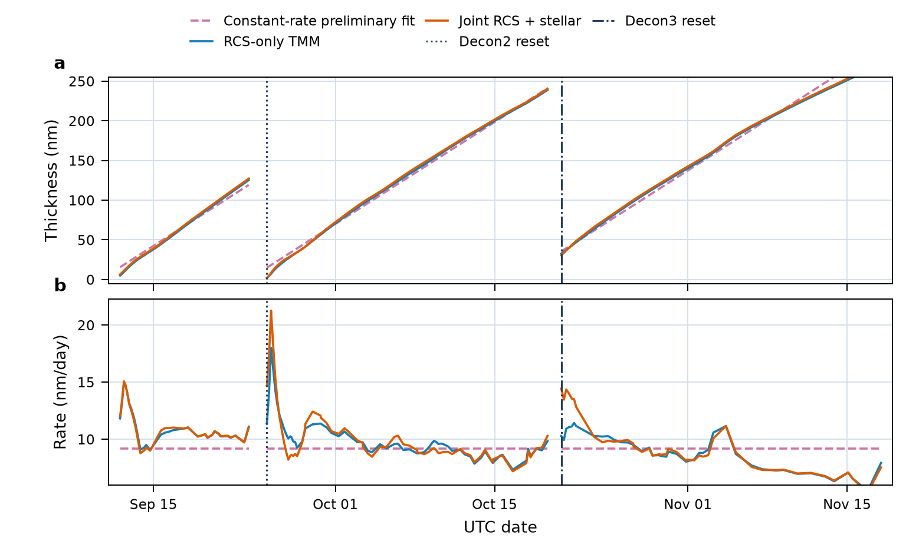
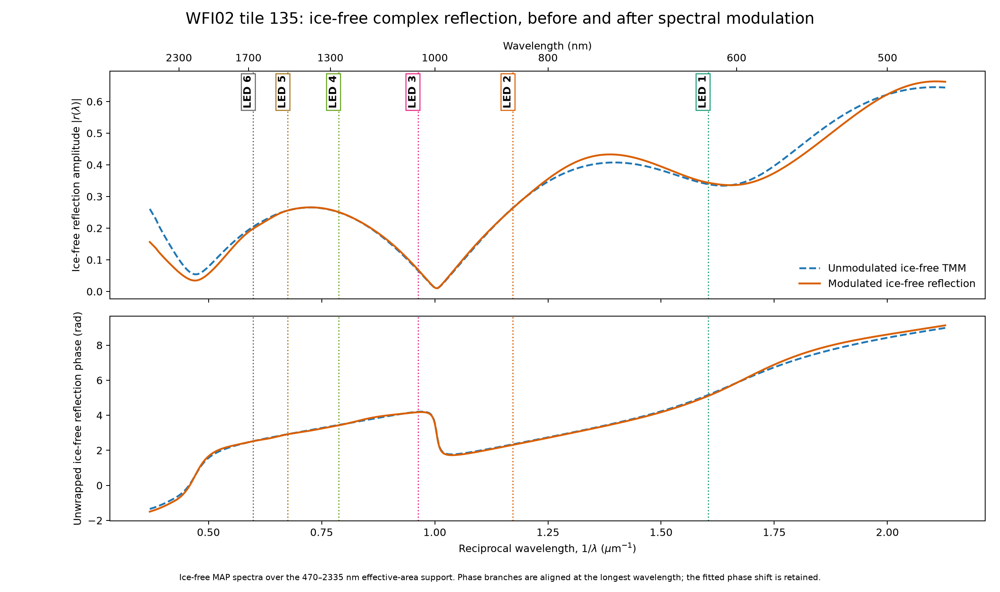

# WFI Ice-Accumulation Methodology from RCS and CAR201 WFI Photometry

## 1. Introduction

Ice accumulating on the Nancy Grace Roman Space Telescope Wide Field Instrument
(WFI) detectors changes their wavelength-dependent response through thin-film
interference. Estimating how that response evolves during commissioning
requires measurements with both temporal cadence and spectral coverage.

The Relative Calibration System (RCS) repeatedly illuminates the detectors in
six narrow LED bands. Changes in the calibrated flat-field response provide a
high-cadence record of the evolving optical stack and its sensitivity to ice.
CAR201 stellar photometry measures sources through eight broad WFI filters,
providing complementary wavelength information between and around the LED
bands. Together, these observations can constrain both the time evolution of
ice and the detector's broader spectral response.

This paper first describes the measurements and their reduction, then develops
the optical and ice-accumulation model used with RCS data. It next explains the
RCS-only ice-history estimates and how broad-band stellar photometry extends
that physical model. Results and limitations follow.

## 2. Observational Data and Reduction

The analysis uses three distinct observational data sets. CAR190 and CAR216
are separate RCS programs; CAR201 supplies broad-band stellar photometry.

| Data set | Program | Measurement | Calibrated products and use |
| --- | --- | --- | --- |
| CAR190 | 1039 | Six-LED RCS observations | Use calibrated Level-2 WFI flats. Before Decon2, use the updated re-reduced CAR190 products available from the external S3 source; at and after Decon2, use MAST Level-2 products. Retain all CAR190 observations. |
| CAR216 | 1063 | Higher-cadence six-LED RCS cycles beginning at Decon2 | Use MAST Level-2 WFI flats. Retain complete six-LED cycles at four-hour cadence. |
| CAR201 | 1043 | Stellar WFI imaging photometry | Use MAST Level-2 images and the associated Amber photometry catalogue; this data set supplies broad-band constraints on detector response. |

### CAR190 RCS observations — Program 1039

All observations are calibrated Level-2 WFI flat exposures. MAST exposure
records provide observation times and programs; calibrated products are
selected using observation time. Before
Decon2 (the second decontamination), at elapsed day `12.907397928240743` from
the first RCS observation, CAR190 uses re-reduced Level-2 products from the
external [Roman CAR190 S3 collection](s3://roman-s3-romcom/activities/CAR190/).
These products contain the updated calibration before it was available through
MAST. At and after Decon2, including CAR216 observations, the calibrated source
is the MAST Level-2 product.

### CAR216 RCS observations — Program 1063

CAR216 begins with the first RCS observation at the Decon2 boundary and uses
MAST Level-2 products. Its physical reset is at elapsed day
`12.907397928240743` from the RCS time origin defined below.

### Shared RCS pixel-pair reduction

Both programs use the six RCS light-emitting diodes (LED1--LED6), with spectral
peaks near 623.5, 852.8, 1038.6, 1269.8, 1481.2, and 1670.2 nm. Their usable
spectra span approximately 480--2700 nm. The following pair selection,
corrections, and tile summaries apply to both programs.

For each detector and LED, measurements are referenced to that LED's first
exposure in time. A pixel pair is kept only if its data-quality (DQ) value is
zero in both images, the reference count is finite and positive, and the
current count is finite and positive after scaling. Any nonzero DQ value
excludes the pair. There is no additional rejection based on the size of a
pixel's measured change, so defects not flagged in DQ can remain.

For this analysis, each detector image is divided into 256-by-256-pixel tiles.
Each tile summarizes up to 65,536 native pixel pairs in its footprint. Retained
pixel-pair log changes are
summarized within each tile, LED, and exposure by the quantities defined
below. Each tile has its own fitted ice history.

For each retained pair, the uncorrected change is

$$
x_i^{\mathrm{raw}}(t) = \ln C_i(t) - \ln C_i(t_{\mathrm{ref}}).
$$

Photodiode scaling removes changes in LED output. A separate side-swap
correction adjusts the image counts and photodiode readings at the readout-side
change. Both corrections are multiplicative count factors, or equivalently
additive offsets in log response. For each detector and LED, separate factors
are estimated for image counts and photodiode readings. Each factor is one
before the side-swap event. Let $f_{\mathrm{img}}(t)$ and
$f_{\mathrm{PD}}(t)$ denote these factors, and let $p(t)$ be the dark-subtracted
photodiode-2 signal. For each LED, $p_{\mathrm{ref}}$ is its first photodiode
measurement not marked as warm-up. The scale is $p_{\mathrm{ref}}/p(t)$. For
a reference/current pair, the combined log offset is

$$
c_{\mathrm{side}}(t) = \ln\!\left[
\frac{
 f_{\mathrm{img}}(t)\,\dfrac{p_{\mathrm{ref}}}{p(t)}
 \dfrac{f_{\mathrm{PD}}(t_{\mathrm{ref}})}{f_{\mathrm{PD}}(t)}
}{
 f_{\mathrm{img}}(t_{\mathrm{ref}})\,
 \dfrac{p_{\mathrm{ref}}}{p(t_{\mathrm{ref}})}
}
\right].
$$

The corrected pair value is $x_i^{\mathrm{side}}=x_i^{\mathrm{raw}}+c_{\mathrm{side}}$. The same first
non-warm-up photodiode reference is used across Programs 1039 (CAR190) and
1063 (CAR216). Image and photodiode side-swap factors are estimated separately
for each detector and LED; each factor is fit with a continuous spline and one
log-step at the side-swap boundary.

The reduction also corrects count changes for detector temperature and for
step changes in the overall signal level (ACM steps).
The temperature predictor is the detector electronics strap temperature,
averaged over five-minute intervals (telemetry channel
`WFI_MCE_ADC_WTSM00`). A fixed quadratic in log-count space is used for each
tile:

$$
c_T(T) = b\,(T-T_{\mathrm{ref}}) + c\,(T-T_{\mathrm{ref}})^2.
$$

Here $T_{\mathrm{ref}}$ is the operating-temperature reference. The temperature
correction is zero at $T_{\mathrm{ref}}$ and is applied equally to all six LEDs for a
tile. ACM steps are constant log-count offsets beginning at identified event
times. Some offsets are shared across all LEDs; others are LED-specific. The
decontamination boundaries start new physical ice-history segments, as
described in Section 3.

Expressing the accumulated correction as a per-LED reference-relative log
offset $c$ transforms the sufficient statistics directly:

$$
S' = S + n c, \qquad Q' = Q + 2cS + nc^2.
$$

For this analysis, observations are selected at four-hour cadence and grouped
into 256-pixel tiles. All CAR190 observations are retained; from the
higher-cadence CAR216 sequence, complete six-LED cycles are selected. Each
selected observation remains a separate time sample.
Elapsed days for the ice histories and CAR201 observations are measured from
`2026-09-12T01:25:50.714 UTC`.

Photodiode/side-swap, temperature-gain, and ACM corrections are applied during
data reduction before the corrected group statistics are formed. Their
coefficients enter the optical fit as fixed inputs.

#### Correction terms and timing

The raw reference-relative statistics are computed from unscaled detector
counts after valid pixel-pair selection. The canonical reduction then applies
three groups of count-space corrections. UTC event times below are shared
across the WFI detectors; the correction factors are estimated at detector,
tile, or LED level as specified.

| Correction group | What is corrected | Timing |
| --- | --- | --- |
| Photodiode scaling and side-swap | PD2 scaling removes LED-output changes using the first non-warm-up reading per LED. Separate image-count and photodiode factors correct the readout-side change with a continuous spline and log-step. | PD2 scaling is applied per exposure. Fitted side-swap boundaries span 2026-10-06 08:07--08:18 UTC across LEDs. |
| Temperature-dependent gain | A fixed per-tile quadratic in five-minute `WFI_MCE_ADC_WTSM00` corrects pairwise log-count changes for temperature and is applied equally to all LEDs when telemetry is available. | Applied exposure by exposure and anchored at the reference temperature. |
| ACM signal-level steps | Additive log-count offsets correct shared-grey or LED-specific changes. | Shared-grey steps: 2026-09-14 23:52 and 2026-09-23 08:49 UTC; per-LED steps: 2026-09-27 15:10 and 2026-10-04 04:54 UTC; shared-grey step: 2026-10-09 04:49 UTC. |

Decon2 and Decon3 set the physical ice-history reset boundaries described in
Section 3.

### CAR201 WFI Photometry and Source Matching

CAR201 WFI photometry is derived from MAST Level-2 calibrated images in Program
1043. Stellar fluxes are measured with forced apertures at known source
positions on all 18 detectors, including initial and post-roll positions. The
measurements cover filters F062, F087, F106, F129, F158, F184, F146, and F213.

The source list comes from Gaia Data Release 3 (DR3): a 0.75-degree-radius
circle centered at right ascension 294.3169668004104 degrees and declination
46.35565460946458 degrees, with Gaia `G` magnitudes from 19 inclusive to 21.5
exclusive. No Gaia temperature is required. The magnitude limit is in Gaia G,
not a Roman WFI filter. The query contains 52,173 sources; the sky region and
input catalogues therefore set the sample's source coverage.

Pan-STARRS DR2 mean point-spread-function (PSF) photometry is matched to Gaia
positions within one arcsecond. Gaia positions are propagated from epoch 2016
to an approximate Pan-STARRS epoch of 2012 using Gaia proper motions where
available; missing proper motions are flagged. A Pan-STARRS measurement is
rejected if multiple counterparts lie within one arcsecond or the same
counterpart is assigned to another Gaia source, including a brighter source.
The brighter-source check is approximate.

Two Micron All Sky Survey (2MASS) point-source matches use Gaia positions
propagated to each candidate observation date. A match must be within one
arcsecond, have no other 2MASS candidate within two arcseconds, and not be
shared with another Gaia source. 2MASS quality flags are used to exclude
individual band measurements.

For the stellar SED fits, a catalog measurement must have a finite magnitude
and finite positive uncertainty. The faint-star catalogue retains
single-detection Pan-STARRS measurements and does not impose an upper cut on
ordinary magnitude errors. A 2MASS band is used only with an accepted quality
flag, valid uncertainty, and no contamination flag. The poor-profile-fit `E`
flag is retained but recorded. Upper-limit `U` measurements are not used as
detections, and `F` or `X` values do not supply a usable measurement and error.
A 2MASS error value of 8 mag or larger is treated as a catalogue flag rather
than a statistical uncertainty. These checks exclude individual bands; they
do not remove the source from the SED sample.

For the joint ice fit, measurements are matched by source, filter, and visit.
The first eleven visits through 31 October 2026 are used. Observations with
the Roman `DO_NOT_USE` bit (mask value 1) or `SATURATED` bit (mask value 2)
set are excluded. A source is excluded entirely if any of its measurements is
saturated; other DQ bits do not trigger exclusion. CAR201 WFI photometry rows
do not contain a native DQ field, so these cuts use the matched WFI observation
metadata. Retained rows must have finite magnitudes and positive finite errors.
Each source/filter group must have at least two visits, and each star must
have a successful version-2 faint-star spectral-energy distribution (SED)
estimate as described below. No further manual exclusions or rejection of
measurements based on repeat variability is applied.

The time-series photometry table takes magnitudes, uncertainties, times, and
detector positions from Amber's epoch-level catalogue. The Zane catalogue
supplies valid source/filter/visit keys and DQ/saturation selection; the two
are joined one-to-one, retaining the union of source coverage across visits.
Detector positions identify each measurement's tile using the zero-based
row-major index $k=\lfloor y/256\rfloor\,16+\lfloor x/256\rfloor$. These
epoch-level measurements and source keys form the photometry-analysis input.

Each detector uses its own Roman WFI v8 effective-area curve, which describes
the fraction of incident light detected at each wavelength. The curves are
published in the [RomanSpaceTelescope technical-information repository,
revision 14a9b0c98b0da723d0f2e4c6277956183c1fdd06](https://github.com/RomanSpaceTelescope/roman-technical-information/tree/14a9b0c98b0da723d0f2e4c6277956183c1fdd06).
Each detector's curve is tabulated over its full nonzero support on a 5 nm
wavelength grid for wavelength-dependent photometric weighting.


**Figure 1. Spectral coverage of the RCS and stellar observations.** (a) Six
RCS LED spectra,
shown relative to each LED's peak and truncated below the five-percent cutoff
used in the RCS integral. (b) WFI02 effective-area curves for the eight imaging
filters, each normalized to its own peak. (c) Illustrative photon spectrum for
a K giant observed on WFI02 (Gaia DR3 source 2128134408017300864;
$T_{\mathrm{eff}}=4861\,\mathrm{K}$, $\log g=1.96$), reconstructed from its
posterior-median stellar parameters and normalized to its peak. The vertical
markers show the six LED centers. Independent peak normalization in each panel
emphasizes the relative wavelength coverage.


**Figure 2. Net effect of the RCS count-space correction sequence.** Each panel
shows one LED for WFI02 tile 135. Blue points are uncorrected reference-relative
log responses from unscaled detector counts; orange points are the same matched
exposures after photodiode/side-swap, temperature-gain, and ACM corrections.
Circles mark CAR190 (Program 1039); triangles mark CAR216 (Program 1063).
The separation of the colored series shows the net change introduced by the
preprocessing sequence. Dotted vertical lines mark the physical ice resets.

### Stellar SED Estimation

Each star is fit with a grid of PHOENIX/BT-Settl stellar-atmosphere spectra to
estimate its wavelength-dependent spectral energy distribution (SED). Dust
attenuation follows the Fitzpatrick (1999) extinction law, with the
total-to-selective extinction ratio $R_V=3.1$ fixed; extinction $A_V$ is fit
for each star. Model fluxes are integrated through Gaia EDR3,
Pan-STARRS, and 2MASS response curves. Gaia DR3 measurements use EDR3 passbands
and zero points.

The fit varies five parameters: effective temperature (3000--10,000 K),
surface gravity ($\log g$, base-10 logarithm in cm/s$^2$, from 0 to 5.5),
metallicity (-1 to $+0.5$ dex relative to solar), visual extinction $A_V$
(0--4 mag), and overall flux normalization.
These bounds and priors strongly influence fits with few usable bands. Every
source with at least one usable measurement is fit; sources with one or two
bands are flagged as weakly constrained, with their SED estimates largely
determined by the priors.

The SED fits use nested sampling (`dynesty`), which maintains 80 active samples
(called live points) and stops when the estimated remaining log evidence is
below 1 ($\mathrm{dlogz}=1$). The resulting posterior draws are approximate. Each
fitted star has 128 draws. A draw is a complete extincted spectrum,
retaining correlations between wavelengths. Catalog magnitude uncertainties
have a 0.03 mag floor to account for calibration and model error. After
magnitudes are converted to fluxes, measurement errors are treated as
independent and Gaussian.

The SED posterior conditions on the Fitzpatrick extinction law and selected
atmosphere-model family, with uncertainty represented through the fitted
stellar parameters. Of 52,173 fitted stars, 50,445 contribute zero usable
2MASS bands and 1,441 contribute one or two. Their infrared SED constraints
therefore depend strongly on the adopted atmosphere and extinction models.

<span style="color: #b45309;"><strong>Amber follow-up — SED treatment:</strong>
Please state how the 128 posterior spectra enter the CAR201 prediction and
whether SED posterior uncertainty is propagated in the reported fit.
</span>

## 3. Physical Model of Ice Accumulation

An ice film changes the optical phase accumulated by light traveling through
the detector's surface layers. Reflections from the layer boundaries then
interfere, making the detector response depend on both ice thickness and
wavelength. The TMM represents this layered optical system; the ice-history
model describes how its thickness changes between observations and resets.

### TMM Optical Stack and Response

For each tile, the optical stack is

```text
air -> ice -> antireflection (AR) layer 1 -> AR layer 2 -> AR layer 3
     -> optically thick mercury-cadmium-telluride (HgCdTe)
```

The transfer-matrix method (TMM) calculates the amplitude and phase of
reflected light through the layers at the wavelengths sampled by each source
spectral energy distribution (SED). The unmodulated, ice-free reference
stack's complex amplitude reflection coefficient is denoted
$r_{\mathrm{TMM},k}(\lambda)$. The complex
refractive index is written $n+i k$: $n$ describes refraction and $k$ describes
absorption. The model
assumes:

- three independent AR layers;
- lossless AR layers, with $k=0$ fixed;
- light arrives perpendicular to the detector surface;
- RCS integration weighted by the measured LED energy spectra;
- wavelength samples spanning approximately `480--2700 nm`;
- 80 K reference optical constants for HgCdTe with composition $x=0.445$,
  treated as optically thick.

For incident admittance $Y_0$ and HgCdTe substrate admittance $Y_s$, let
$(U,V)$ be the transfer-boundary pair after the ice layer and the three AR
layers. The TMM substrate power is

$$
P_{\mathrm{sub}}=\operatorname{Re}\!\left(\frac{Y_s}{Y_0}\right)
\left|\frac{2Y_0}{Y_0U+V}\right|^2.
$$

For the ice-free reference stack, let
$P_{\mathrm{sub}}^{\mathrm{ice\text{-}free}}(\lambda)$ be the substrate power
with the ice layer removed. Adding ice of thickness $d$ changes the
transfer-boundary pair and produces
$P_{\mathrm{sub}}^{\mathrm{ice}}(\lambda,d)$. Their ratio describes the
wavelength-dependent response change caused by ice:

$$
\mathcal{R}_{k}^{\mathrm{RCS}}(\lambda,d)=
\frac{P_{\mathrm{sub},k}^{\mathrm{ice}}(\lambda,d)}
     {P_{\mathrm{sub},k}^{\mathrm{ice\text{-}free}}(\lambda)}.
$$

This ratio connects the physical stack to the RCS measurement: the LED's
energy spectrum weights the response across its finite wavelength band, and
the predicted value is referenced to that LED's first observation.

The six RCS LEDP spectral-energy distributions are external data. Their source
is the 2024-Oct-25 sRCS Personality Table, sheet “LED Spectrum”; a public
Roman Space Telescope technical-information review describes the spectra and
their conversion to relative output ([data provenance](https://github.com/RomanSpaceTelescope/roman-technical-information/pull/93)). Each band's relative spectral output is normalized to a peak of 100 percent. Samples below five percent of an LED's peak spectral output are excluded before integration.
For each LED, the modeled power with ice is integrated over the LED spectrum
and divided by the corresponding ice-free power. This gives one relative
response per LED and ice thickness. Its logarithm is differenced from the first
observation of that LED before comparison with the data.

#### Antireflection-Layer Parameters

Each tile has two fitted parameters per antireflection layer: thickness and
real refractive index. The bounds are:

- Thickness coordinate: $0.01\le\tau_j\le10$; physical thickness is
  $d_j=100\tau_j\,\mathrm{nm}$, for layers $j=1,2,3$.
- Refractive index: $1\le n_1\le4$; for layers $j=2,3$,
  $n_{j-1}\le n_j\le4$.
- Absorption index: $k_j=0$ for all three layers.

The coating prior is centered on a three-layer starting design at `1050 nm`,
with optical thickness near one quarter of that wavelength and a geometric
sequence of indices based on nominal HgCdTe $n=3.6$. Thicknesses and indices
are mapped to bounded fit coordinates; prior widths and physical bounds are
given with the RCS-only fitting procedure.

#### HgCdTe Parameters

Each tile has independent positive wavelength-independent scales for the
reference HgCdTe optical constants, plus smooth wavelength-dependent
corrections:

$$
\begin{aligned}
n(\lambda) &= n_{\mathrm{ref}}(\lambda)\,\exp\!\left(\alpha_n+\delta_n(\lambda)\right),\\
k(\lambda) &= k_{\mathrm{ref}}(\lambda)\,\exp\!\left(\alpha_k+\delta_k(\lambda)\right).
\end{aligned}
$$

Here $\alpha_n$ and $\alpha_k$ are constant log scales, and $\delta_n(\lambda)$
and $\delta_k(\lambda)$ are smooth spectral adjustments. The corresponding
priors are given with the RCS-only fitting procedure. These are effective
optical-model parameters describing uncertainty in the adopted material model.

#### Spectral Corrections to Optical Constants

The deterministic MAP fit allows broad log-space adjustments to AR $n$,
HgCdTe $n$, and HgCdTe $k$. Each adjustment is a sum of six broad Gaussian
curves centered near

```text
624, 853, 1039, 1270, 1481, 1670 nm
```

with width `500 nm`. Subtracting the value at `1050 nm` makes each adjustment
zero at the AR design wavelength. Their role in the initial optical fit and
coefficient priors are described in Section 4.

#### Ice Optical Index and Incidence

The baseline ice refractive index is $n=1.25+i0$. The initial full-TMM fit
estimates one positive wavelength-independent scale per tile; later ice-history
fits hold that state fixed. Ice is modeled as lossless, with $k=0$, at normal
incidence.

### Tile Ice and Rate Model

Each detector tile has an independent ice history. At each observation-time
node $t_i$, the fitted quantity $q_i$ is the logarithm of the instantaneous
deposition rate. The rate is positive by construction:

$$
r_i=\exp(q_i).
$$

The log rate is interpolated linearly between time nodes. Within reset segment
$s$, the RCS-only thickness is

$$
d_{k,s}(t)=d_{0,k,s}+\int_{t_s}^{t}\exp[\widetilde q_{k,s}(u)]\,du,
$$

where $t_s$ and $d_{0,k,s}$ are that segment's start time and fitted starting
thickness. The integral is evaluated interval by interval with 8-point
Gauss-Legendre quadrature. Each tile has an independent rate trajectory.

At each decontamination, a new thickness segment starts with its own fitted
initial value. The first physical reset is the CAR216 Program 1063 boundary at
`2026-09-24T23:12:29.895 UTC` (elapsed day `12.907397928240743`). For analyses
extending through the third decontamination, its event-chronology boundary is
`2026-10-20T20:34:44.531 UTC` (elapsed day `38.79784510416666`).

The third decontamination was brief, so the model does not assume that all ice
was removed. A nonzero post-event thickness can represent residual ice that
remained or ice that reaccumulated quickly.

The model also fits an overall wavelength-independent response offset after
each reset. For tile $k$ and reset segment $s$, a value $\gamma_{k,s}$ gives a
multiplicative response factor $\exp(\gamma_{k,s})$.

### RCS Sufficient Statistics and Likelihood

The RCS fit uses corrected per-tile sufficient statistics. Photodiode,
side-swap, temperature, and ACM corrections are represented in these inputs to
the optical-fit likelihood. Physical decontamination boundaries define the
ice-history segments. For each tile, LED, and observation group, the reduction retains:

- $n$: valid pixel-pair count;
- $S$: sum of pixel log changes;
- $Q$: sum of squared pixel log changes.

These sums are sufficient to reconstruct the exact Gaussian squared error for
any model prediction for that tile, LED, and observation group.

The observed group mean is $y=S/n$. For a model prediction $m$, the
within-group residual sum of squares is

$$
\mathrm{SSE}=Q-\frac{S^2}{n}+n(m-y)^2.
$$

The first group for each LED is the reference. The forward model predicts a
relative log change by comparing the current and reference response for the
same LED. Small fitted LED offsets, when used in the rapid update, apply only
to non-reference groups.

The parameter-dependent RCS Gaussian loss is

$$
\mathcal{L}_{\mathrm{RCS}}=
\frac{1}{2\sigma_{\log}^2}\sum_{k,g}
w_{kg}\,n_{kg}\left[m_{kg}(\theta)-y_{kg}\right]^2.
$$

Here $k$ indexes tiles, $g$ indexes LED/observation groups, $y_{kg}=S_{kg}/n_{kg}$
is the corrected observed mean, and $m_{kg}$ is the predicted log change from
that LED's first observation. The log-response noise scale is
$\sigma_{\log}=0.005$. The weights $w_{kg}$ set the relative influence of each
group. For the initial full-TMM fit and rapid update,
$w_{kg}=1/(N_{\mathrm{tile}}\widetilde n)$, where $N_{\mathrm{tile}}$ is the
number of fitted tiles and $\widetilde n$ is the median valid-pixel count
across all groups. The joint-fit likelihood uses the alternative per-tile
median-count weights defined in Section 5.

The RCS-only MAP objective adds Gaussian prior penalties:

$$
\mathcal{J}_{\mathrm{RCS-only}}(\theta)=
\mathcal{L}_{\mathrm{RCS}}+
\frac{1}{2}\sum_j\left(\frac{\eta_j-\mu_j}{s_j}\right)^2.
$$

Here $\eta_j$ is a fitted parameter in its prior coordinate, with prior center
$\mu_j$ and standard deviation $s_j$. The exact SSE separates into the
data-only within-group scatter $Q-S^2/n$ and the model-dependent residual term.

## 4. RCS Ice-History Fitting

With the layered optical response and ice-dependent power defined above, the
RCS measurements can be used to infer the optical state and the independent ice
history of each tile. The six LEDs provide repeated time samples at discrete
wavelength bands. The initial fit estimates the full optical state; subsequent
rapid updates hold that state fixed and refit the time-dependent ice histories.

### Full-TMM Optical Fit and Initialization

The initial RCS-only fit estimates the antireflection-layer parameters,
HgCdTe optical-constant scales and smooth spectral corrections, the ice-index
scale, and an independent ice history for each tile. An ensemble MCMC search
with a constant-rate ice model identifies an initial region for the
deterministic full-TMM MAP fit. The fitted optical state then supplies the
fixed response model used by rapid RCS updates.

### Rapid RCS Update with Precomputed Responses

For a fast update, the optical parameters from the full transfer-matrix fit
are held fixed. Repeated transfer-matrix and SED evaluations are replaced
by six per-LED log-response curves as functions of ice thickness, evaluated on
a grid from $0$ to $400\,\mathrm{nm}$ with spacing $\Delta d=0.25\,\mathrm{nm}$
and interpolated during the fit. The fixed optical quantities are:

- the three-layer AR parameters;
- HgCdTe $n$ and $k$ scales;
- ice-index state;
- anchored AR/HgCdTe spectral modulation;
- normal incidence.

The fast update estimates tile ice histories, reset response offsets, and
small per-LED log offsets. An initial constant-rate fit provides a starting
point, after which the fit estimates an independent rate at each time node.
The time-varying history is estimated from current RCS observations using the
rate prior below.

### RCS-Only Parameter Priors and Bounds

The two RCS-only stages use the same independent per-tile ice-history
parameterization. The rapid update holds the full-TMM optical state fixed and
fits small LED offsets; the validated cached run also uses a warm-up-centered
prior for third-decontamination thickness.

| Quantity | Full-TMM RCS fit | Rapid RCS update |
| --- | --- | --- |
| AR thickness and real $n$ | Fit per tile within the physical bounds above; broad Gaussian around the 1050 nm quarter-wave design, standard deviation `10` in bounded coordinates | Fixed at full-TMM values |
| AR absorption $k$ | Fixed at zero | Fixed at zero |
| HgCdTe $n$ and $k$ scales | Independent positive scales per tile; zero-centered normal priors in log scale, standard deviation `0.25` | Fixed at full-TMM values |
| AR $n$ and HgCdTe $n,k$ spectral adjustments | Six broad Gaussian wavelength modes anchored at 1050 nm; zero-centered normal priors in log scale, standard deviation `0.10` | Fixed at full-TMM values |
| Ice real-index scale | Positive, wavelength-independent scale per tile; zero-centered normal prior in log scale, standard deviation `0.01` | Fixed at full-TMM value |
| Ice absorption $k$ and incidence | Ice $k=0$; normal incidence | Ice $k=0$; normal incidence |
| Initial and ordinary reset thickness | Positive per tile and reset segment; lognormal with median `10 nm` and log standard deviation `1.5` | Same parameterization and prior |
| Third-decontamination start thickness | Positive per tile; lognormal with median `10 nm` and log standard deviation `1.5` | In the validated cached run, centered per tile on an independent constant-rate warm-up with log standard deviation `0.10` |
| Deposition rate | Positive, independent trajectory per tile; lognormal with median `12 nm/day` and log standard deviation `1.5` | Same parameterization and prior |
| Post-reset response offset | One wavelength-independent log offset per tile and reset; zero-centered normal prior, standard deviation `0.1` | Same parameterization and prior |
| Per-LED log offset | Fixed at zero | One additive offset per detector and LED; zero-centered normal prior, standard deviation `0.01` |

The AR prior width is specified in bounded fit coordinates. The third-
decontamination warm-up uses a `40 nm` starting value to estimate its
tile-specific thickness centers.

### Regularization and Optimization

For observed data $D$ and model parameters $\theta$, the maximum a posteriori
(MAP) estimate maximizes the posterior density:

$$
\widehat{\theta}_{\mathrm{MAP}}
=\arg\max_{\theta}p(\theta\mid D)
=\arg\max_{\theta}p(D\mid\theta)\,p(\theta).
$$

The RCS-only fits use bounded trust-region reflective nonlinear least squares
with automatically differentiated residuals. Parameters are scaled by their
prior widths. Convergence is assessed from objective-change and parameter-step
criteria; the scaled-gradient norm is reported separately. The reported
optical and tile-history solutions are MAP estimates. The ensemble MCMC search
supplies an initial region for the deterministic full-TMM MAP fit.

Each tile's rate trajectory is estimated independently under the stated prior.
Instrumental corrections enter through the corrected sufficient statistics.
A constant-rate solution initializes the time-variable-rate fit, whose
trajectory is estimated from the current RCS observations.

## 5. Joint RCS and CAR201 Model

### Why extend the RCS model?

The RCS constrains the optical response through six LED bands. Those repeated
measurements give strong temporal information, but they sample the spectrum at
only six separated wavelength ranges. CAR201 adds stellar measurements in
eight broad filters, providing complementary wavelength coverage. Combining
the data can therefore constrain smooth response structure between the LED
bands while retaining the RCS time sampling of ice evolution.

The joint model builds on the RCS-based physical model. It keeps the full-TMM
optical state of the unmodulated, ice-free reference fixed, applies a smooth
wavelength-dependent modulation to its ice-free complex reflection, and
refines each tile's RCS-derived ice history against both data sets. The
modulated reflection is propagated through the ice layer in the TMM calculation
before predicting measured counts.

### Joint ice-free-reflection and photometric forward model

For detector $d$, tile $k$, and wavelength $\lambda$, the modulated ice-free
reflection is

$$
\begin{aligned}
r_{\mathrm{mod},d,k}(\lambda)
  &=r_{\mathrm{TMM},d,k}(\lambda)
    \exp\!\left[g_d(\lambda)+i\phi_d(\lambda)\right],\\
g_d(\lambda)&=\sum_{j=1}^{15}a_{d,j}B_j(\lambda),\\
\phi_d(\lambda)&=\sum_{j=1}^{15}p_{d,j}B_j(\lambda).
\end{aligned}
$$

The basis functions $B_j$ are shared by tiles on detector $d$ and are defined
below. Here $r_{\mathrm{TMM}}$ denotes the unmodulated, ice-free TMM reflection;
the modulation specifies its wavelength-dependent change. At each tile's ice
thickness, the modulated ice-free reflection sets the ice-layer input admittance
$Y_{\mathrm{mod}}=Y_0(1-r_{\mathrm{mod}})/(1+r_{\mathrm{mod}})$. The fitted
ice-free reference-stack transfer normalization and substrate admittance $Y_s$
remain fixed. The ice-layer transfer matrix is applied to this boundary to
calculate $P_{\mathrm{sub}}^{\mathrm{ice,mod}}$.

For CAR201, the wavelength-dependent relative substrate response is

$$
\mathcal{R}_{d,k}(\lambda,t)=
\frac{P^{\mathrm{ice,mod}}_{\mathrm{sub},d,k}(\lambda,d_k(t))}
     {P^{\mathrm{ice\text{-}free}}_{\mathrm{sub},d,k}(\lambda)}.
$$

The numerator is substrate power after the modulated ice-free reflection has
been propagated through ice of thickness $d_k(t)$; the denominator is the
fixed, unmodulated, ice-free TMM substrate power. For star $s$, filter $f$, and
visit $v$, the band-integrated model rate and reference-visit-relative
magnitude prediction are

$$
\begin{aligned}
I_{sfv}&=\int S_s^{\mathrm{ph}}(\lambda)
 A_{df}(\lambda)\,\mathcal{R}_{d,k(s,f,v)}(\lambda,t_v)\,d\lambda,\\
\widehat{\Delta m}_{sfv}
  &=-\frac{2.5}{\ln 10}\ln\!\left(\frac{I_{sfv}}{I_{sfv_0}}\right).
\end{aligned}
$$

The fixed reference visit $v_0$ is EP3 pass 1 for every star/filter group. The
band integral weights the relative substrate response by the stellar photon
spectrum and detector-specific effective area. The RCS term compares each
LED's energy-weighted TMM response with that LED's first observation.

#### Spectral-Modulation Basis Specification

This subsection defines the basis functions, bounds, and regularizers for the
joint ice-free-reflection adjustment.

The basis functions $B_j$ are fixed, dimensionless functions of wavelength
$\lambda$ (in nanometers); their knots and shapes are defined directly in
$\lambda$. The normalized inverse-wavelength coordinate evaluates the
regularization terms. The functions span the interval over which the detector's
effective area is nonzero.
For detector $d$, define eight ordered wavelength knots: the blue and red
ends of that interval, with the six LED centers between them,

$$
\kappa_0=\lambda_{\min,d},\qquad
\kappa_i=\lambda_{\mathrm{LED},i}\ (i=1,\ldots,6),\qquad
\kappa_7=\lambda_{\max,d}.
$$

There are seven gap modes, one in each interval between adjacent knots,
including the two end intervals:

$$
G_\ell(\lambda)=
\begin{cases}
\sin^2\!\left(\pi\dfrac{\lambda-\kappa_{\ell-1}}
{\kappa_\ell-\kappa_{\ell-1}}\right),
&\kappa_{\ell-1}\le\lambda\le\kappa_\ell,\\
0,&\text{otherwise},
\end{cases}
\qquad \ell=1,\ldots,7.
$$

Each gap mode is zero at both knots and reaches one at the interval midpoint.
Six raised-cosine nodal modes are centered on the LEDs. For LED knot
$i=1,\ldots,6$, its mode rises from zero at the preceding knot to one at the
LED, then falls to zero at the next knot:

$$
H_i(\lambda)=
\begin{cases}
\dfrac{1}{2}\left[1-\cos\!\left(\pi\dfrac{\lambda-\kappa_{i-1}}
{\kappa_i-\kappa_{i-1}}\right)\right],
&\kappa_{i-1}\le\lambda\le\kappa_i,\\
\dfrac{1}{2}\left[1+\cos\!\left(\pi\dfrac{\lambda-\kappa_i}
{\kappa_{i+1}-\kappa_i}\right)\right],
&\kappa_i\le\lambda\le\kappa_{i+1},\\
0,&\text{otherwise}.
\end{cases}
$$

The remaining two raised-cosine endpoint modes take value one at their
detector-specific support edge, taper to zero at the nearest LED, and remain
at one outside the support:

$$
H_0(\lambda)=
\begin{cases}
1,&\lambda\le\kappa_0,\\
\dfrac{1}{2}\left[1+\cos\!\left(\pi\dfrac{\lambda-\kappa_0}
{\kappa_1-\kappa_0}\right)\right],&\kappa_0<\lambda<\kappa_1,\\
0,&\lambda\ge\kappa_1,
\end{cases}
\qquad
H_7(\lambda)=
\begin{cases}
0,&\lambda\le\kappa_6,\\
\dfrac{1}{2}\left[1-\cos\!\left(\pi\dfrac{\lambda-\kappa_6}
{\kappa_7-\kappa_6}\right)\right],&\kappa_6<\lambda<\kappa_7,\\
1,&\lambda\ge\kappa_7.
\end{cases}
$$

The 15 functions in the modulation equation are ordered as
$B_j=G_j$ for $j=1,\ldots,7$, $B_8=H_0$ (blue endpoint), $B_9=H_7$
(red endpoint), and $B_{9+i}=H_i$ for LED $i=1,\ldots,6$. Thus the
LED-centered coefficient directly sets $g_d$ or $\phi_d$ at that LED center;
the gap modes add independent smooth variation between knots. The LED centers
are:

```text
LED centers (nm): 623.521, 852.803, 1038.585,
                  1269.758, 1481.241, 1670.169.
```

All modes join continuously with zero slope at their knots. Log-amplitude
coefficients are bounded by +/-0.30 for gap and LED modes and +/-0.60 at the
endpoints. Phase coefficients are bounded by +/-1 radian.

The amplitude relative-entropy and amplitude/phase curvature penalties
regularize wavelength-dependent spectral structure. The phase-coefficient term
applies quadratic shrinkage to each phase coefficient. Their numerical
definitions and weights are given with the joint objective below.

#### RCS and CAR201 Data Terms

For the RCS observations from CAR190 (Program 1039) and CAR216 (Program 1063),
the modulated thin-film model predicts an energy-weighted response for each
tile, LED, and observation. Its predicted log change is differenced against
the LED's reference and compared with the corrected sufficient statistics in
the RCS Sufficient Statistics and Likelihood section. Valid-pixel counts
determine the Gaussian weights in the RCS likelihood.

The band integral and reference-visit normalization are defined above. A post-roll
log-response offset $\zeta_f$ is added to the model response. The reference
group has $\zeta_{f,0}=0$; one offset per filter is fitted for the post-roll
group. For this data set the reference group contains EP3 passes 1--6 and EP4
pass 1; the fitted post-roll offsets apply to
EP4 passes 2--5. Each offset is fitted within bounds `+/-0.25`.

Photometric residuals use a Student-t likelihood with four degrees of freedom.
One additional scale $s_d$ is fitted for each detector and combined with the
catalog uncertainty $\sigma_i$ as

$$
\sigma_{i,\mathrm{eff}}=\sqrt{\sigma_{i,\mathrm{catalog}}^2+s_d^2}.
$$

The joint model uses a single fitted scale $s_d$ per detector, shared
across its valid photometry rows. This gives large residuals less weight than a
Gaussian likelihood while retaining the catalog errors for well-fitting
observations. The detector's modulation coefficients and tile ice histories
are fitted against both data sets.

#### Joint Ice-History Refinement

Each tile begins with the ice history fitted to RCS measurements alone. That
history is evaluated at all RCS and stellar observation times and then
refined jointly. In each interval between resets, the fit adjusts the starting
thickness and multiplies the baseline thickness growth by a positive rate
factor. The log of this factor is interpolated at two-day control points and
exponentiated, so the adjusted growth remains positive. Reset times stay fixed
and the post-reset response offsets are retained.

The log rate-factor and reset-segment starting-thickness adjustments are
centered on the starting RCS-derived history. Their prior widths and bounds
are listed in the joint-model parameter table below. Each tile has an
independent history.

The numerical construction is interval-based. The starting history is linearly
interpolated to each CAR201 visit time within its reset segment. Between
successive times in the union of RCS and CAR201 visits, the nonnegative
baseline thickness increment is
multiplied by the exponential of the linearly interpolated log-rate controls
evaluated at that interval's midpoint. For a segment spanning $T$ days, the
number of controls is $N=\max(2,\lceil T/2\rceil+1)$; their knots are evenly
spaced from its first to last baseline time. Segment starts are scaled by a
positive exponential adjustment, with controls evaluated within each segment.

The RCS LED measurements provide the starting histories and also enter the
joint likelihood, so the RCS comparison is in-sample. The two-day adjustment
spacing, observation cadence, measurement sensitivity, and priors limit the
temporal detail the fit can resolve.

#### Joint-Model Priors and Bounds

| Quantity | Parameterization | Prior, bounds, or fixed convention |
| --- | --- | --- |
| Joint log-amplitude coefficients $a_{d,j}$ | Shared by tiles on a detector; gap/LED and endpoint coefficients | Bounds `+/-0.30` and `+/-0.60`, respectively; relative-entropy and curvature penalties below |
| Joint phase coefficients $p_{d,j}$ | Shared by tiles on a detector | Bounds `+/-1 rad`; coefficient-shrinkage penalty below |
| Joint segment-start adjustments | Log adjustments about the starting RCS-derived history, per tile and segment | Zero-centered normal prior; standard deviation `1.5`, except `0.10` after the third decontamination; optimizer bounds `+/-ln(4)` |
| Joint log-rate controls | Per-tile log multipliers on baseline thickness increments, with at-most-two-day knot spacing | Zero-centered normal prior, standard deviation `1.5`; optimizer bounds `+/-ln(4)` |
| Post-reset response offsets | Fixed from the starting RCS-derived history; one per tile and reset | Retained at their RCS-only MAP values |
| Post-roll offset $\zeta_f$ | One log-response offset per filter; zero in the pre-roll group | Fitted within bounds `+/-0.25` |
| Star/filter location $\mu_{sf}$ | Robust residual location profiled separately for every star/filter group | Profiled under the Student-$t$ likelihood |
| Extra scale $s_d$ | One positive Student-$t$ scale per detector, added in quadrature to catalog error | Fitted within bounds $10^{-4}$--$100$ mmag |

#### Joint Objective

The joint objective combines one RCS data term with CAR201 and the joint-fit
penalties:

$$
\mathcal{J}_{\mathrm{joint}}=
\mathcal{L}_{\mathrm{RCS}}+
\mathcal{L}_{\mathrm{CAR201}}+
\mathcal{P}_{\mathrm{ice}}+
\mathcal{P}_{\mathrm{entropy}}+
\mathcal{P}_{\mathrm{curvature}}+
\mathcal{P}_{\mathrm{phase}}.
$$

The joint fit uses the same group-mean Gaussian RCS loss defined in the RCS
Sufficient Statistics and Likelihood section, with joint-fit weight
$w_{kg}=1/\widetilde n_k$ and
$\widetilde n_k=\operatorname{median}_g(n_{kg})$ for each tile. Thus each
group's residual is weighted by its valid-pixel count relative to that tile's
median.

For measurement $i=(s,f,v)$, let $y_i$ be the observed magnitude change in
millimagnitudes after subtracting the median for its star/filter group. The
modeled change, including the fitted post-roll offset, is

$$
\widehat m_{sfv}=-1000\frac{2.5}{\ln 10}
\left[\ln\!\left(\frac{I_{sfv}}{I_{sfv_0}}\right)+\zeta_{f,r(v)}\right],
\qquad \zeta_{f,0}=0,
$$

where $r(v)$ is the reference/post-roll group. The residual also includes a
profiled star/filter location $\mu_{sf}$:

$$
e_i=y_i-\widehat m_{sfv}-\mu_{sf}.
$$

The nuisance brightness $\mu_{sf}$ is profiled separately for each
star/filter group under the Student-$t$ likelihood.

Its Student-t scale is

$$
s_i=\sqrt{\sigma_{i,\mathrm{catalog}}^2+s_d^2},
$$

where $s_d$ is the fitted extra scale for that detector. With fixed
degrees-of-freedom $\nu=4$, the photometry term is

$$
\mathcal{L}_{\mathrm{CAR201}}=
\sum_{i\in\mathrm{valid}}
\left[
\ln s_i+\frac{\nu+1}{2}
\ln\!\left(1+\frac{e_i^2}{\nu s_i^2}\right)
\right].
$$

The fitted extra scale uses the bounds in the joint-model parameter table.

Let $a_{k,s}$ be the log adjustment to the starting thickness for tile $k$ and
reset segment $s$, and let $q_{k,s,j}$ be the log rate multiplier at its
two-day control point $j$. With prior widths $\tau_s$ and $\sigma_q$ from the
joint-model parameter table, their prior penalty is

$$
\mathcal{P}_{\mathrm{ice}}=
\frac{1}{2}\sum_{k,s}\left(\frac{a_{k,s}}{\tau_s}\right)^2+
\frac{1}{2}\sum_{k,s,j}\left(\frac{q_{k,s,j}}{\sigma_q}\right)^2.
$$

These parameters are adjustments about the starting RCS-derived history.

The amplitude regularization favors a unit multiplier and integrates over
normalized inverse wavelength $u$. For detector $d$, this coordinate and its
inverse are

$$
u_d(\lambda)=
\frac{\lambda^{-1}-\lambda_{\max,d}^{-1}}
{\lambda_{\min,d}^{-1}-\lambda_{\max,d}^{-1}},
\qquad
\lambda_d(u)=
\left[\lambda_{\max,d}^{-1}
+u\left(\lambda_{\min,d}^{-1}-\lambda_{\max,d}^{-1}\right)\right]^{-1}.
$$

Thus $u=0$ is the red support edge and $u=1$ is the blue edge. In the two
regularization integrals below, $g_d(u)$ and $\phi_d(u)$ are the wavelength-
domain curves evaluated at $\lambda_d(u)$; the basis knots and functions are
unchanged. The phase-coefficient penalty acts directly on the fitted
coefficients.

$$
\mathcal{P}_{\mathrm{entropy}}=
1890.5989417500793\int_0^1
\left[e^{g_d(u)}g_d(u)-\left(e^{g_d(u)}-1\right)\right]du.
$$

The curvature penalty limits rapid variation in log-amplitude $g_d(u)$ and
phase $\phi_d(u)$ as functions of inverse wavelength:

$$
\mathcal{P}_{\mathrm{curvature}}=
\frac{0.01}{2}\int_0^1
\left[
\left(\frac{g_d''(u)}{0.30}\right)^2+
\left(\frac{\phi_d''(u)}{1\,\mathrm{rad}}\right)^2
\right]du.
$$

The entropy integral is evaluated by trapezoidal quadrature; curvature is
estimated by second finite differences on the same uniform 513-point $u$ grid.
The phase-coefficient term pads each coefficient individually with zeros:

$$
\mathcal{P}_{\mathrm{phase}}=
\frac{100}{2}\sum_{j=1}^{15}
\left[\Delta^2(0,\phi_j,0)\right]^2
=200\sum_{j=1}^{15}\phi_j^2.
$$

Applying the penalty to each coefficient gives the coefficient-wise quadratic
shrinkage shown above. The joint objective combines this term with the
curvature and entropy penalties and the two likelihood terms.

The inverse-wavelength entropy strength `1890.6` was calibrated by matching
its penalty to the earlier coefficient-wise MaxEnt penalty at the WFI01
starting fit. The curvature strength `0.01` was selected through WFI01
fixed-ice sensitivity tests of its effect on predicted photometry and then
applied uniformly. The phase strength `100` sets the coefficient-shrinkage
penalty; these three values control the regularization terms.

The final joint objective is minimized directly as a scalar function using
bounded L-BFGS-B.

## 6. Results and Discussion

### RCS ice histories and fit agreement



**Figure 3. Ice thickness and accumulation rate for representative WFI02 tile
135.** The upper panel compares the constant-rate RCS warm-up (dashed purple),
rapid RCS update (blue), and final joint RCS + CAR201 fit (orange). The lower
panel shows the corresponding accumulation rates; the joint-fit rate is the
derivative of its fitted thickness history evaluated on a dense date grid.
Dotted vertical lines mark Decon2 and Decon3; model curves are drawn separately
across each reset. The displayed trajectories are MAP estimates.


**Figure 4. RCS data and fits for WFI02 tile 135.** Each panel shows one LED.
Black points with error bars are corrected group-mean log responses; purple
dashed and blue curves show the constant-rate warm-up and rapid RCS update.
The orange curve is the final joint-modulated RCS prediction, using the fitted
complex-reflection adjustment and jointly refined tile history. It is an
in-sample prediction because the same RCS observations enter the joint fit.
Model curves are evaluated on a denser date grid and split at the Decon2 and
Decon3 resets.

### CAR201 joint-fit data and predictions


**Figure 5. CAR201 data and model predictions for WFI02.** The panels show
all eight filters and all 33,645 valid measurements from 604 stars in the WFI02
joint-fit sample, summarized by visit. Black points and error bars show the
median and 16th--84th percentile range of observed median-centered magnitude
changes across stars. The blue dashed curve is the unmodulated TMM prediction
using RCS-only ice histories; the orange curve and band show the joint
modulated prediction using the jointly refined histories. Both predictions use
the fitted post-roll offsets, with star/filter locations profiled separately
for each model. Dotted vertical lines mark the decontamination resets; the
dashed line marks the post-roll transition. Between visits, model curves are
evaluated on a 0.25-day grid using the nearest measured source-to-tile
assignment, and are split at reset and roll boundaries.



**Figure 6. Effect of joint spectral modulation on the ice-free complex
reflection.** The panels show the amplitude and unwrapped phase of the ice-free
reflection for representative WFI02 tile 135, before modulation (blue dashed,
the unmodulated ice-free reference) and after the final joint-fit modulation
(orange, the modulated ice-free reflection). The same fixed full-TMM tile state
is used for both curves; the fitted detector-wide modulation multiplies the
unmodulated ice-free reflection by $\exp[g(\lambda)+i\phi(\lambda)]$. The
horizontal axes show reciprocal wavelength and wavelength over the 470--2335 nm
effective-area support. The phase branches are aligned at the longest
wavelength, retaining the fitted phase shift. Both curves are MAP spectra of
the ice-free reflection.

### Independent Spectrum Checks

Three example stars from Pal's stellar-spectra catalogue were compared with
their fitted BT-Settl spectra and Gaia and 2MASS measurements. Pal's comparison
spectra were intrinsic, so the estimated extinction was applied before
comparing with observed photometry. Pal's catalogue supplied Gaia-band
extinction $A_G$, which was approximately converted to $A_V$ using a model
spectrum and the Fitzpatrick law. The spectra were integrated through the
corresponding bandpasses. The results were broadly similar, with differences
in some bands. For two stars, linked BOSZ atmosphere models were also checked:
their input flux, catalogued radius, and distance reproduced the supplied
intrinsic spectra to a maximum fractional difference below
$4\times10^{-10}$. This comparison provides a qualitative cross-check of the
fitted stellar spectra.

### Interpretation and limitations

The reported CAR201 prediction is the relative substrate-power convention
defined in Section 5: modulated ice-coated substrate power divided by the
fixed unmodulated, ice-free TMM power, integrated with the stellar photon
spectrum and detector effective area. The fit produces independent tile ice
histories and detector-wide complex spectral adjustments. Optical coefficients
are effective parameters of the adopted model.

The joint fit includes RCS observations that initialize the tile histories, so
its RCS agreement is an in-sample comparison. Two-day ice controls, observation
cadence, sensitivity, and priors limit temporal resolution. The reported
optical parameters and tile histories are MAP point estimates.

## References

- Roman WFI calibrated image products and observation metadata: [MAST](https://mast.stsci.edu/).
- Updated pre-Decon2 CAR190 calibrated exposures are available from the public Roman CAR190 S3 data collection: `s3://roman-s3-romcom/activities/CAR190/`.
- Decon2-and-later calibrated RCS exposures: Level-2 products listed in the MAST exposure catalogue.
- CAR201/Program 1043 Level-2 WFI images and forced-aperture photometry inputs.
- Detector-specific WFI effective areas: [RomanSpaceTelescope technical-information repository, revision `14a9b0c98b0da723d0f2e4c6277956183c1fdd06`](https://github.com/RomanSpaceTelescope/roman-technical-information/tree/14a9b0c98b0da723d0f2e4c6277956183c1fdd06).
- RCS LED spectral-energy distributions: Roman Space Telescope WFI technical information, sourced from the 2024-Oct-25 sRCS Personality Table, “LED Spectrum” sheet ([public data review](https://github.com/RomanSpaceTelescope/roman-technical-information/pull/93)).
