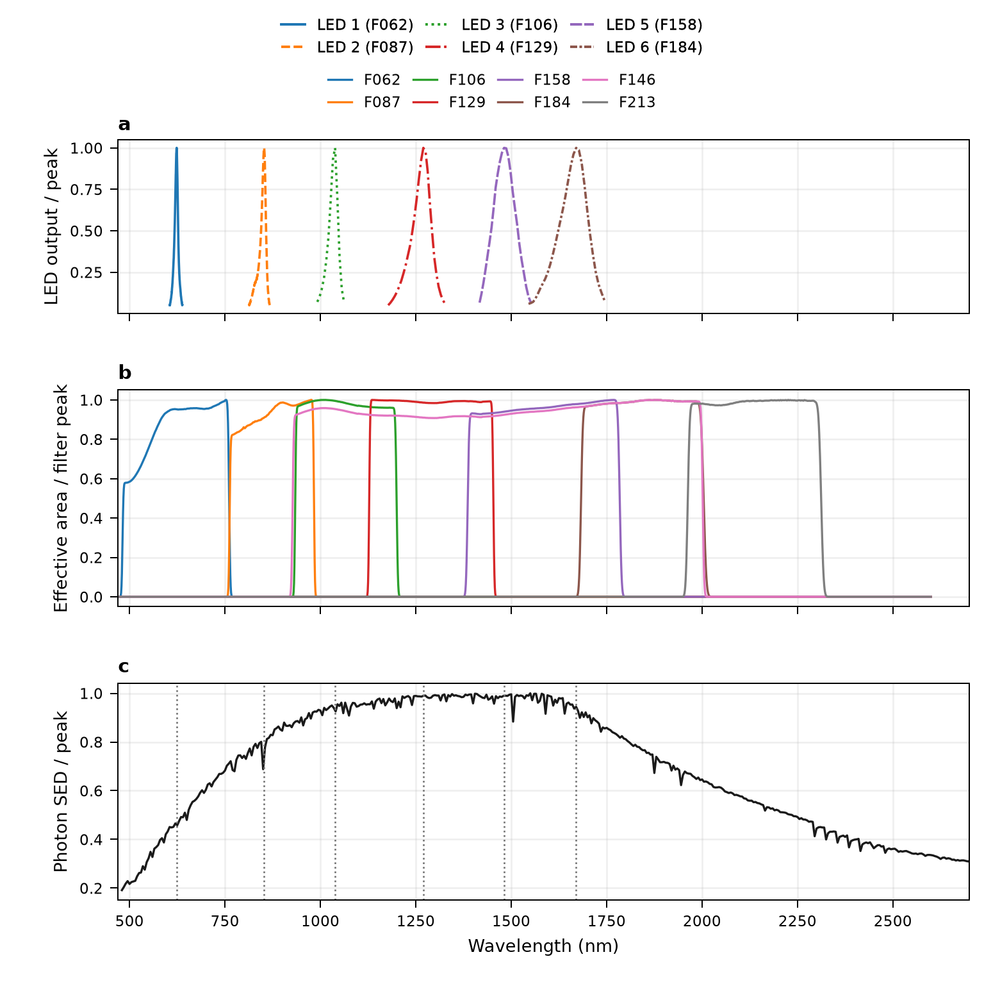
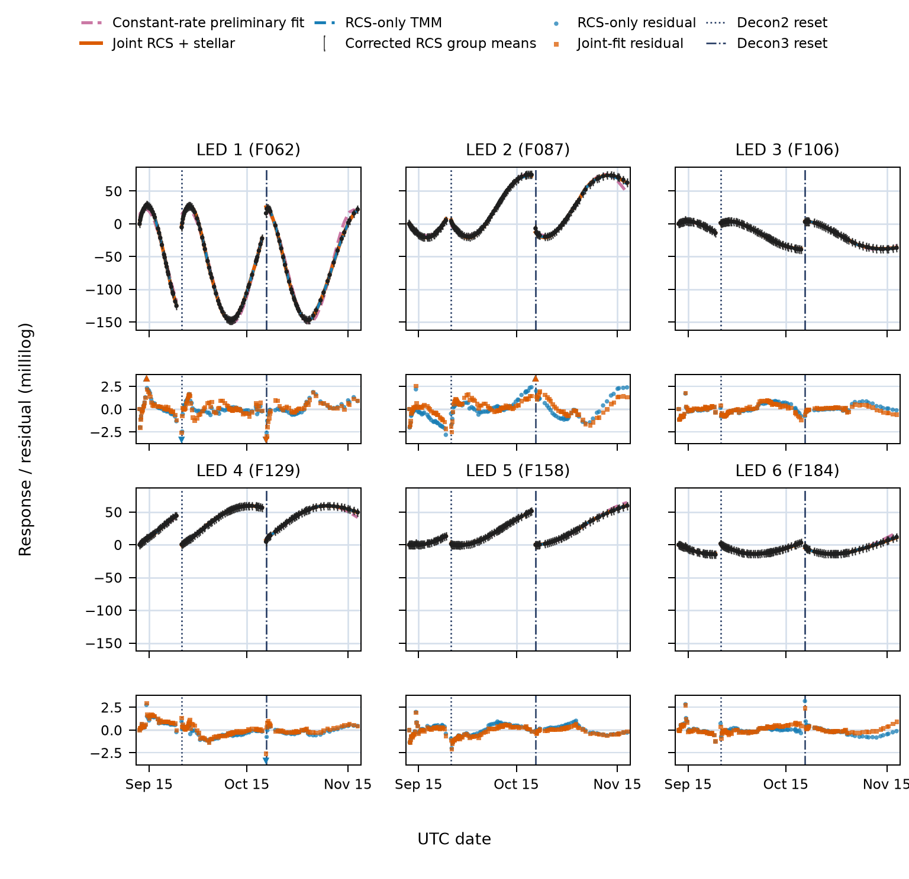
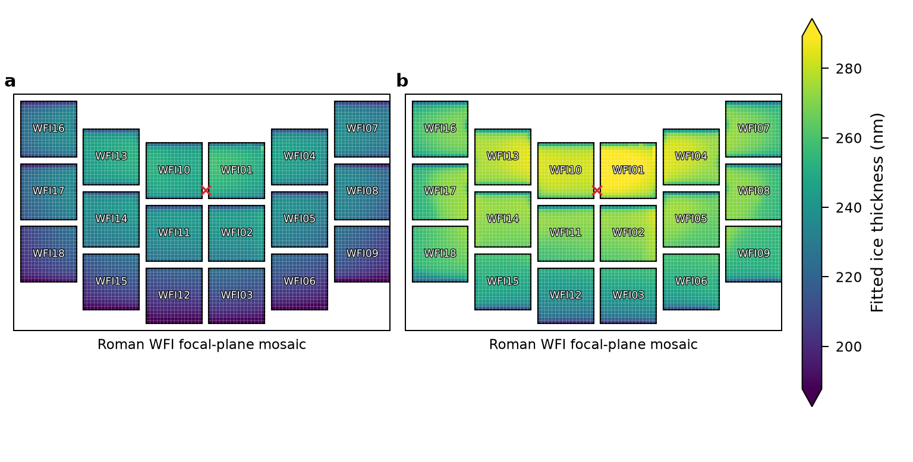

\begin{center}
\small Department of Astronomy, The Ohio State University\\
4055 McPherson Laboratory, 140 West 18th Avenue\\
Columbus, OH 43210, USA
\end{center}

**Abstract.** Thin-film water ice changes the wavelength-dependent response of
Nancy Grace Roman Space Telescope Wide Field Instrument (WFI) detectors through
thin-film interference. We combine high-cadence Relative Calibration System
(RCS) flats in six LED bands (624--1670 nm) with multi-epoch stellar photometry
in eight broad filters (F062--F213; 470--2335 nm) to reconstruct spatially
resolved ice histories and detector response across all 18 detectors. A
four-layer RCS transfer-matrix fit is followed by a CAR201 joint fit that
modulates the ice-free complex reflection and refines ice histories. The series
starts just after Decon1, with a 12.9-day first interval, and ends 17 November
2026. Segment-average deposition rates decline from 9.9 nm/day before Decon2 to
9.0 between Decon2 and Decon3 and 8.1 after Decon3. Ice is thickest on upper and
central detectors, including WFI01 and WFI10. Median post-reset rates peak at
15.1 and 12.7 nm/day half a day after Decon2 and Decon3, declining to 8.0 and
6.7 by day 20; boundary sensitivity and residual cooling may contribute. At the
final observation, WFI01 reaches 306.1 nm, slightly above the 300 nm limit; the
10-day Decon4 dryout began the next day, outside the analysis. The RCS-only fit
lowers CAR201 NMAD in all 144 detector/filter combinations. The joint fit adds
its largest reductions in F062 and F213, beyond the LED anchors. We outline WFI
slitless-prism spectrophotometry as an independent validation test.

## 1. Introduction

Ice deposited onto the Nancy Grace Roman Space Telescope Wide Field Instrument
(WFI) detector surfaces forms a thin film that changes their wavelength-dependent
response through thin-film interference. Estimating how the ice thickness and
ice-deposition rate evolve during commissioning requires measurements with both
temporal cadence and spectral coverage.

The Relative Calibration System (RCS) repeatedly illuminates the detectors in
six narrow LED bands. Changes in the calibrated flat-field response provide a
high-cadence record of the evolving optical stack and its sensitivity to ice.
The RCS observations analyzed here come from Commissioning Activity Requests
(CARs) 190 and 216. CAR201 stellar photometry measures sources through eight
broad WFI filters, providing complementary wavelength information between and
around the LED bands. Together, these data sets constrain the time evolution of
ice and the detector's broader spectral response.

This paper describes the observations and reduction (Section 2), develops the
transfer-matrix method (TMM) optical stack and ice-deposition model (Section 3),
and presents two modeling stages: an RCS-only fit (Section 4) and a joint fit
incorporating CAR201 stellar photometry (Section 5). Section 6 compares their
reconstructions, discusses limitations, and outlines an independent validation
test using slitless prism spectroscopy from CAR192 (Program 1042).

## 2. Observational Data and Reduction

Elapsed days throughout this paper are measured from the reference epoch
$t_0=$`2026-09-12T01:25:50.714 UTC`, immediately after Decon1. The first modeled
segment therefore begins just after the first spacecraft decontamination and
ends at Decon2. Decon2 and Decon3 denote the second and third spacecraft
decontamination events; they reset the ice-history segments at
`2026-09-24T23:12:29.895 UTC` and `2026-10-20T20:34:44.531 UTC`, respectively
(elapsed days 12.90740 and 38.79785). The final analyzed RCS observation was
`2026-11-17T23:33:33.773 UTC`. The 10-day Decon4 dryout began on `2026-11-18` and
falls outside this analysis.

The analysis combines three observational data sets: two RCS flat-field programs
(CAR190 and CAR216) and broad-band stellar photometry from CAR201 (Table 1).

| Data set | Program | Measurement | Calibrated products |
| --- | --- | --- | --- |
| CAR190 | 1039 | Six-LED RCS observations | Re-reduced S3 Level-2 flats before Decon2; MAST Level-2 flats thereafter; all exposures retained. |
| CAR216 | 1063 | Higher-cadence six-LED RCS cycles beginning at Decon2 | MAST Level-2 WFI flats; complete six-LED cycles retained at nominal four-hour cadence where available. |
| CAR201 | 1043 | Stellar WFI imaging photometry | MAST Level-2 images for broad-band detector-response measurements. |

**Table 1. Observational data sets and calibrated products.**

The RCS data are calibrated Level-2 WFI flats; MAST exposure records provide
observation times and program metadata. Before Decon2, CAR190 uses updated
re-reduced Level-2 products because the calibration was not yet available in
MAST. At and after Decon2, including CAR216, we use MAST Level-2 products; from
the higher-cadence CAR216 sequence, we retain complete six-LED cycles at nominal
four-hour cadence where available, preserving gaps in the observing sequence.

### Shared RCS pixel-pair reduction

Both programs use the six RCS light-emitting diodes (LED1--LED6), with spectral
peaks at 623.521, 852.803, 1038.585, 1269.758, 1481.241, and 1670.169 nm. Their usable
spectra span approximately 480--2700 nm. The following pair selection,
corrections, and tile summaries apply to both programs.

For each detector and LED, measurements are referenced to that LED's first
exposure in time. A pixel pair is kept only if its data-quality (DQ) value is
zero in both images, both the reference and current unscaled counts are finite
and strictly positive, and the dark-subtracted photodiode signals used for
exposure scaling are positive. We apply no additional outlier clipping on flux
changes, so unflagged defects remain in the sample.

We divide each 4096-by-4096 detector image into a 16-by-16 grid of 256-by-256-pixel
tiles, each covering up to 65,536 native pixel pairs. For each tile, LED, and
exposure, we summarize retained pairwise log changes with the quantities below
and fit an independent ice-thickness history.

For each retained pair, the uncorrected change is

$$
x_i^{\mathrm{raw}}(t) = \ln C_i(t) - \ln C_i(t_{\mathrm{ref}}).
$$

Photodiode scaling removes changes in LED output, while separate image-count
and photodiode factors correct the readout-side swap. Both corrections are
multiplicative count factors (additive offsets in log response); for each
detector and LED, we fit continuous splines with a log-step at the side-swap
boundary. Each factor is one before the event. Let $f_{\mathrm{img}}(t)$ and
$f_{\mathrm{PD}}(t)$ denote these factors, and let $p(t)$ be the dark-subtracted
photodiode-2 signal. For each LED, $p_{\mathrm{ref}}$ is its first photodiode
measurement not marked as warm-up. The scale is $p_{\mathrm{ref}}/p(t)$. For
a reference/current pair, the combined log offset simplifies to

$$
c_{\mathrm{side}}(t)=
\ln\!\left[
\frac{f_{\mathrm{img}}(t)}{f_{\mathrm{PD}}(t)}
\frac{p(t_{\mathrm{ref}})}{p(t)}
\right],
\qquad
f_{\mathrm{img}}(t_{\mathrm{ref}})=f_{\mathrm{PD}}(t_{\mathrm{ref}})=1.
$$

The corrected pair value is $x_i^{\mathrm{side}}=x_i^{\mathrm{raw}}+c_{\mathrm{side}}$. The same first
non-warm-up photodiode reference is used across Programs 1039 (CAR190) and
1063 (CAR216).

The reduction also corrects count changes for detector temperature and for
step changes in the overall signal level associated with the Alignment
Compensation Mechanism (ACM).
The temperature predictor is the detector electronics strap temperature,
averaged over five-minute intervals (telemetry channel
`WFI_MCE_ADC_WTSM00`). A fixed quadratic in log-count space is used for each
tile:

$$
c_T(T) = c_1\,(T-T_{\mathrm{ref}}) + c_2\,(T-T_{\mathrm{ref}})^2.
$$

Here $T_{\mathrm{ref}}$ is the operating-temperature reference. The temperature
correction is zero at $T_{\mathrm{ref}}$ and is applied equally to all six LEDs for a
tile. ACM steps are constant log-count offsets beginning at identified event
times. Some offsets are shared across all LEDs; others are LED-specific.

For each tile, LED, and observation group, let $N$ be the valid-pair count and
define the raw sufficient statistics $S=\sum_{i=1}^{N}x_i^{\mathrm{raw}}$ and
$Q=\sum_{i=1}^{N}(x_i^{\mathrm{raw}})^2$. An accumulated per-LED
reference-relative log offset $c$ transforms these statistics directly:

$$
S' = S + Nc, \qquad Q' = Q + 2cS + Nc^2.
$$

The reduction applies count-space corrections before forming corrected group
statistics, using UTC event times shared across detectors and factors estimated
at detector, tile, or LED level as indicated.

\pagebreak

#### Correction terms and timing

| Correction group | What is corrected | Timing |
| --- | --- | --- |
| Photodiode scaling and side-swap | PD2 scaling removes LED-output changes using the first non-warm-up reading per LED. Separate image-count and photodiode factors correct the readout-side change with a continuous spline and log-step. | PD2 scaling is applied per exposure. Fitted side-swap boundaries span 2026-10-06 08:07–08:18 UTC across LEDs. |
| Temperature-dependent sensitivity | A fixed per-tile quadratic in five-minute `WFI_MCE_ADC_WTSM00` corrects pairwise log-count changes for temperature and is applied equally to all LEDs when telemetry is available. | Applied exposure by exposure and anchored at the reference temperature. |
| ACM signal-level steps | Additive log-count offsets correct shared-grey or LED-specific changes. | Shared-grey steps: 2026-09-14 23:52 and 2026-09-23 08:49 UTC; per-LED steps: 2026-09-27 15:10 and 2026-10-04 04:54 UTC; shared-grey step: 2026-10-09 04:49 UTC. |

**Table 2. Count-space corrections applied before forming the RCS statistics.**

### CAR201 WFI Photometry and Source Matching

CAR201 WFI photometry is derived from MAST Level-2 calibrated images in Program
1043. Stellar fluxes are measured with forced apertures at known source
positions on all 18 detectors, including initial and post-roll positions. The
measurements cover filters F062, F087, F106, F129, F158, F184, F146, and F213.

The source list comes from Gaia Data Release 3 (DR3; Gaia Collaboration et al.
2023): a 0.75-degree-radius
circle centered at right ascension 294.3170 degrees and declination 46.3557
degrees, selected solely by Gaia $G$ magnitude ($13\le G<21.5$) without
temperature cuts. The query contains 85,297 sources; 52,173 are in the fainter
subset ($19\le G<21.5$).

For the fainter stars, Pan-STARRS DR2 (Flewelling et al. 2020) mean
point-spread-function (PSF)
photometry is matched to Gaia positions within one arcsecond. Gaia positions are
propagated from epoch 2016 to an approximate Pan-STARRS epoch of 2012 using Gaia
proper motions where available; missing proper motions are flagged. A
Pan-STARRS measurement is rejected if multiple counterparts lie within one
arcsecond or the same counterpart is assigned to another Gaia source, including
a brighter source. We also apply an approximate brighter-neighbor veto to flag
likely blends.

Two Micron All Sky Survey (2MASS; Skrutskie et al. 2006) point-source matches use Gaia positions
propagated to each candidate observation date. A match must be within one
arcsecond, have no other 2MASS candidate within two arcseconds, and not be
shared with another Gaia source. 2MASS quality flags are used to exclude
individual band measurements.

Brighter stars ($13 \le G < 19$) use Gaia and 2MASS photometry, without
Pan-STARRS. Their 2MASS measurements are restricted to quality flags A--C and
uncertainties below 0.2 mag. Every star in this bright subset has at least
three usable Gaia-band measurements.

For the faint-star SED fits, a photometric measurement must have a finite
magnitude and finite positive uncertainty. The catalog retains single-detection
Pan-STARRS measurements and does not impose an upper cut on their ordinary
photometric uncertainties. A faint-star 2MASS band requires an accepted quality
flag, a finite positive uncertainty below 8 mag (larger values are catalogue
flags), and no contamination flag; we retain and record poor-profile-fit `E`
flags but exclude upper limits (`U`) and unusable (`F` or `X`) measurements.
These quality cuts filter out individual bands while retaining the star in the
SED sample.

For the joint ice fit, we use the first eleven visits through 31 October 2026,
matched by source, filter, and visit. They comprise Execution Plan 3 (EP3)
passes 1--6 and Execution Plan 4 (EP4) passes 1--5. The roll separates EP4 pass
1 from pass 2 and moves many
stars to new detector positions. Because no L-flat was applied to these CAR201
measurements, the changed positions can produce flux steps from spatial response
variation, apart from the time-dependent ice signal. Figure 6 marks the median
timestamp of the first post-roll pass, `2026-10-18T09:39:36.654 UTC`. We discard
exposures flagged `DO_NOT_USE` (bit 1) and remove any star entirely if any of its
measurements is flagged `SATURATED` (bit 2). Retained rows must have finite
magnitudes and positive finite photometric uncertainties.
Each source/filter group must have at least two visits, and each star must
have a successful spectral-energy distribution (SED)
estimate as described below.

Across the 18 detector-specific fit samples, the CAR201 data comprise 9,480
distinct Gaia sources and 605,084 valid detector/filter/visit measurements.
Sources appearing at multiple detector positions are counted once in the source
total and once per valid detector/filter/visit in the measurement total.

For photometric weighting, we tabulate each detector's Roman WFI v8
effective-area curve (see Data Availability) on a 5 nm grid over its full nonzero
support.



**Figure 1. Spectral coverage of the RCS and stellar observations.** (a) Six
RCS LED spectra,
shown relative to each LED's peak and truncated below the five-percent cutoff
used in the RCS integral. (b) WFI02 effective-area curves for the eight imaging
filters, each normalized to its own peak. (c) Illustrative photon spectrum for
a K-type star observed on WFI02 (Gaia DR3 source 2128134408017300864;
$T_{\mathrm{eff}}=4861\,\mathrm{K}$, $\log g=1.96$), reconstructed from its
posterior-median stellar parameters and normalized to its peak. The vertical
markers show the six LED centers. Independent peak normalization in each panel
emphasizes the relative wavelength coverage.


**Figure 2. Net effect of the RCS count-space correction sequence.** Each panel
shows one LED for WFI02 tile 135. Blue points are uncorrected reference-relative
log responses from unscaled detector counts; orange points are the same matched
exposures after photodiode/side-swap, temperature-gain, and ACM corrections.
Circles mark CAR190 (Program 1039); triangles mark CAR216 (Program 1063).
The separation of the colored series shows the net change introduced by the
preprocessing sequence. Dotted and dash-dot vertical lines mark the Decon2 and
Decon3 ice resets, respectively.

### Stellar SED Estimation

Each star is fit with a grid of PHOENIX/BT-Settl stellar-atmosphere spectra
(Husser et al. 2013; Allard et al. 2012) to
estimate its wavelength-dependent spectral energy distribution (SED). Dust
attenuation follows the Fitzpatrick (1999) extinction law, with the
total-to-selective extinction ratio $R_V=3.1$ fixed; extinction $A_V$ is fit
for each star. Model fluxes are integrated through Gaia EDR3 passbands and zero
points (Gaia Collaboration et al. 2021), Pan-STARRS, and 2MASS response curves.

The fit varies five parameters: effective temperature (3000--10,000 K),
surface gravity ($\log g$, base-10 logarithm in cm/s$^2$, from 0 to 5.5),
metallicity (-1 to $+0.5$ dex relative to solar), visual extinction $A_V$
(0--4 mag), and overall flux normalization.
Every source with at least one usable measurement is fit; faint sources with one or
two bands are flagged as weakly constrained, with their SED estimates largely
determined by the priors.

The SED fits use nested sampling (`dynesty`; Speagle 2020) with 80 live points
and stop when the estimated remaining log evidence is below 1
($\mathrm{dlogz}=1$). Each fitted
star has 128 approximate posterior draws; each draw is a complete extincted
spectrum that retains correlations across wavelength. We apply a 0.03 mag floor
to photometric uncertainties for calibration and model error, then treat flux
uncertainties as independent and Gaussian.

The SED posterior conditions on the Fitzpatrick extinction law and selected
atmosphere-model family, with uncertainty represented through the fitted
stellar parameters. Rather than marginalizing over the 128 posterior draws, the
joint forward model evaluates one photon spectrum per star from its
posterior-median parameters and the BT-Settl grid. The likelihood includes the
reported photometric uncertainties and fitted detector-level excess scatter.
Within the 52,173-star
faint subset ($19\le G<21.5$), 50,445 stars lack usable 2MASS detections, and
1,441 have only one or two usable photometric bands across Gaia, Pan-STARRS, and
2MASS combined. These sparse-band SED constraints depend strongly on the
adopted atmosphere and extinction models.

#### Independent Spectrum Checks

As an external check, we compared the fitted BT-Settl spectra for three stars
and their Gaia/2MASS photometry with intrinsic stellar spectra supplied by
Tathagata Pal (private communication). We converted the supplied Gaia-band
extinction $A_G$ approximately to $A_V$ using a model spectrum and the
Fitzpatrick law, applied it to the intrinsic spectra, and integrated them
through the corresponding bandpasses; the results broadly agreed, with minor
band-to-band differences. For two stars, linked BOSZ atmosphere models
(Bohlin et al. 2017) also reproduced the supplied intrinsic spectra from their
input fluxes, catalogued radii, and distances to a maximum fractional difference
below $4\times10^{-10}$.

## 3. Physical Model of Ice Deposition

An ice film changes the optical phase accumulated by light traveling through
the detector's surface layers. Reflections from the layer boundaries then
interfere, making the detector response depend on both ice thickness and
wavelength. The TMM represents this layered optical system; the
ice-thickness-history model describes how the film thickness changes between
observations and resets.

### TMM Optical Stack and Response

For each tile, the optical stack is

```text
air -> ice -> antireflection (AR) layer 1 -> AR layer 2 -> AR layer 3
     -> optically thick mercury-cadmium-telluride (HgCdTe)
```

The transfer-matrix method (TMM) calculates the amplitude and phase of
reflected light through the layers at the wavelengths sampled by each source
spectral energy distribution (SED). The unmodulated, ice-free reference
stack's complex amplitude reflection coefficient is denoted
$r_{\mathrm{TMM},k}(\lambda)$. The complex refractive index is $n+ik$. We
evaluate the model on a 480--2700 nm wavelength grid and assume:

- three independent AR layers;
- lossless AR layers, with $k=0$ fixed;
- light arrives perpendicular to the detector surface;
- 80 K reference optical constants for HgCdTe with composition $x=0.445$,
  treated as optically thick.

For incident admittance $Y_0$ and HgCdTe substrate admittance $Y_s$, let
$(U,V)$ be the transfer-boundary pair after the ice layer and the three AR
layers. The TMM substrate power is

$$
P_{\mathrm{sub}}=\operatorname{Re}\!\left(\frac{Y_s}{Y_0}\right)
\left|\frac{2Y_0}{Y_0U+V}\right|^2.
$$

For the ice-free reference stack, let
$P_{\mathrm{sub}}^{\mathrm{ice\text{-}free}}(\lambda)$ be the substrate power
with the ice layer removed. Adding ice of thickness $d$ changes the
transfer-boundary pair and produces
$P_{\mathrm{sub}}^{\mathrm{ice}}(\lambda,d)$. Their ratio describes the
wavelength-dependent response change caused by ice:

$$
\mathcal{R}_{k}^{\mathrm{RCS}}(\lambda,d)=
\frac{P_{\mathrm{sub},k}^{\mathrm{ice}}(\lambda,d)}
     {P_{\mathrm{sub},k}^{\mathrm{ice\text{-}free}}(\lambda)}.
$$

This monochromatic ratio connects the physical stack to the RCS measurement.
The measured LED energy spectrum weights the response across its finite band;
each relative spectrum is normalized to its peak, and samples below five
percent of that peak are excluded. For LED $\ell$, the band-integrated response is

$$
\begin{aligned}
\bar{\mathcal{R}}_{k,\ell}^{\mathrm{RCS}}(d)
&=\frac{\int S_{\ell}^{\mathrm{LED}}(\lambda)
P_{\mathrm{sub},k}^{\mathrm{ice}}(\lambda,d)\,d\lambda}
{\int S_{\ell}^{\mathrm{LED}}(\lambda)
P_{\mathrm{sub},k}^{\mathrm{ice\text{-}free}}(\lambda)\,d\lambda},\\
m^0_{k,\ell}(t)
&=\ln\bar{\mathcal{R}}_{k,\ell}^{\mathrm{RCS}}(d_{k,s(t)}(t))
-\ln\bar{\mathcal{R}}_{k,\ell}^{\mathrm{RCS}}(d_{k,0}(t_{\mathrm{ref},\ell})).
\end{aligned}
$$

Here $S_{\ell}^{\mathrm{LED}}$ is the measured LED energy spectrum,
$t_{\mathrm{ref},\ell}$ is that LED's first observation, and $s(t)$ denotes the
reset segment containing $t$. Thus $m^0_{k,\ell}$ is the TMM-predicted log
change before the fitted reset correction described below.

The optical properties of the AR coating, HgCdTe substrate, and deposited ice
are parameterized separately.

#### Antireflection-Layer Parameters

Each tile has two fitted parameters per antireflection layer: thickness and
real refractive index. The bounds are:

- Thickness coordinate: $0.01\le\tau_j\le10$; physical thickness is
  $d_j=100\tau_j\,\text{ nm}$, for layers $j=1,2,3$.
- Refractive index: $1\le n_1\le4$; for layers $j=2,3$,
  $n_{j-1}\le n_j\le4$.
- Absorption index: $k_j=0$ for all three layers.

The coating prior is centered on a three-layer starting design at `1050 nm`,
with optical thickness near one quarter of that wavelength and a geometric
sequence of indices based on nominal HgCdTe $n=3.6$. Thicknesses and indices
are mapped to bounded fit coordinates.

#### HgCdTe Parameters

Each tile has independent positive, wavelength-independent scales
$\alpha_n,\alpha_k$ and smooth wavelength-dependent corrections
$\delta_n(\lambda),\delta_k(\lambda)$ to the reference HgCdTe optical
constants:

$$
\begin{aligned}
n(\lambda) &= n_{\mathrm{ref}}(\lambda)\,\exp\!\left(\alpha_n+\delta_n(\lambda)\right),\\
k(\lambda) &= k_{\mathrm{ref}}(\lambda)\,\exp\!\left(\alpha_k+\delta_k(\lambda)\right).
\end{aligned}
$$

#### Spectral Corrections to Optical Constants

The deterministic MAP fit allows broad log-space adjustments to AR $n$,
HgCdTe $n$, and HgCdTe $k$. The three AR layers have independent spectral
modulations:

$$
n_{\mathrm{AR},j}(\lambda)=n_{\mathrm{AR},j,0}
\exp[\delta_{n,\mathrm{AR},j}(\lambda)],\qquad j=1,2,3.
$$

Each AR-layer modulation and each HgCdTe modulation is a sum of six broad
Gaussian curves centered on the LED wavelengths listed in Section 2, with width
`500 nm`. Subtracting the value at `1050 nm` makes each adjustment zero at the AR
design wavelength.

#### Ice Optical Index and Incidence

We model the ice film as lossless ($k=0$) at normal incidence with a baseline
refractive index of $n=1.25$, fitting one positive, wavelength-independent
scale factor per tile in the RCS-only fit.

### Tile Ice-Deposition Rate and Thickness-History Model

Each detector tile has an independent ice-thickness history. Ice deposits onto
the detector surface at a positive instantaneous ice-deposition rate. At each
observation-time node $t_i$, $q_i$ is the logarithm of that rate, measured in
nm/day. The ice-deposition rate at that node is positive by construction:

$$
\dot d_i=\exp(q_i).
$$

Stage 1 places one rate node at each distinct RCS repeat time, defined as the
mean time of the LED groups in that cycle. The representative WFI02 tile has
143 such nodes across the analyzed series. Each retained CAR216 cycle
contributes a node at the nominal four-hour cadence where available; the grid
otherwise follows the actual observation gaps and irregular CAR190 sampling.
The production rate prior is independent lognormal at each node, and trajectory
curvature and entropy weights are zero. Thus interpolation between node values
does not impose a temporal smoothness penalty.

The log ice-deposition rate is interpolated linearly between time nodes. Within
reset segment $s$, integrating this rate gives the ice-thickness history in the
RCS-only fit:

$$
d_{k,s}(t)=d_{0,k,s}+\int_{t_s}^{t}\exp[\widetilde q_{k,s}(u)]\,du,
$$

where $t_s$ and $d_{0,k,s}$ are that segment's start time and fitted starting
ice thickness. The integral is evaluated interval by interval with 8-point
Gauss-Legendre quadrature.

Each decontamination (Decon2 and Decon3; Section 2) initiates a new
thickness-history segment with its own fitted starting thickness.

The third decontamination was brief, so the model does not assume that all ice
was removed. A nonzero post-event ice thickness can represent residual ice that
remained on the detector or ice deposited again soon after the event.

The likelihood includes a wavelength-independent grey correction
$\gamma_{k,s}$ for each reset segment, added to the observed group mean and set
to zero in the reference segment. For tile $k$, this correction corresponds to
a multiplicative response factor $\exp(\gamma_{k,s})$.

### RCS Sufficient Statistics and Likelihood

The RCS-only fit uses per-tile sufficient statistics after the fixed
count-space corrections; decontamination boundaries define the ice-history
segments. For each tile, LED, and observation group, the reduction retains:

- $N$: valid pixel-pair count;
- $S'$: corrected sum of pixel log changes;
- $Q'$: corrected sum of squared pixel log changes.

These sums are sufficient to reconstruct the exact Gaussian squared error for
any model prediction for that tile, LED, and observation group.

The observed group mean is $y=S'/N$. Let $m^0_{kg}$ denote the predicted
reference-relative log change from the band-integrated TMM response. The fitted
reset correction $\gamma_{k,s}$ is added to the observed group mean for reset
segment $s$ (and is zero in the reference segment), so the within-group
residual sum of squares is

$$
\mathrm{SSE}=Q'-\frac{(S')^2}{N}+N(m^0-y-\gamma_{k,s})^2.
$$

The exact SSE separates into the data-only within-group scatter
$Q'-(S')^2/N$ and the model-dependent residual term above. The first group for
each LED is the reference, and the forward model compares each current response
with that LED's first observation.

The parameter-dependent part of the RCS negative log-likelihood (Gaussian
loss), omitting terms constant across model predictions, is

$$
\mathcal{L}_{\mathrm{RCS}}=
\frac{1}{2\sigma_{\log}^2}\sum_{k,g}
w_{kg}\,N_{kg}
\left[m^0_{kg}(\theta)-y_{kg}-\gamma_{k,s(g)}\right]^2.
$$

Here $k$ indexes tiles, $g$ indexes LED/observation groups,
$y_{kg}=S'_{kg}/N_{kg}$
is the corrected observed mean, $m^0_{kg}$ is the TMM-predicted log change from
that LED's first observation, and $\gamma_{k,s(g)}$ is the fitted grey reset
correction for the segment containing group $g$. The log-response noise scale is
$\sigma_{\log}=0.005$. The weights $w_{kg}$ set the relative influence of each
group. For each tile $k$, let
$\widetilde N_k=\operatorname{median}_g(N_{kg})$ be its median valid-pixel
count. We use the per-tile normalization $w_{kg}=1/\widetilde N_k$, matching
the convention in Section 5.

The RCS-only fit's MAP objective adds Gaussian prior penalties:

$$
\mathcal{J}_{\mathrm{RCS-only}}(\theta)=
\mathcal{L}_{\mathrm{RCS}}+
\frac{1}{2}\sum_j\left(\frac{\eta_j-\mu_j}{s_j}\right)^2.
$$

Here $\eta_j$ is a fitted parameter in its prior coordinate, with prior center
$\mu_j$ and standard deviation $s_j$.

## 4. RCS-only TMM Model

Using the six LED time series, the RCS-only fit estimates the full optical stack
and independent per-tile ice histories, including AR and HgCdTe properties,
ice-index scales, spectral adjustments, and deposition trajectories.

The full-stack transfer matrix is evaluated while the optical state is being
fit. Once an optical state is fixed, trajectory evaluation interpolates
precomputed per-LED TMM response curves over ice thickness rather than
re-evaluating the transfer matrix at every time node.

\pagebreak

### RCS-only Fit Priors and Bounds

| Quantity | Parameterization, prior, or fixed convention |
| --- | --- |
| AR thickness and real $n$ | Fit per tile within the physical bounds above; broad Gaussian around the 1050 nm quarter-wave design, standard deviation `10` in bounded coordinates |
| AR absorption $k$ | Fixed at zero |
| HgCdTe $n$ and $k$ scales | Independent positive scales per tile; zero-centered normal priors in log scale, standard deviation `0.25` |
| AR $n$ (independent for each layer) and HgCdTe $n,k$ spectral adjustments | Six broad Gaussian wavelength modes anchored at 1050 nm; separate mode coefficients per AR layer; zero-centered normal priors in log scale, standard deviation `0.10` |
| Ice real-index scale | Positive, wavelength-independent scale per tile; zero-centered normal prior in log scale, standard deviation `0.01` |
| Ice absorption $k$ and incidence | Ice $k=0$; normal incidence |
| Initial and reset-segment starting ice thickness | Positive per tile and segment, including post-Decon3; lognormal with median `10 nm` and log standard deviation `1.5` |
| Ice deposition rate | Positive per-tile log-rate at every RCS repeat node; independent lognormal priors with median `12 nm/day` and log standard deviation `1.5`; no temporal smoothness penalty |
| Post-reset response offset $\gamma_{k,s}$ | One wavelength-independent log correction per tile and reset; zero-centered normal prior, standard deviation `0.1` |
| Per-LED log offset | Fixed at zero |

**Table 3. RCS-only fit parameterization, priors, and fixed conventions.**

### emcee Search and MAP Optimization

The `emcee` ensemble search (Foreman-Mackey et al. 2013) begins with a
constant-in-time ice-deposition rate,
reducing the trajectory dimension while it explores the posterior over the
optical stack, ice thicknesses, and deposition rate. High-posterior states
identify promising likelihood basins. The best scalar rate is copied to every
time node to initialize the non-parametric trajectory. The deterministic MAP
fit then optimizes the full optical state and independent per-tile ice histories
together against the RCS likelihood, with priors regularizing weakly constrained
parameters.

The RCS-only fit's MAP estimate uses bounded trust-region reflective nonlinear least
squares. Parameters are scaled by their prior widths so optical, thickness, and
deposition-rate coordinates enter the optimization on comparable scales.
Convergence is assessed from objective-change and parameter-step criteria; the
scaled-gradient norm is reported separately.

## 5. Joint RCS + Stellar Photometry Model

### Motivation

The RCS measurements provide high-cadence constraints on ice evolution, but
their spectral coverage is limited to six LED bands. Stellar photometry from
CAR201 provides complementary measurements across eight broad filters, allowing
the wavelength-dependent detector response to be constrained between and beyond
the LED bands. The joint model starts from the optical state and ice histories
fitted by the RCS-only model. It adds a smooth spectral modulation of the ice-free
complex reflection and refines the ice histories jointly against both data sets.
The modulation is propagated through the ice layer when predicting measured
counts.

### Joint forward model

For detector $D$, tile $k$, and wavelength $\lambda$, the modulated ice-free
reflection is

$$
\begin{aligned}
r_{\mathrm{mod},D,k}(\lambda)
  &=r_{\mathrm{TMM},D,k}(\lambda)
    \exp\!\left[g_D(\lambda)+i\phi_D(\lambda)\right],\\
g_D(\lambda)&=\sum_{j=1}^{15}a_{D,j}B_j(\lambda),\\
\phi_D(\lambda)&=\sum_{j=1}^{15}p_{D,j}B_j(\lambda).
\end{aligned}
$$

The basis functions $B_j$, defined below, are shared across all tiles on a
detector. Each tile's ice-free reflection, transfer normalization, and
substrate admittance $Y_s$ remain tile-specific and fixed at their RCS-only
values. At each tile's ice thickness, the modulated ice-free reflection sets
the ice-layer input admittance
$Y_{\mathrm{mod}}=Y_0(1-r_{\mathrm{mod}})/(1+r_{\mathrm{mod}})$. Let
$U_{0,k}(\lambda)$ be the first component of the fitted ice-free transfer
boundary. The input pair for the ice-layer transfer
matrix is $(U_{0,k},U_{0,k}Y_{\mathrm{mod}})$; applying the ice matrix gives
$(U_{\mathrm{ice,mod}},V_{\mathrm{ice,mod}})$. The resulting substrate power is

$$
P_{\mathrm{sub},D,k}^{\mathrm{ice,mod}}(\lambda,d_k(t))=
\operatorname{Re}\!\left(\frac{Y_s}{Y_0}\right)
\left|\frac{2Y_0}{Y_0U_{\mathrm{ice,mod}}+V_{\mathrm{ice,mod}}}\right|^2.
$$

For CAR201, the wavelength-dependent relative substrate response is

$$
\mathcal{R}_{D,k}(\lambda,t)=
\frac{P^{\mathrm{ice,mod}}_{\mathrm{sub},D,k}(\lambda,d_k(t))}
     {P^{\mathrm{ice\text{-}free}}_{\mathrm{sub},D,k}(\lambda)}.
$$

For star $s$, filter $f$, and visit $v$, the band-integrated model rate and
reference-visit-relative magnitude prediction are

$$
\begin{aligned}
I_{sfv}&=\int S_s^{\mathrm{ph}}(\lambda)
 A_{Df}(\lambda)\,\mathcal{R}_{D,k(s,f,v)}(\lambda,t_v)\,d\lambda,\\
\widehat{\Delta m}_{sfv}
  &=-\frac{2.5}{\ln 10}\ln\!\left(\frac{I_{sfv}}{I_{sfv_0}}\right).
\end{aligned}
$$

The fixed reference visit $v_0$ is EP3 pass 1 for every star/filter group.

#### Spectral-Modulation Basis Specification

The basis functions $B_j$ are fixed, dimensionless functions of wavelength
$\lambda$ (in nanometers); their knots and shapes are defined directly in
$\lambda$. The functions span the interval over which the detector's effective
area is nonzero.
For detector $D$, define eight ordered wavelength knots: the blue and red
ends of that interval, with the six LED centers between them,

$$
\kappa_0=\lambda_{\min,D},\qquad
\kappa_i=\lambda_{\mathrm{LED},i}\ (i=1,\ldots,6),\qquad
\kappa_7=\lambda_{\max,D}.
$$

There are seven gap modes, one in each interval between adjacent knots,
including the two end intervals:

$$
G_\ell(\lambda)=
\begin{cases}
\sin^2\!\left(\pi\dfrac{\lambda-\kappa_{\ell-1}}
{\kappa_\ell-\kappa_{\ell-1}}\right),
&\kappa_{\ell-1}\le\lambda\le\kappa_\ell,\\
0,&\text{otherwise},
\end{cases}
\qquad \ell=1,\ldots,7.
$$

Each gap mode is zero at both knots and reaches one at the interval midpoint.
Six raised-cosine nodal modes are centered on the LEDs. For LED knot
$i=1,\ldots,6$, its mode rises from zero at the preceding knot to one at the
LED, then falls to zero at the next knot:

$$
H_i(\lambda)=
\begin{cases}
\dfrac{1}{2}\left[1-\cos\!\left(\pi\dfrac{\lambda-\kappa_{i-1}}
{\kappa_i-\kappa_{i-1}}\right)\right],
&\kappa_{i-1}\le\lambda<\kappa_i,\\
\dfrac{1}{2}\left[1+\cos\!\left(\pi\dfrac{\lambda-\kappa_i}
{\kappa_{i+1}-\kappa_i}\right)\right],
&\kappa_i\le\lambda\le\kappa_{i+1},\\
0,&\text{otherwise}.
\end{cases}
$$

The remaining two raised-cosine endpoint modes take value one at their
detector-specific support edge, taper to zero at the nearest LED, and remain
at one outside the support:

$$
H_0(\lambda)=
\begin{cases}
1,&\lambda\le\kappa_0,\\
\dfrac{1}{2}\left[1+\cos\!\left(\pi\dfrac{\lambda-\kappa_0}
{\kappa_1-\kappa_0}\right)\right],&\kappa_0<\lambda<\kappa_1,\\
0,&\lambda\ge\kappa_1,
\end{cases}
\qquad
H_7(\lambda)=
\begin{cases}
0,&\lambda\le\kappa_6,\\
\dfrac{1}{2}\left[1-\cos\!\left(\pi\dfrac{\lambda-\kappa_6}
{\kappa_7-\kappa_6}\right)\right],&\kappa_6<\lambda<\kappa_7,\\
1,&\lambda\ge\kappa_7.
\end{cases}
$$

The 15 functions in the modulation equation are ordered as
$B_j=G_j$ for $j=1,\ldots,7$, $B_8=H_0$ (blue endpoint), $B_9=H_7$
(red endpoint), and $B_{9+i}=H_i$ for LED $i=1,\ldots,6$. Thus the
LED-centered coefficient directly sets $g_D$ or $\phi_D$ at that LED center;
the gap modes add independent smooth variation between knots. The LED centers
are those listed in Section 2.

All modes join continuously with zero slope at their knots. Log-amplitude
coefficients are bounded by +/-0.30 for gap and LED modes and +/-0.60 at the
endpoints. Phase coefficients are bounded by +/-1 radian.

The amplitude relative-entropy and amplitude/phase curvature penalties
regularize wavelength-dependent spectral structure. The phase-coefficient term
applies quadratic shrinkage to each phase coefficient. Their numerical
definitions and weights are given with the joint objective below.

#### RCS and Stellar Photometry Data Terms

For CAR190 (Program 1039) and CAR216 (Program 1063), the model predicts an
energy-weighted response for each tile, LED, and observation. Predicted changes
are compared with the corrected sufficient statistics in the RCS Sufficient
Statistics and Likelihood section, with valid-pixel counts setting the Gaussian
weights.

To prevent roll-induced spatial-response steps from being misattributed to ice
evolution, a per-filter post-roll log-response offset $\zeta_f$ captures the
aggregate flux shift as stars sample new detector positions. The reference group
has $\zeta_{f,0}=0$; offsets apply to EP4 passes 2--5, after the EP3 passes and
EP4 pass 1 reference group. Each is fitted within bounds `+/-0.25`.
This filter-wide offset absorbs only the mean roll step; it cannot correct
star-to-star spatial-response differences as sources move across the detector's
L-flat.

Photometric residuals use a Student-$t$ likelihood with four degrees of freedom.
The reported measurement uncertainty and one detector-level excess scatter term
are combined as defined in the joint objective below. The heavy-tailed
likelihood downweights large residuals while retaining the reported uncertainty
for well-fitting observations.

#### Ice-history refinement

Each tile starts from its RCS-only ice-thickness history, interpolated to the
union of RCS and CAR201 observation times within each reset segment. The joint
fit scales the starting thickness by $\exp(\delta d_{0,k,s})$ and multiplies
each nonnegative baseline thickness increment by $\exp(\delta q_{k,s,j})$.
The log-rate controls are interpolated at interval midpoints on an approximately
two-day grid. For a segment spanning $T$ days, $J_s=\max(2,\lceil T/2\rceil+1)$
controls are placed evenly between its first and last baseline times. These
exponential adjustments preserve positive thickness and deposition rates; reset
times and the fixed RCS-only post-reset response offsets are retained. The
adjustments are centered on the starting RCS-only history, with priors and bounds
given in Table 4.
Because the brief Decon3 leaves a weakly constrained, nonzero starting thickness
that trades off against early post-reset growth, Stage 2 keeps that boundary
close to the RCS-only estimate (log-prior width `0.10`) while allowing the
subsequent rate controls to adjust (log-prior width `1.5`).

#### Joint-fit Priors and Bounds

| Quantity | Parameterization | Prior, bounds, or fixed convention |
| --- | --- | --- |
| Log-amplitude coefficients $a_{D,j}$ | Shared by tiles on a detector; gap/LED and endpoint coefficients | Bounds `+/-0.30` and `+/-0.60`, respectively; relative-entropy and curvature penalties below |
| Phase coefficients $p_{D,j}$ | Shared by tiles on a detector | Bounds `+/-1 rad`; coefficient-shrinkage penalty below |
| Segment-start thickness adjustments $\delta d_{0,k,s}$ | Log adjustments about the starting RCS-derived ice-thickness history, per tile and segment | Zero-centered normal prior; standard deviation `1.5`, except `0.10` after the third decontamination; optimizer bounds $\pm\ln(4)$ |
| Rate multipliers $\delta q_{k,s,j}$ | Per-tile log multipliers on baseline deposition, with at-most-two-day knot spacing | Zero-centered normal prior, standard deviation `1.5`; optimizer bounds $\pm\ln(4)$ |
| Post-reset response offsets | Fixed from the starting RCS-derived ice-thickness history; one per tile and reset | Retained at their RCS-only MAP values |
| Post-roll offset $\zeta_f$ | One log-response offset per filter to absorb the aggregate position-dependent response step; zero in the pre-roll group | Fitted within bounds `+/-0.25` |
| Star/filter baseline magnitude $b_{sf}$ | Constant star/filter brightness term in the median-centered data | Profiled under the Student-$t$ likelihood |
| Detector-level excess photometric scatter $\sigma_{\mathrm{det},D}$ | One positive scatter term per detector, added in quadrature to reported photometric uncertainty | Fitted within bounds $10^{-4}$--$100$ mmag |

**Table 4. Joint-fit parameterization, priors, and fixed conventions.**

#### Joint objective

The joint objective combines the RCS and stellar-photometry likelihoods with its
regularization penalties:

$$
\mathcal{J}_{\mathrm{joint}}=
\mathcal{L}_{\mathrm{RCS}}+
\mathcal{L}_{\mathrm{phot}}+
\mathcal{P}_{\mathrm{ice}}+
\mathcal{P}_{\mathrm{entropy}}+
\mathcal{P}_{\mathrm{curvature}}+
\mathcal{P}_{\mathrm{phase}}.
$$

The joint fit uses the same group-mean Gaussian RCS loss defined in the RCS
Sufficient Statistics and Likelihood section, with weight
$w_{kg}=1/\widetilde N_k$ and
$\widetilde N_k=\operatorname{median}_g(N_{kg})$ for each tile. Thus each
group's residual is weighted by its valid-pixel count relative to that tile's
median.

For measurement $i=(s,f,v)$, let $y_i$ be the observed magnitude change in
millimagnitudes after subtracting the median for its star/filter group. The
modeled change, including the fitted post-roll offset, is

$$
\widehat m_{sfv}=-1000\frac{2.5}{\ln 10}
\left[\ln\!\left(\frac{I_{sfv}}{I_{sfv_0}}\right)+\zeta_{f,r(v)}\right],
\qquad \zeta_{f,0}=0,
$$

where $r(v)$ is the reference/post-roll group. The residual also includes a
constant star/filter baseline magnitude $b_{sf}$:

$$
e_i=y_i-\widehat m_{sfv}-b_{sf}.
$$

The baseline magnitude $b_{sf}$ is profiled separately for each star/filter
group under the Student-$t$ likelihood. It absorbs the relative offset between
the median-centered observations and the $v_0$-referenced model.

The effective Student-$t$ width is

$$
\sigma_{i,\mathrm{eff}}=
\sqrt{\sigma_{i,\mathrm{phot}}^2+\sigma_{\mathrm{det},D}^2},
$$

where $\sigma_{i,\mathrm{phot}}$ is the reported photometric measurement
uncertainty and $\sigma_{\mathrm{det},D}$ is the fitted detector-level excess
photometric scatter. With fixed degrees of freedom $\nu=4$, the parameter-dependent
Student-$t$ negative log-likelihood (NLL) is

$$
\mathcal{L}_{\mathrm{phot}}=
\sum_{i\in\mathrm{valid}}
\left[
\ln\sigma_{i,\mathrm{eff}}+\frac{\nu+1}{2}
\ln\!\left(1+\frac{e_i^2}{\nu\sigma_{i,\mathrm{eff}}^2}\right)
\right].
$$

The detector-level excess photometric scatter uses the bounds in Table 4.

Let $\delta d_{0,k,s}$ be the log adjustment to the starting ice thickness for
tile $k$ and reset segment $s$, and let $\delta q_{k,s,j}$ be the log
ice-deposition-rate multiplier at its two-day control point $j$. With prior
widths $\tau_s$ and $\sigma_{\delta q}$ from Table 4, their prior penalty is

$$
\mathcal{P}_{\mathrm{ice}}=
\frac{1}{2}\sum_{k,s}\left(\frac{\delta d_{0,k,s}}{\tau_s}\right)^2+
\frac{1}{2}\sum_{k,s,j}\left(\frac{\delta q_{k,s,j}}{\sigma_{\delta q}}\right)^2.
$$

The amplitude regularization favors a unit multiplier and integrates over
normalized inverse wavelength $u$. For detector $D$, this coordinate and its
inverse are

$$
u_D(\lambda)=
\frac{\lambda^{-1}-\lambda_{\max,D}^{-1}}
     {\lambda_{\min,D}^{-1}-\lambda_{\max,D}^{-1}},
\qquad
\lambda_D(u)=
\left[\lambda_{\max,D}^{-1}
+u\left(\lambda_{\min,D}^{-1}-\lambda_{\max,D}^{-1}\right)\right]^{-1}.
$$

Thus $u=0$ is the red support edge and $u=1$ is the blue edge. In the two
regularization integrals below, $g_D(u)$ and $\phi_D(u)$ are the wavelength-
domain curves evaluated at $\lambda_D(u)$; the basis knots and functions are
unchanged. The phase-coefficient penalty acts directly on the fitted
coefficients.

$$
\mathcal{P}_{\mathrm{entropy}}=
1890.6\int_0^1
\left[e^{g_D(u)}g_D(u)-\left(e^{g_D(u)}-1\right)\right]du.
$$

The curvature penalty limits rapid variation in log-amplitude $g_D(u)$ and
phase $\phi_D(u)$ as functions of inverse wavelength:

$$
\mathcal{P}_{\mathrm{curvature}}=
\frac{0.01}{2}\int_0^1
\left[
\left(\frac{g_D''(u)}{0.30}\right)^2+
\left(\frac{\phi_D''(u)}{1\,\mathrm{rad}}\right)^2
\right]du.
$$

The entropy integral is evaluated by trapezoidal quadrature; curvature is
estimated by second finite differences on the same uniform 513-point $u$ grid.
For a fit to detector $D$, the phase-coefficient penalty is

$$
\mathcal{P}_{\mathrm{phase}}=200\sum_{j=1}^{15}p_{D,j}^2.
$$

The production regularization weights are fixed at `1890.6` for inverse-
wavelength entropy, `0.01` for curvature, and `200` for the phase-coefficient
ridge penalty. A curvature-weight sweep on WFI01 across
$10^{-4}$--$10^{-2}$ shifted CAR201 predictions by less than 1.4 mmag at the
95th percentile while leaving CAR190 weighted $\chi^2$ virtually unchanged; we
adopt `0.01` across all detectors. The entropy weight is calibrated so that the
RCS-only starting spectrum incurs an integrated entropy penalty of 2.92; it is
fixed at `1890.6` across detectors.

We minimize the joint objective directly as a scalar function using bounded
L-BFGS-B.

## 6. Results and Discussion

We illustrate the model in detail with detector WFI02 and representative tile
135, then summarize performance across all 18 WFI detectors in Appendix A. On
WFI02, the joint fit improves agreement with RCS and reduces CAR201
residual scatter, most strongly in F062 and F213.

All comparisons below are in-sample with respect to at least one fit: RCS
measurements enter both fits, and CAR201 measurements enter the joint fit. The
no-ice-correction reference sets modeled ice response to zero while physical
ice remains on the detector.

### RCS likelihood scale and residual correlation

The fixed scale $\sigma_{\log}=0.005$ (5.0 millilog units) is a conservative
effective width for the count-weighted likelihood. In the corrected RCS
statistics, the median within-group pixel standard deviation is
$6.17\times10^{-3}$ in log response (10th--90th percentile:
$5.66\times10^{-3}$--$7.27\times10^{-3}$), with a median of 64,753 valid pixel
pairs per group. Treating those pairs as independent gives a group-mean standard
error of $2.42\times10^{-5}$, far below the observed post-fit residuals.

Fit-residual summaries exclude each LED's initial reference observation. NMAD is
$1.4826$ times the median absolute deviation about the residual median. Across
the 18 detectors, the median RCS-only group-mean RMSE is
$0.737\times10^{-3}$ and the median NMAD is $0.534\times10^{-3}$ (detector
ranges $0.683$--$1.619$ and $0.459$--$0.893$, respectively, in units of
$10^{-3}$ log response). For the joint fit, the corresponding medians are
$0.686\times10^{-3}$ and $0.501\times10^{-3}$, with detector ranges
$0.648$--$1.526$ and $0.433$--$0.916$. The weighted $\chi^2$ divided by the
number of non-reference tile/LED observations has a median of 0.0216 for the
RCS-only fit (detector range 0.0186--0.1094) and 0.0188 for the joint fit
(0.0167--0.0980). Successive non-reference residuals are strongly
autocorrelated: median detector-level lag-one correlations are 0.80 for the
RCS-only fit and 0.79 for the joint fit (ranges 0.64--0.86 and 0.67--0.87).

Because of this autocorrelation, the independent-pixel standard error severely
underestimates the uncertainty of the group means. The weighted $\chi^2$/group
values are relative goodness-of-fit diagnostics rather than reduced
$\chi^2$ estimates; $\sigma_{\log}=0.005$ remains a conservative effective scale.
WFI18 is the clearest detector-level exception: its tile/group residual RMS rises
from 1.32 millilog before day 60 to 4.41 millilog afterward, with fewer valid
pairs than the other detectors (Appendix A, Table A2).

### RCS ice-thickness histories and fit agreement


**Figure 3. Ice-thickness history and ice-deposition rate for representative
WFI02 tile 135.** The upper panel compares the constant-rate preliminary fit (dashed
purple), RCS-only fit (blue), and joint fit (orange). The lower panel shows the
corresponding ice-deposition rates; the joint-fit rate is the derivative of its
fitted ice-thickness history evaluated on a dense date grid.
Dotted and dash-dot vertical lines mark Decon2 and Decon3, respectively; model
curves are drawn separately across each reset. The displayed trajectories are MAP estimates.
Stage 1 rate estimates are placed at RCS repeat nodes and interpolated in log
rate; the fit includes no temporal-smoothness penalty.

The rate curve peaks at roughly 18--21 nm/day just after Decon2 and
14--15 nm/day after Decon3, compared with roughly 9--10 nm/day over much of the
trajectory. Because these rates are numerical derivatives of the piecewise MAP
thickness history, the current data cannot distinguish rapid post-reset
reaccumulation from boundary sensitivity.

The first fitted segment runs from the post-Decon1 reference epoch to Decon2,
only 12.907 days later. Preliminary, unconverged fits to this short interval
gave imprecise high rates and raised concern that the inferred thickness would
quickly reach the 300 nm operational limit. With the completed dataset, the
final fit now disentangles detector-optics changes from ice thickness well
enough to estimate the segment-average rates in Table 5.

\pagebreak

\begin{center}
\begin{tabular}{@{}p{3.2cm}p{6.7cm}rr@{}}
\hline
\textbf{Summary} & \textbf{Interval / time} & \textbf{Rate} & \textbf{Detector spread} \\
\hline
Segment average & Post-Decon1--Decon2 (12.9 days) & 9.9 & 9.0--10.8 \\
 & Decon2--Decon3 & 9.0 & 8.2--9.8 \\
 & Decon3--final RCS observation & 8.1 & 7.2--9.2 \\
\hline
Post-reset median & Decon2, 0.5 days after reset & 15.1 & 9.8--18.1 \\
 & Decon2, 7 days after reset & 10.1 & 9.1--10.8 \\
 & Decon2, 20 days after reset & 8.0 & 7.2--8.6 \\
 & Decon3, 0.5 days after reset & 12.7 & 10.7--14.8 \\
 & Decon3, 7 days after reset & 8.7 & 7.6--9.4 \\
 & Decon3, 20 days after reset & 6.7 & 6.0--7.3 \\
\hline
\end{tabular}
\end{center}

**Table 5. Segment-average and post-reset ice-deposition rates from the final
joint model.** Each detector's segment-average rate is the mean of its 256
tile-wise thickness slopes over the segment; each post-reset rate is the median
across that detector's tiles at the stated elapsed time. Segment rows report the
mean and min--max range across detectors; post-reset rows report the median and
10th--90th percentile across detector medians. Rates and spreads are in nm/day.
Reset jumps are excluded, and post-reset rates are interpolated within each
reset segment.

The final joint-model maximum is 306.1 nm in WFI01 tile 239 at the last RCS
observation on 17 November, slightly above the nominal 300 nm operational limit.
The 10-day Decon4 dryout began on 18 November, after the analyzed data ended, so
its effect is not modeled.
At the Decon3 boundary, the fitted starting thickness is 33.2 nm median across
4,608 tiles (10th--90th percentile 27.3--41.6 nm; full range 21.7--54.9 nm),
indicating that a substantial residual ice layer remains in the model.

The high early post-reset rates may partly reflect residual detector cooling: an
imperfect temperature-dependent sensitivity correction could leave a time-varying
response that the model attributes to ice deposition.

\pagebreak



**Figure 4. RCS data and fits for WFI02 tile 135.** Each LED panel shows
corrected group means as black points with error bars, together with the
constant-rate preliminary fit (purple dashed), RCS-only fit (blue dashed), and
joint fit (orange). The joint fit uses the spectral modulation and refitted ice
history. Model curves are evaluated at the retained observation times and split
at Decon2 and Decon3. The residual panels show data-minus-model residuals in
millilog for the RCS-only and joint fits; unconnected points are slightly offset
in time for visibility, with a horizontal zero line. Residual axes show the
central 99.5\% range, with triangles marking off-scale points.

\pagebreak

### Focal-plane ice-thickness pattern

Figure 5 shows the fitted per-tile ice thickness from the joint RCS and
stellar-photometry model across the full WFI, at the last fitted node in segment
2 before Decon3 and at the final fitted node in segment 3.
The maps show a broad spatial gradient, with thicker fitted ice on upper and
central detectors such as WFI01 and WFI10, and thinner ice toward the bottom
and outer edge of the focal plane.



**Figure 5. Joint-model ice thickness across the WFI focal plane.** Each panel
maps the fitted thickness from the joint RCS and stellar-photometry model in all
256 tiles on each of the 18 detectors, using a shared color scale. Panel (a)
shows the last fitted node in segment 2 before Decon3 (2026-10-19 15:33:38 UTC);
panel (b) shows the final segment-3 node (2026-11-17 23:33:34 UTC). The maps use
the detector science-frame tile orientation. The color scale is clipped to the
1st--99th percentiles of mapped tile values; colorbar end caps indicate clipped
values. The red cross marks WFI_CEN.

### CAR201 data and predictions

Figure 6 shows CAR201 data in the joint fit's model-conditioned zero-ice frame.
Define $\Delta\bar{\ell}_{J-R}=
\bar{\ell}_{\mathrm{joint}}-\bar{\ell}_{\mathrm{RCS-only}}$ as the pure data
log-likelihood difference, excluding priors and regularization; positive values
favor the joint fit. CAR201 differences are per valid measurement and use the
Student-$t$ likelihood with the same reported uncertainties and joint-fit
detector scatter for both predictions; constant star/filter magnitude offsets
are profiled separately. RCS differences are per nonreference LED/tile/observation
group and equal half the RCS-only minus joint weighted $\chi^2$.


**Figure 6. CAR201 ice-induced magnitude response relative to zero ice for
WFI02.** The panels show visit summaries of all 33,645 valid measurements from
604 stars across eight filters. Black points show the median observed magnitude
changes transformed into the joint model's zero-ice frame; bars span the
16th--84th percentiles. For each star/filter, the transformation subtracts the
profiled baseline and fitted reset-gray and post-roll terms, then adds the joint
model's EP3 pass-1 ice response relative to the ice-free stack. This display is
model-conditioned; CAR201 has no direct ice-free visit. Blue dashed curves show
the RCS-only ice response; orange curves and shading show the joint-fit response
and 16th--84th percentile range. Each model is relative to its own
zero-thickness ice-free stack, so zero denotes no modeled ice response. Model
summaries use the same observed-star cohort. Dotted and dash-dot lines mark
Decon2 and Decon3; the dashed line marks post-roll. Between visits, curves use a
0.25-day grid and each source's nearest available tile assignment, with curves
split at both resets. CAR201 visits end 31 October 2026; model curves continue
through the joint-fit endpoint on 17 November 2026.

The wide F062 model band is driven primarily by stellar SED diversity rather
than the WFI02 tile gradient. At EP4 pass 5, the full 16th--84th percentile
width is 32.6 mmag; it remains 26.3 mmag when all 380 valid sources are placed
on a representative tile with median assigned ice thickness but retain their
individual SEDs, and falls to 10.2 mmag when they use the cohort-median SED at
their actual tile assignments. This one-at-a-time counterfactual comparison is
not additive, but indicates that SED variation dominates this spread while
tile-to-tile response variation adds a smaller contribution.

| Filter | $N$ | No-ice-correction reference NMAD (mmag) | RCS-only fit NMAD (mmag) | Joint-fit NMAD (mmag) | $\Delta\bar{\ell}_{J-R}$/obs |
| --- | ---: | ---: | ---: | ---: | ---: |
| F062 | 4,211 | 12.88 | 7.74 | 6.12 | +0.2110 |
| F087 | 4,206 | 14.75 | 4.80 | 4.32 | +0.0944 |
| F106 | 4,207 | 7.72 | 3.96 | 3.92 | +0.0071 |
| F129 | 4,204 | 20.33 | 3.57 | 3.50 | +0.0104 |
| F158 | 4,207 | 6.65 | 3.60 | 3.50 | +0.0128 |
| F184 | 4,201 | 10.98 | 4.39 | 4.24 | +0.0250 |
| F146 | 4,204 | 3.68 | 2.46 | 2.47 | +0.0003 |
| F213 | 4,205 | 11.21 | 7.97 | 6.66 | +0.2266 |

**Table 6. WFI02 CAR201 residual metrics.** NMAD (mmag) is $1.4826$ times the
median absolute deviation after fitting per-star/filter magnitude offsets.
$\Delta\bar{\ell}_{J-R}$/obs is the joint fit minus the RCS-only fit's
$\nu=4$ Student-$t$ data log likelihood; positive favors the joint fit.
Both predictions use the same
roll-adjusted photometry and reported photometric uncertainties, with the
detector-level excess photometric scatter held at its joint-fit estimate.
Magnitude offsets are profiled separately for each fit.

| LED/filter | Nonreference groups | RCS-only fit $\chi^2$/group | Joint-fit $\chi^2$/group | $\Delta\bar{\ell}_{J-R}$/group |
| --- | ---: | ---: | ---: | ---: |
| 1/F062 | 36,352 | 0.05585 | 0.04303 | +0.006411 |
| 2/F087 | 36,352 | 0.05787 | 0.04268 | +0.007596 |
| 3/F106 | 36,352 | 0.01211 | 0.01052 | +0.000796 |
| 4/F129 | 36,352 | 0.01916 | 0.01945 | -0.000145 |
| 5/F158 | 36,352 | 0.01765 | 0.01568 | +0.000983 |
| 6/F184 | 36,096 | 0.01280 | 0.00984 | +0.001480 |

**Table 7. WFI02 RCS likelihood by LED.** Values are production-weighted
$\chi^2$/group across 256 tiles, excluding each LED's first reference group.
$\Delta\bar{\ell}_{J-R}$ is the joint minus the RCS-only fit log likelihood per
group, equal to half the RCS-only fit minus joint-fit weighted $\chi^2$ per
group; positive favors the joint fit.

Across 217,856 nonreference RCS groups, weighted $\chi^2$ falls from 6,374.2 to
5,130.3 ($\Delta\log L_{J-R}=+622.0$). Across 33,645 CAR201 measurements, the joint
photometric log-likelihood gain is $+2,472.0$. Relative to the no-ice-correction
reference, the RCS-only fit lowers NMAD in all eight filters. The joint fit adds
the largest reductions at F062 (21\%) and F213 (17\%); F146 is essentially
unchanged.

The joint fit can also improve the RCS likelihood after Stage 1 because Stage 1
optimizes the RCS-only parameterization, whereas Stage 2 adds detector-shared
complex-reflection modulation and refits the tile histories against both data
sets. The modulation propagates through the finite-width LED integrals, so the
expanded joint model can improve its RCS predictions as well; for WFI02, the
largest gains are in LEDs 1 and 2 (Table 7).

The wavelength pattern in Table 6 is consistent with Figure 7, where the joint
modulation differs most from the RCS-only response at the blue and red support edges and
in the 700--800 nm gap between LED1 and LED2. F062 extends blueward of LED1,
while F213 lies redward of LED6; these filters add broad-band constraints where
the RCS-only response is extrapolated beyond the LED anchors and show the largest
residual improvements. By contrast, broad
F146 overlaps LED3--LED6, so its integrated response is already anchored by
several RCS bands and averages over local spectral structure; its NMAD is
essentially unchanged.


**Figure 7. Effect of joint-fit spectral modulation on the ice-free complex
reflection.** The panels show the amplitude and unwrapped phase of the ice-free
reflection for representative WFI02 tile 135, for the RCS-only fit (blue dashed)
and the joint fit after spectral modulation (orange). Both use the optical
state fitted by the RCS-only fit. The joint modulation multiplies the
unmodulated ice-free reflection by
$\exp[g(\lambda)+i\phi(\lambda)]$. The
horizontal axes show reciprocal wavelength and wavelength over the 470--2335 nm
effective-area support. The phase branches are aligned at the longest
wavelength, retaining the fitted phase shift. Both curves are MAP spectra of
the ice-free reflection.

\pagebreak

Across the 18 detectors, fitted $\sigma_{\mathrm{det},D}$ has a median of 1.04
mmag (range 0.001--3.08; Table A3). For comparison, the per-detector median
reported error has an array median of 3.35 mmag (3.21--3.42), and the per-detector
median joint-fit filter NMAD has an array median of 3.60 mmag (3.31--4.75). Seven
excess scales are below
0.1 mmag; WFI01's 3.08 mmag is 91\% of its reported-error median and 65\% of
its median filter NMAD. Across detectors, $\sigma_{\mathrm{det},D}$ tracks the
median filter NMAD (Spearman $\rho=0.88$), but not the reported-error median
($\rho=-0.02$). This fitted Student-$t$ scale is not a residual RMS; estimated
from the same residuals, it captures unexplained width but cannot distinguish
intrinsic stellar variability from visit/detector systematics or residual model
error. The two largest scales occur on WFI01 and WFI10, which also have the
thickest modeled ice; this correspondence is descriptive and does not establish
a causal link.

\pagebreak

### Summary and Operational Implications

The two-stage analysis combines high-cadence RCS constraints on ice evolution
with broad-band stellar constraints on detector response between and beyond the
LED bands. The commissioning results have four main implications:

1. **Spatially varying deposition and operational margin.** Segment-average
   deposition declines across the analyzed intervals (Table 5), while fitted ice
   is thickest on upper and central detectors and thinner toward the focal-plane
   edges. Decon3 leaves a median starting thickness of about 33 nm across tiles.
   The endpoint maximum, 306.1 nm in WFI01 tile 239, is slightly above the
   nominal 300 nm limit; the 10-day Decon4 dryout began the next day, outside
   these data. Early post-reset rates remain sensitive to boundary effects and
   residual cooling.

2. **Baseline thin-film capture.** The RCS-only fit lowers CAR201 NMAD in all 144
   detector/filter combinations relative to the no-ice-correction reference.
   Median reductions across detectors are 80.0% in F129 and 73.6% in F087.
3. **Broad-band extrapolation.** The joint fit lowers CAR201
   NMAD in 126 of 144 detector/filter combinations and RCS weighted $\chi^2$ in
   95 of 108 detector/LED groups. The largest median NMAD reductions are in
   F062 (21.2%) and F213 (16.8%), whose bandpasses extend beyond the blue and red
   LED anchors.
4. **Limitations and independent validation.** Stellar predictions use
   posterior-median SEDs without propagating the full spectral-parameter
    covariance, and the remaining millimagnitude residuals are not calibrated
    prediction intervals. CAR192 (Program 1042) WFI slitless prism
   spectrophotometry, covering roughly 750--1800 nm, is a natural held-out test
   of the inter-LED spectral modulation and reconstructed ice histories when
   those data are reduced; it does not enter the fits presented here.

## Data Availability

- Roman WFI calibrated image products and observation metadata: [MAST](https://mast.stsci.edu/).
- Updated pre-Decon2 CAR190 calibrated exposures are available from the public Roman CAR190 S3 data collection: `s3://roman-s3-romcom/activities/CAR190/`.
- Decon2-and-later calibrated RCS exposures: Level-2 products listed in the MAST exposure catalogue.
- CAR201/Program 1043 Level-2 WFI images and forced-aperture photometry inputs.
- Detector-specific WFI effective areas: [Roman Space Telescope technical-information repository, revision `14a9b0c98b0da723d0f2e4c6277956183c1fdd06`](https://github.com/RomanSpaceTelescope/roman-technical-information/tree/14a9b0c98b0da723d0f2e4c6277956183c1fdd06).
- RCS LED spectral-energy distributions: relative output measurements transcribed from the 2024-Oct-25 `sRCS_PersonalityTable.xlsx`, “LED Spectrum” sheet, into the [public Roman WFI technical-information ECSV](https://github.com/RomanSpaceTelescope/roman-technical-information/blob/ff3bcfea58b5693169d7c30fa71dc90fc8346ea3/roman_technical_information/data/WideFieldInstrument/RelativeCalibrationSystem/WFI_RCS_LEDP_spectral_energy_distribution.ecsv) ([data review PR #93](https://github.com/RomanSpaceTelescope/roman-technical-information/pull/93)).

## Acknowledgements

We thank everyone involved in Roman commissioning analysis for their support.
We are especially grateful to Chris Hirata and Nihar Dalal for helpful
discussions about TMM optical models; Eric Switzer for helpful discussions
about modeling complex reflectance at the ice/antireflection-coating boundary;
Maxime Rizzo for advice on ACM-step and photodiode corrections to the data; Tim
Brandt for advice on temperature-dependent sensitivity corrections; Tathagata
Pal for providing stellar SEDs for comparison; and Zane Penella for providing
CAR201 stellar photometry for comparison.

## References

- Allard, F., Homeier, D., Freytag, B., & Sharp, C. M. 2012, “Atmospheres From Very Low-Mass Stars to Extrasolar Planets,” *EAS Publications Series*, 57, 3 ([doi:10.1051/eas/1257001](https://doi.org/10.1051/eas/1257001)).
- Bohlin, R. C., Mészáros, S., Fleming, S. W., Gordon, K. D., Koekemoer, A. M., & Kovács, J. 2017, “A New Stellar Atmosphere Grid and Comparisons with HST/STIS CALSPEC Flux Distributions,” *The Astronomical Journal*, 153, 234 ([doi:10.3847/1538-3881/aa6ba9](https://doi.org/10.3847/1538-3881/aa6ba9)).
- Fitzpatrick, E. L. 1999, “Correcting for the Effects of Interstellar Extinction,” *Publications of the Astronomical Society of the Pacific*, 111, 63 ([doi:10.1086/316293](https://doi.org/10.1086/316293)).
- Flewelling, H. A., Magnier, E. A., Chambers, K. C., et al. 2020, “The Pan-STARRS1 Database and Data Products,” *The Astrophysical Journal Supplement Series*, 251, 7 ([doi:10.3847/1538-4365/abb82d](https://doi.org/10.3847/1538-4365/abb82d)).
- Foreman-Mackey, D., Hogg, D. W., Lang, D., & Goodman, J. 2013, “emcee: The MCMC Hammer,” *Publications of the Astronomical Society of the Pacific*, 125, 306 ([doi:10.1086/670067](https://doi.org/10.1086/670067)).
- Gaia Collaboration, Brown, A. G. A., Vallenari, A., et al. 2021, “Gaia Early Data Release 3: Summary of the Contents and Survey Properties,” *Astronomy & Astrophysics*, 649, A1 ([doi:10.1051/0004-6361/202039657](https://doi.org/10.1051/0004-6361/202039657)).
- Gaia Collaboration, Vallenari, A., Brown, A. G. A., et al. 2023, “Gaia Data Release 3: Summary of the Content and Survey Properties,” *Astronomy & Astrophysics*, 674, A1 ([doi:10.1051/0004-6361/202243940](https://doi.org/10.1051/0004-6361/202243940)).
- Husser, T.-O., Wende-von Berg, S., Dreizler, S., Homeier, D., Reiners, A., Barman, T., & Hauschildt, P. H. 2013, “A New Extensive Library of PHOENIX Stellar Atmospheres and Synthetic Spectra,” *Astronomy & Astrophysics*, 553, A6 ([doi:10.1051/0004-6361/201219058](https://doi.org/10.1051/0004-6361/201219058)).
- Skrutskie, M. F., Cutri, R. M., Stiening, R., et al. 2006, “The Two Micron All Sky Survey (2MASS),” *The Astronomical Journal*, 131, 1163 ([doi:10.1086/498708](https://doi.org/10.1086/498708)).
- Speagle, J. S. 2020, “dynesty: A Dynamic Nested Sampling Package for Estimating Bayesian Posteriors and Evidences,” *Monthly Notices of the Royal Astronomical Society*, 493, 3132 ([doi:10.1093/mnras/staa278](https://doi.org/10.1093/mnras/staa278)).

\clearpage

## Appendix A. Detector Comparison: RCS-only and Joint Fits

The likelihood convention defined above applies throughout this appendix; a
positive $\Delta\bar{\ell}_{J-R}$ favors the joint fit. Pooled mean CAR201
log-likelihood gains are largest in F062 (+0.225) and F213 (+0.203), followed
by F087 (+0.112). For WFI02, the CAR201 log-likelihood gain lies near the
detector median, whereas the RCS gain is roughly twice the median (ranking third
of 18), with NMAD improving in seven of eight filters and weighted $\chi^2$
improving in five of six LEDs.

| Detector | Filter | $N$ | No-ice-correction NMAD (mmag) | RCS-only fit NMAD (mmag) | Joint-fit NMAD (mmag) | $\Delta\bar{\ell}_{J-R}$/obs |
| --- | --- | ---: | ---: | ---: | ---: | ---: |
| WFI01 | F062 | 4,597 | 14.97 | 9.31 | 7.65 | +0.18342 |
|  | F087 | 4,601 | 33.79 | 5.51 | 5.01 | +0.05890 |
|  | F106 | 4,603 | 5.72 | 4.53 | 4.49 | +0.01015 |
|  | F129 | 4,605 | 17.52 | 4.48 | 4.38 | +0.01858 |
|  | F158 | 4,604 | 12.07 | 4.21 | 4.13 | +0.01381 |
|  | F184 | 4,604 | 8.50 | 5.34 | 5.48 | -0.00881 |
|  | F146 | 4,601 | 7.19 | 3.00 | 2.99 | +0.00812 |
|  | F213 | 4,604 | 16.06 | 7.87 | 6.77 | +0.14186 |
| WFI02 | F062 | 4,211 | 12.88 | 7.74 | 6.12 | +0.21100 |
|  | F087 | 4,206 | 14.75 | 4.80 | 4.32 | +0.09436 |
|  | F106 | 4,207 | 7.72 | 3.96 | 3.92 | +0.00713 |
|  | F129 | 4,204 | 20.33 | 3.57 | 3.50 | +0.01045 |
|  | F158 | 4,207 | 6.65 | 3.60 | 3.50 | +0.01278 |
|  | F184 | 4,201 | 10.98 | 4.39 | 4.24 | +0.02495 |
|  | F146 | 4,204 | 3.68 | 2.46 | 2.47 | +0.00029 |
|  | F213 | 4,205 | 11.21 | 7.97 | 6.66 | +0.22660 |
| WFI03 | F062 | 4,576 | 8.97 | 7.07 | 5.65 | +0.20567 |
|  | F087 | 4,574 | 12.01 | 4.96 | 3.87 | +0.23195 |
|  | F106 | 4,566 | 4.44 | 3.38 | 3.32 | +0.00802 |
|  | F129 | 4,562 | 15.32 | 3.31 | 3.15 | +0.03641 |
|  | F158 | 4,556 | 4.90 | 3.05 | 3.06 | +0.00607 |
|  | F184 | 4,564 | 9.98 | 4.47 | 3.97 | +0.11287 |
|  | F146 | 4,552 | 3.06 | 2.21 | 2.14 | +0.03794 |
|  | F213 | 4,573 | 8.85 | 8.02 | 6.40 | +0.27087 |
| WFI04 | F062 | 4,568 | 12.81 | 8.24 | 5.92 | +0.27716 |
|  | F087 | 4,564 | 23.54 | 4.37 | 4.16 | +0.04557 |
|  | F106 | 4,564 | 7.82 | 3.65 | 3.39 | +0.04961 |
|  | F129 | 4,568 | 17.45 | 3.49 | 3.27 | +0.03090 |
|  | F158 | 4,560 | 6.58 | 3.28 | 3.18 | +0.02911 |
|  | F184 | 4,560 | 10.14 | 3.94 | 3.92 | +0.00275 |
|  | F146 | 4,549 | 3.35 | 2.30 | 2.21 | +0.03240 |
|  | F213 | 4,556 | 12.79 | 6.79 | 5.56 | +0.19915 |
| WFI05 | F062 | 4,240 | 10.66 | 7.10 | 5.57 | +0.22975 |
|  | F087 | 4,247 | 21.06 | 3.92 | 3.66 | +0.06281 |
|  | F106 | 4,250 | 6.26 | 3.44 | 3.44 | +0.00719 |
|  | F129 | 4,248 | 16.76 | 3.09 | 3.03 | +0.00986 |
|  | F158 | 4,250 | 5.98 | 2.96 | 2.86 | +0.01364 |
|  | F184 | 4,246 | 9.21 | 4.03 | 3.87 | +0.01922 |
|  | F146 | 4,245 | 3.35 | 2.00 | 2.02 | -0.00115 |
|  | F213 | 4,249 | 11.59 | 6.82 | 5.63 | +0.23221 |
| WFI06 | F062 | 4,468 | 9.78 | 7.51 | 5.51 | +0.29449 |
|  | F087 | 4,482 | 11.57 | 5.33 | 3.79 | +0.31297 |
|  | F106 | 4,485 | 4.43 | 3.41 | 3.26 | +0.02853 |
|  | F129 | 4,493 | 16.97 | 3.55 | 3.20 | +0.08073 |
|  | F158 | 4,498 | 5.01 | 3.04 | 2.96 | +0.02325 |
|  | F184 | 4,492 | 12.18 | 4.18 | 3.86 | +0.05298 |
|  | F146 | 4,492 | 3.77 | 2.44 | 2.21 | +0.12050 |
|  | F213 | 4,492 | 9.94 | 7.78 | 5.83 | +0.35771 |
| WFI07 | F062 | 3,800 | 11.21 | 7.12 | 5.90 | +0.18687 |
|  | F087 | 3,818 | 23.88 | 4.12 | 3.85 | +0.04898 |
|  | F106 | 3,806 | 5.57 | 3.37 | 3.28 | +0.03093 |
|  | F129 | 3,787 | 15.32 | 3.17 | 3.02 | +0.01901 |
|  | F158 | 3,771 | 6.96 | 3.04 | 2.96 | +0.02145 |
|  | F184 | 3,792 | 7.42 | 3.95 | 3.79 | +0.02407 |
|  | F146 | 3,779 | 3.53 | 1.99 | 1.97 | +0.00721 |
|  | F213 | 3,805 | 11.71 | 6.59 | 5.16 | +0.24435 |
| WFI08 | F062 | 4,454 | 9.39 | 7.05 | 5.25 | +0.28539 |
|  | F087 | 4,462 | 15.48 | 3.94 | 3.76 | +0.03857 |
|  | F106 | 4,463 | 5.48 | 3.30 | 3.25 | +0.01317 |
|  | F129 | 4,463 | 16.78 | 3.10 | 3.07 | +0.01665 |
|  | F158 | 4,460 | 6.27 | 2.92 | 2.85 | +0.01263 |
|  | F184 | 4,460 | 10.79 | 3.84 | 3.79 | +0.01778 |
|  | F146 | 4,459 | 3.47 | 2.02 | 2.01 | +0.00681 |
|  | F213 | 4,460 | 12.47 | 7.06 | 5.26 | +0.33563 |
| WFI09 | F062 | 3,157 | 10.52 | 6.71 | 5.33 | +0.18874 |
|  | F087 | 3,156 | 18.56 | 4.57 | 3.62 | +0.18334 |
|  | F106 | 3,155 | 4.89 | 3.21 | 3.25 | -0.00800 |
|  | F129 | 3,159 | 14.51 | 3.16 | 3.02 | +0.04094 |
|  | F158 | 3,152 | 6.43 | 2.87 | 2.80 | +0.02451 |
|  | F184 | 3,144 | 8.57 | 3.80 | 3.79 | +0.00488 |
|  | F146 | 3,153 | 3.70 | 2.09 | 1.92 | +0.07954 |
|  | F213 | 3,155 | 9.69 | 6.48 | 5.44 | +0.20265 |
| WFI10 | F062 | 4,436 | 12.68 | 8.68 | 6.69 | +0.24116 |
|  | F087 | 4,441 | 24.55 | 5.03 | 4.75 | +0.02667 |
|  | F106 | 4,439 | 7.90 | 4.45 | 4.35 | +0.01249 |
|  | F129 | 4,435 | 20.14 | 4.17 | 4.11 | +0.00978 |
|  | F158 | 4,440 | 7.79 | 4.11 | 4.05 | +0.01360 |
|  | F184 | 4,442 | 13.36 | 5.46 | 5.23 | +0.02532 |
|  | F146 | 4,440 | 4.62 | 3.03 | 2.94 | +0.01051 |
|  | F213 | 4,448 | 17.33 | 6.76 | 6.21 | +0.06516 |
| WFI11 | F062 | 4,111 | 11.26 | 7.34 | 5.99 | +0.19255 |
|  | F087 | 4,111 | 16.96 | 4.67 | 4.26 | +0.05593 |
|  | F106 | 4,109 | 6.04 | 3.59 | 3.61 | -0.00229 |
|  | F129 | 4,114 | 18.72 | 3.40 | 3.34 | +0.01151 |
|  | F158 | 4,110 | 5.93 | 3.30 | 3.26 | +0.01061 |
|  | F184 | 4,107 | 12.82 | 4.29 | 4.27 | -0.00050 |
|  | F146 | 4,112 | 3.33 | 2.34 | 2.36 | +0.00084 |
|  | F213 | 4,104 | 12.31 | 7.44 | 5.81 | +0.24401 |
| WFI12 | F062 | 4,448 | 9.96 | 7.40 | 5.48 | +0.28758 |
|  | F087 | 4,448 | 18.04 | 5.18 | 3.79 | +0.32909 |
|  | F106 | 4,450 | 5.83 | 3.21 | 3.30 | -0.00893 |
|  | F129 | 4,452 | 14.94 | 3.07 | 3.01 | +0.01989 |
|  | F158 | 4,457 | 5.53 | 2.93 | 2.88 | +0.01132 |
|  | F184 | 4,457 | 9.76 | 3.68 | 3.67 | +0.02063 |
|  | F146 | 4,453 | 3.04 | 2.15 | 2.11 | +0.01847 |
|  | F213 | 4,455 | 10.16 | 6.33 | 5.18 | +0.18501 |
| WFI13 | F062 | 4,137 | 11.79 | 7.56 | 5.64 | +0.25219 |
|  | F087 | 4,134 | 14.63 | 4.24 | 3.92 | +0.04090 |
|  | F106 | 4,118 | 5.77 | 3.41 | 3.35 | +0.00564 |
|  | F129 | 4,122 | 21.10 | 3.40 | 3.33 | +0.01874 |
|  | F158 | 4,123 | 5.63 | 3.33 | 3.20 | +0.02527 |
|  | F184 | 4,125 | 13.56 | 3.98 | 3.99 | +0.00026 |
|  | F146 | 4,110 | 3.61 | 2.28 | 2.26 | +0.00556 |
|  | F213 | 4,124 | 15.12 | 6.14 | 5.29 | +0.13870 |
| WFI14 | F062 | 4,174 | 11.50 | 7.61 | 5.58 | +0.27526 |
|  | F087 | 4,174 | 14.79 | 4.57 | 3.79 | +0.16425 |
|  | F106 | 4,179 | 7.24 | 3.48 | 3.44 | +0.00526 |
|  | F129 | 4,178 | 19.33 | 3.02 | 2.99 | +0.01185 |
|  | F158 | 4,178 | 5.85 | 3.05 | 2.96 | +0.01968 |
|  | F184 | 4,187 | 12.13 | 4.11 | 4.11 | +0.00327 |
|  | F146 | 4,174 | 2.97 | 1.96 | 1.99 | +0.00393 |
|  | F213 | 4,182 | 13.50 | 5.76 | 5.06 | +0.13375 |
| WFI15 | F062 | 4,352 | 8.35 | 6.65 | 5.45 | +0.16999 |
|  | F087 | 4,349 | 14.34 | 4.08 | 3.77 | +0.07333 |
|  | F106 | 4,350 | 4.77 | 3.20 | 3.16 | +0.00311 |
|  | F129 | 4,335 | 17.34 | 3.08 | 2.95 | +0.03193 |
|  | F158 | 4,334 | 4.62 | 2.87 | 2.78 | +0.01173 |
|  | F184 | 4,324 | 13.39 | 3.85 | 3.85 | -0.00090 |
|  | F146 | 4,331 | 3.82 | 2.02 | 2.01 | +0.00862 |
|  | F213 | 4,326 | 11.89 | 5.99 | 4.96 | +0.18854 |
| WFI16 | F062 | 4,435 | 10.36 | 6.73 | 4.93 | +0.27452 |
|  | F087 | 4,424 | 18.98 | 3.62 | 3.42 | +0.03137 |
|  | F106 | 4,431 | 4.33 | 3.29 | 3.20 | +0.01931 |
|  | F129 | 4,430 | 19.16 | 2.98 | 2.82 | +0.03077 |
|  | F158 | 4,430 | 5.35 | 3.03 | 2.80 | +0.05781 |
|  | F184 | 4,424 | 12.93 | 3.70 | 3.73 | -0.00358 |
|  | F146 | 4,430 | 4.12 | 1.99 | 1.92 | +0.03275 |
|  | F213 | 4,422 | 15.00 | 6.12 | 5.19 | +0.18041 |
| WFI17 | F062 | 3,926 | 9.50 | 6.80 | 5.99 | +0.12652 |
|  | F087 | 3,923 | 16.52 | 4.53 | 4.24 | +0.09982 |
|  | F106 | 3,925 | 4.23 | 3.88 | 4.03 | +0.03798 |
|  | F129 | 3,925 | 18.65 | 3.72 | 3.63 | +0.09032 |
|  | F158 | 3,925 | 6.28 | 3.62 | 3.59 | +0.02527 |
|  | F184 | 3,927 | 10.39 | 4.66 | 5.02 | -0.01078 |
|  | F146 | 3,917 | 4.91 | 2.54 | 2.76 | +0.04698 |
|  | F213 | 3,923 | 13.54 | 6.40 | 5.80 | +0.14364 |
| WFI18 | F062 | 3,575 | 11.59 | 6.66 | 5.89 | +0.12350 |
|  | F087 | 3,573 | 28.10 | 4.74 | 4.04 | +0.12586 |
|  | F106 | 3,572 | 5.73 | 3.89 | 3.76 | +0.04383 |
|  | F129 | 3,562 | 9.68 | 3.72 | 3.45 | +0.07433 |
|  | F158 | 3,557 | 8.53 | 3.50 | 3.39 | +0.03106 |
|  | F184 | 3,557 | 6.62 | 4.47 | 4.84 | +0.00116 |
|  | F146 | 3,558 | 3.76 | 2.52 | 2.55 | +0.07534 |
|  | F213 | 3,551 | 11.47 | 6.36 | 5.63 | +0.13788 |

**Table A1. CAR201 residual metrics by detector and filter.** Detector labels
appear once at the start of each eight-filter block. NMAD columns are in mmag;
$N$ is the valid measurement count. $\Delta\bar{\ell}_{J-R}$/obs is the joint
fit minus the RCS-only fit's Student-$t$ log likelihood per measurement;
positive favors the joint fit. The same
reported photometric uncertainties and detector-level excess scatter are used
for both predictions, with per-star/filter magnitude offsets profiled
separately.

\clearpage

| Detector | LED | Filter | Nonreference groups | RCS-only fit $\chi^2$/group | Joint-fit $\chi^2$/group | $\Delta\bar{\ell}_{J-R}$/group |
| --- | ---: | --- | ---: | ---: | ---: | ---: |
| WFI01 | 1 | F062 | 36,352 | 0.09371 | 0.06990 | +0.011906 |
|  | 2 | F087 | 36,352 | 0.04365 | 0.03792 | +0.002866 |
|  | 3 | F106 | 36,352 | 0.02084 | 0.01566 | +0.002590 |
|  | 4 | F129 | 36,352 | 0.01063 | 0.00936 | +0.000637 |
|  | 5 | F158 | 36,352 | 0.01255 | 0.00692 | +0.002817 |
|  | 6 | F184 | 36,096 | 0.00935 | 0.00770 | +0.000823 |
| WFI02 | 1 | F062 | 36,352 | 0.05585 | 0.04303 | +0.006411 |
|  | 2 | F087 | 36,352 | 0.05787 | 0.04268 | +0.007596 |
|  | 3 | F106 | 36,352 | 0.01211 | 0.01052 | +0.000796 |
|  | 4 | F129 | 36,352 | 0.01916 | 0.01945 | -0.000145 |
|  | 5 | F158 | 36,352 | 0.01765 | 0.01568 | +0.000983 |
|  | 6 | F184 | 36,096 | 0.01280 | 0.00984 | +0.001480 |
| WFI03 | 1 | F062 | 36,352 | 0.03373 | 0.03266 | +0.000534 |
|  | 2 | F087 | 36,352 | 0.04443 | 0.03303 | +0.005699 |
|  | 3 | F106 | 36,352 | 0.00905 | 0.00628 | +0.001385 |
|  | 4 | F129 | 36,352 | 0.01104 | 0.01201 | -0.000487 |
|  | 5 | F158 | 36,352 | 0.01381 | 0.01250 | +0.000653 |
|  | 6 | F184 | 36,096 | 0.01381 | 0.00995 | +0.001930 |
| WFI04 | 1 | F062 | 36,352 | 0.06696 | 0.06294 | +0.002012 |
|  | 2 | F087 | 36,352 | 0.05963 | 0.05307 | +0.003280 |
|  | 3 | F106 | 36,352 | 0.01494 | 0.01467 | +0.000139 |
|  | 4 | F129 | 36,352 | 0.03512 | 0.03031 | +0.002405 |
|  | 5 | F158 | 36,352 | 0.01961 | 0.01812 | +0.000743 |
|  | 6 | F184 | 36,096 | 0.00976 | 0.00960 | +0.000078 |
| WFI05 | 1 | F062 | 36,352 | 0.03626 | 0.03283 | +0.001715 |
|  | 2 | F087 | 36,352 | 0.03984 | 0.03419 | +0.002828 |
|  | 3 | F106 | 36,352 | 0.01233 | 0.01243 | -0.000051 |
|  | 4 | F129 | 36,352 | 0.01856 | 0.01786 | +0.000348 |
|  | 5 | F158 | 36,352 | 0.01234 | 0.01156 | +0.000390 |
|  | 6 | F184 | 36,096 | 0.01003 | 0.00904 | +0.000492 |
| WFI06 | 1 | F062 | 36,352 | 0.08147 | 0.07704 | +0.002213 |
|  | 2 | F087 | 36,352 | 0.04819 | 0.04234 | +0.002924 |
|  | 3 | F106 | 36,352 | 0.01753 | 0.01035 | +0.003592 |
|  | 4 | F129 | 36,352 | 0.02076 | 0.01942 | +0.000669 |
|  | 5 | F158 | 36,352 | 0.01985 | 0.01894 | +0.000455 |
|  | 6 | F184 | 36,096 | 0.01574 | 0.01078 | +0.002477 |
| WFI07 | 1 | F062 | 36,352 | 0.04812 | 0.04065 | +0.003735 |
|  | 2 | F087 | 36,352 | 0.02744 | 0.02238 | +0.002530 |
|  | 3 | F106 | 36,352 | 0.01183 | 0.01226 | -0.000216 |
|  | 4 | F129 | 36,352 | 0.01165 | 0.01160 | +0.000025 |
|  | 5 | F158 | 36,352 | 0.00978 | 0.00942 | +0.000183 |
|  | 6 | F184 | 36,096 | 0.01119 | 0.00933 | +0.000932 |
| WFI08 | 1 | F062 | 36,352 | 0.03751 | 0.03264 | +0.002438 |
|  | 2 | F087 | 36,352 | 0.02797 | 0.02413 | +0.001918 |
|  | 3 | F106 | 36,352 | 0.01252 | 0.01246 | +0.000032 |
|  | 4 | F129 | 36,352 | 0.02033 | 0.01924 | +0.000547 |
|  | 5 | F158 | 36,352 | 0.01446 | 0.01376 | +0.000349 |
|  | 6 | F184 | 36,096 | 0.01114 | 0.00973 | +0.000702 |
| WFI09 | 1 | F062 | 36,352 | 0.04167 | 0.03558 | +0.003044 |
|  | 2 | F087 | 36,352 | 0.04204 | 0.03597 | +0.003035 |
|  | 3 | F106 | 36,352 | 0.00903 | 0.00696 | +0.001032 |
|  | 4 | F129 | 36,352 | 0.01395 | 0.01313 | +0.000413 |
|  | 5 | F158 | 36,352 | 0.01254 | 0.01195 | +0.000297 |
|  | 6 | F184 | 36,096 | 0.01058 | 0.00965 | +0.000467 |
| WFI10 | 1 | F062 | 36,352 | 0.04605 | 0.03671 | +0.004671 |
|  | 2 | F087 | 36,352 | 0.02513 | 0.01861 | +0.003263 |
|  | 3 | F106 | 36,352 | 0.01094 | 0.01143 | -0.000245 |
|  | 4 | F129 | 36,352 | 0.01892 | 0.01812 | +0.000399 |
|  | 5 | F158 | 36,352 | 0.00946 | 0.00868 | +0.000390 |
|  | 6 | F184 | 36,096 | 0.00892 | 0.00688 | +0.001022 |
| WFI11 | 1 | F062 | 36,352 | 0.02848 | 0.02659 | +0.000944 |
|  | 2 | F087 | 36,352 | 0.03866 | 0.02973 | +0.004465 |
|  | 3 | F106 | 36,352 | 0.00962 | 0.00938 | +0.000122 |
|  | 4 | F129 | 36,352 | 0.01802 | 0.01772 | +0.000149 |
|  | 5 | F158 | 36,352 | 0.01251 | 0.01113 | +0.000690 |
|  | 6 | F184 | 36,096 | 0.01217 | 0.00995 | +0.001110 |
| WFI12 | 1 | F062 | 36,352 | 0.05411 | 0.05084 | +0.001634 |
|  | 2 | F087 | 36,352 | 0.05042 | 0.04379 | +0.003315 |
|  | 3 | F106 | 36,352 | 0.01452 | 0.01266 | +0.000928 |
|  | 4 | F129 | 36,352 | 0.03420 | 0.03276 | +0.000721 |
|  | 5 | F158 | 36,352 | 0.02169 | 0.02106 | +0.000315 |
|  | 6 | F184 | 36,096 | 0.01329 | 0.01283 | +0.000230 |
| WFI13 | 1 | F062 | 36,352 | 0.03505 | 0.02981 | +0.002620 |
|  | 2 | F087 | 36,352 | 0.04093 | 0.02889 | +0.006017 |
|  | 3 | F106 | 36,352 | 0.01049 | 0.00952 | +0.000484 |
|  | 4 | F129 | 36,352 | 0.01678 | 0.01684 | -0.000028 |
|  | 5 | F158 | 36,352 | 0.01520 | 0.01349 | +0.000859 |
|  | 6 | F184 | 36,096 | 0.01308 | 0.00932 | +0.001882 |
| WFI14 | 1 | F062 | 36,352 | 0.04886 | 0.04115 | +0.003856 |
|  | 2 | F087 | 36,352 | 0.05594 | 0.04242 | +0.006759 |
|  | 3 | F106 | 36,352 | 0.01188 | 0.01040 | +0.000737 |
|  | 4 | F129 | 36,352 | 0.01640 | 0.01681 | -0.000204 |
|  | 5 | F158 | 36,352 | 0.01684 | 0.01478 | +0.001028 |
|  | 6 | F184 | 36,096 | 0.01436 | 0.01086 | +0.001753 |
| WFI15 | 1 | F062 | 36,352 | 0.02899 | 0.02765 | +0.000670 |
|  | 2 | F087 | 36,352 | 0.03452 | 0.02681 | +0.003852 |
|  | 3 | F106 | 36,352 | 0.00843 | 0.00721 | +0.000610 |
|  | 4 | F129 | 36,352 | 0.01449 | 0.01482 | -0.000164 |
|  | 5 | F158 | 36,352 | 0.01565 | 0.01390 | +0.000872 |
|  | 6 | F184 | 36,096 | 0.01481 | 0.01080 | +0.002003 |
| WFI16 | 1 | F062 | 36,352 | 0.03412 | 0.03543 | -0.000657 |
|  | 2 | F087 | 36,352 | 0.02707 | 0.02320 | +0.001936 |
|  | 3 | F106 | 36,352 | 0.00851 | 0.00690 | +0.000804 |
|  | 4 | F129 | 36,352 | 0.01663 | 0.01696 | -0.000164 |
|  | 5 | F158 | 36,352 | 0.01423 | 0.01464 | -0.000206 |
|  | 6 | F184 | 36,096 | 0.01303 | 0.00933 | +0.001852 |
| WFI17 | 1 | F062 | 36,352 | 0.04526 | 0.03833 | +0.003470 |
|  | 2 | F087 | 36,352 | 0.02317 | 0.02066 | +0.001252 |
|  | 3 | F106 | 36,352 | 0.00808 | 0.00748 | +0.000301 |
|  | 4 | F129 | 36,352 | 0.01469 | 0.01402 | +0.000336 |
|  | 5 | F158 | 36,352 | 0.01103 | 0.01131 | -0.000137 |
|  | 6 | F184 | 36,096 | 0.00905 | 0.00837 | +0.000341 |
| WFI18 | 1 | F062 | 36,352 | 0.19899 | 0.14944 | +0.024776 |
|  | 2 | F087 | 36,352 | 0.17462 | 0.17548 | -0.000427 |
|  | 3 | F106 | 36,352 | 0.07978 | 0.06871 | +0.005535 |
|  | 4 | F129 | 36,352 | 0.07034 | 0.06741 | +0.001466 |
|  | 5 | F158 | 36,352 | 0.06831 | 0.06418 | +0.002066 |
|  | 6 | F184 | 36,096 | 0.06399 | 0.06283 | +0.000579 |

**Table A2. RCS fit comparison by detector, LED, and filter.** The detector
label appears once per six-LED block. Nonreference groups count tile/observation
samples after excluding each LED's first reference observation. The two
$\chi^2$/group columns are production-weighted values for the RCS-only fit and
the joint fit. $\Delta\bar{\ell}_{J-R}$ is the joint minus RCS-only fit log
likelihood per group, equal to half the RCS-only fit minus joint-fit weighted
$\chi^2$ per group; positive favors the joint fit.

Although WFI18's CAR201 NMADs are comparable to the array (Table A1), its RCS
residuals are elevated across all six LEDs (Table A2). Its median valid-pair
count is 49,198 per tile/group, compared with 64,900 for the median of the other
17 detectors, which may increase group-mean noise. The unweighted RMS of its
tile/group mean residuals rises from 1.32 millilog before elapsed day 60 to 4.41
millilog thereafter, indicating an additional late-run mismatch; the diagnostics
do not identify a specific hardware defect.

\pagebreak

| Detector | Excess scale ($\sigma_{\mathrm{det},D}$) | Median photometric error | Median filter NMAD |
| --- | ---: | ---: | ---: |
| WFI01 | 3.080 | 3.374 | 4.751 |
| WFI02 | 2.000 | 3.292 | 4.081 |
| WFI03 | 1.019 | 3.363 | 3.593 |
| WFI04 | 1.233 | 3.408 | 3.652 |
| WFI05 | 0.018 | 3.345 | 3.548 |
| WFI06 | 1.046 | 3.329 | 3.527 |
| WFI07 | 0.005 | 3.424 | 3.537 |
| WFI08 | 0.011 | 3.327 | 3.508 |
| WFI09 | 0.001 | 3.293 | 3.434 |
| WFI10 | 2.755 | 3.412 | 4.551 |
| WFI11 | 1.372 | 3.350 | 3.935 |
| WFI12 | 1.027 | 3.205 | 3.484 |
| WFI13 | 1.309 | 3.357 | 3.635 |
| WFI14 | 0.061 | 3.369 | 3.612 |
| WFI15 | 0.005 | 3.366 | 3.467 |
| WFI16 | 0.033 | 3.275 | 3.310 |
| WFI17 | 2.352 | 3.253 | 4.137 |
| WFI18 | 1.966 | 3.283 | 3.903 |

**Table A3. Detector-level excess photometric scales and comparison scatter.** All
values are in mmag. The excess scale is the fitted Student-$t$ scale added in
quadrature to each reported measurement uncertainty. Median photometric error is
calculated over valid observations in that detector's fit sample. Median filter
NMAD is the median of the eight joint-fit filter NMADs in Table A1.
