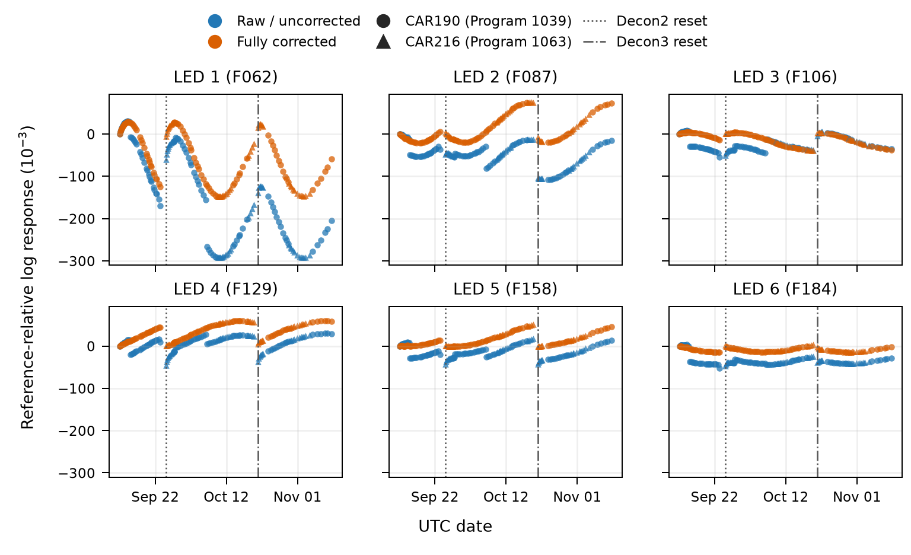
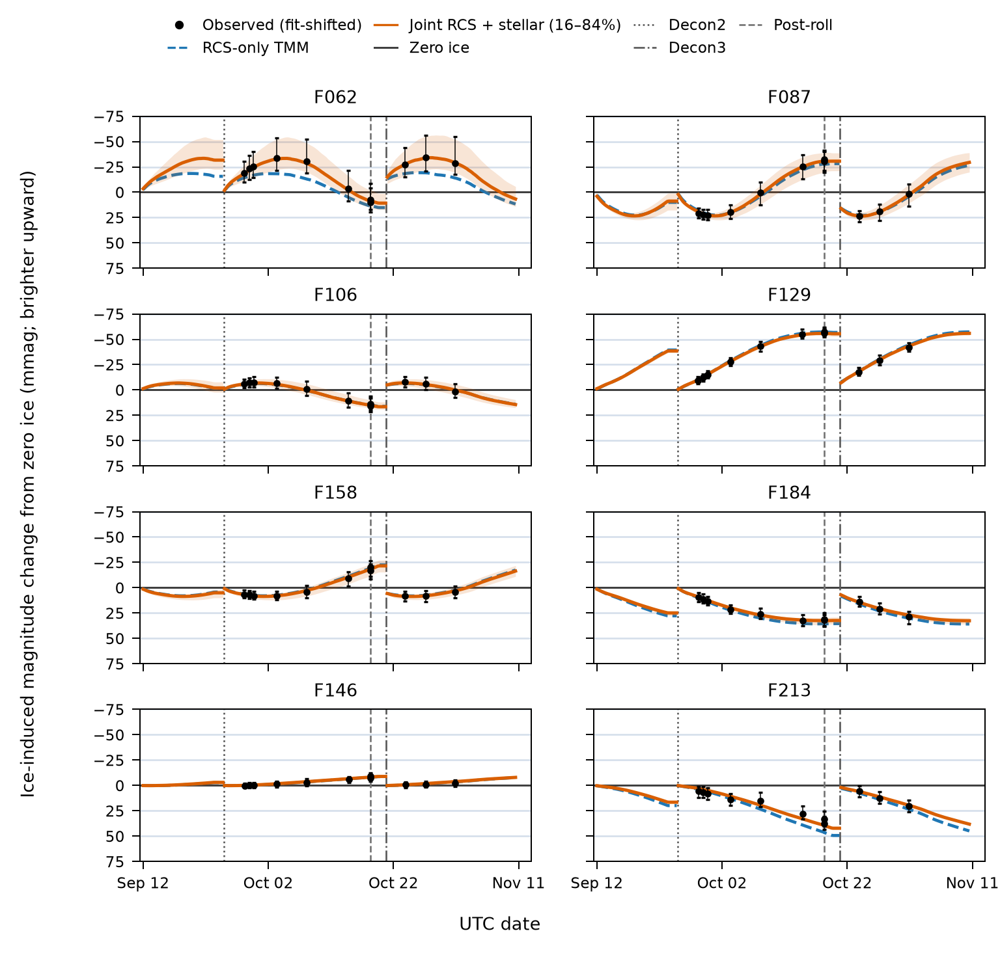

# WFI Ice-Deposition Methodology from RCS and Stellar Photometry

## 1. Introduction

Ice deposited onto the Nancy Grace Roman Space Telescope Wide Field Instrument
(WFI) detector surfaces forms a thin film that changes their wavelength-dependent
response through thin-film interference. Estimating how the ice thickness and
ice-deposition rate evolve during commissioning requires measurements with both
temporal cadence and spectral coverage.

The Relative Calibration System (RCS) repeatedly illuminates the detectors in
six narrow LED bands. Changes in the calibrated flat-field response provide a
high-cadence record of the evolving optical stack and its sensitivity to ice.
The RCS observations analyzed here come from Commissioning Activity Requests
(CARs) 190 and 216. CAR201 stellar photometry measures sources through eight
broad WFI filters, providing complementary wavelength information between and
around the LED bands. Together, these observations can constrain both the time
evolution of ice and the detector's broader spectral response.

This paper describes the observations and their reduction (Section 2), develops
the transfer-matrix method (TMM) optical stack and ice-deposition model
(Section 3), and presents the RCS-only TMM fit (Section 4) and Joint RCS + stellar
photometry fit (Section 5). Section 6 compares the resulting reconstructions
and discusses model limitations.

## 2. Observational Data and Reduction

Elapsed days throughout this paper are measured from the reference epoch
$t_0=$`2026-09-12T01:25:50.714 UTC`. Decon2 and Decon3 denote the second and
third spacecraft decontamination events; they reset the ice-history segments at
`2026-09-24T23:12:29.895 UTC` and `2026-10-20T20:34:44.531 UTC`, respectively
(elapsed days 12.90740 and 38.79785).

The analysis uses three distinct observational data sets. CAR190 and CAR216
are separate RCS programs; CAR201 supplies broad-band stellar photometry.

| Data set | Program | Measurement | Calibrated products and use |
| --- | --- | --- | --- |
| CAR190 | 1039 | Six-LED RCS observations | Use calibrated Level-2 WFI flats. Before Decon2, use the updated re-reduced CAR190 products available from the external S3 source; at and after Decon2, use MAST Level-2 products. Retain all CAR190 observations. |
| CAR216 | 1063 | Higher-cadence six-LED RCS cycles beginning at Decon2 | Use MAST Level-2 WFI flats. Retain complete six-LED cycles at four-hour cadence. |
| CAR201 | 1043 | Stellar WFI imaging photometry | Use MAST Level-2 images; this data set supplies broad-band constraints on detector response. |

### CAR190 RCS observations — Program 1039

All observations are calibrated Level-2 WFI flat exposures. MAST exposure
records provide observation times and programs; calibrated products are
selected using observation time. Before
Decon2 (the second decontamination), at elapsed day `12.90740` from
the first RCS observation, CAR190 uses re-reduced Level-2 products from the
external [Roman CAR190 S3 collection](s3://roman-s3-romcom/activities/CAR190/).
These products contain the updated calibration before it was available through
MAST. At and after Decon2, including CAR216 observations, the calibrated source
is the MAST Level-2 product.

### CAR216 RCS observations — Program 1063

CAR216 begins with the first RCS observation at the Decon2 boundary and uses
MAST Level-2 products. Its physical reset is at elapsed day `12.90740`, the
Decon2 epoch defined above.

### Shared RCS pixel-pair reduction

Both programs use the six RCS light-emitting diodes (LED1--LED6), with spectral
peaks near 623.5, 852.8, 1038.6, 1269.8, 1481.2, and 1670.2 nm. Their usable
spectra span approximately 480--2700 nm. The following pair selection,
corrections, and tile summaries apply to both programs.

For each detector and LED, measurements are referenced to that LED's first
exposure in time. A pixel pair is kept only if its data-quality (DQ) value is
zero in both images, both the reference and current unscaled counts are finite
and strictly positive, and the dark-subtracted photodiode signals used for
exposure scaling are positive. Any nonzero DQ value excludes the pair. There is
no additional rejection based on the size of a pixel's measured change, so
defects not flagged in DQ can remain.

For this analysis, each detector image is divided into 256-by-256-pixel tiles.
Each tile summarizes up to 65,536 native pixel pairs in its footprint. Retained
pixel-pair log changes are
summarized within each tile, LED, and exposure by the quantities defined
below. Each tile has its own fitted ice-thickness history.

For each retained pair, the uncorrected change is

$$
x_i^{\mathrm{raw}}(t) = \ln C_i(t) - \ln C_i(t_{\mathrm{ref}}).
$$

Photodiode scaling removes changes in LED output. A separate side-swap
correction adjusts the image counts and photodiode readings at the side
change. Both corrections are multiplicative count factors, or equivalently
additive offsets in log response. For each detector and LED, separate factors
are estimated for image counts and photodiode readings. Each factor is one
before the side-swap event. Let $f_{\mathrm{img}}(t)$ and
$f_{\mathrm{PD}}(t)$ denote these factors, and let $p(t)$ be the dark-subtracted
photodiode-2 signal. For each LED, $p_{\mathrm{ref}}$ is its first photodiode
measurement not marked as warm-up. The scale is $p_{\mathrm{ref}}/p(t)$. For
a reference/current pair, the combined log offset simplifies to

$$
c_{\mathrm{side}}(t)=
\ln\!\left[
\frac{f_{\mathrm{img}}(t)}{f_{\mathrm{PD}}(t)}
\frac{p(t_{\mathrm{ref}})}{p(t)}
\right],
\qquad
f_{\mathrm{img}}(t_{\mathrm{ref}})=f_{\mathrm{PD}}(t_{\mathrm{ref}})=1.
$$

The corrected pair value is $x_i^{\mathrm{side}}=x_i^{\mathrm{raw}}+c_{\mathrm{side}}$. The same first
non-warm-up photodiode reference is used across Programs 1039 (CAR190) and
1063 (CAR216). Image and photodiode side-swap factors are estimated separately
for each detector and LED; each factor is fit with a continuous spline and one
log-step at the side-swap boundary.

The reduction also corrects count changes for detector temperature and for
step changes in the overall signal level associated with the Alignment
Compensation Mechanism (ACM).
The temperature predictor is the detector electronics strap temperature,
averaged over five-minute intervals (telemetry channel
`WFI_MCE_ADC_WTSM00`). A fixed quadratic in log-count space is used for each
tile:

$$
c_T(T) = c_1\,(T-T_{\mathrm{ref}}) + c_2\,(T-T_{\mathrm{ref}})^2.
$$

Here $T_{\mathrm{ref}}$ is the operating-temperature reference. The temperature
correction is zero at $T_{\mathrm{ref}}$ and is applied equally to all six LEDs for a
tile. ACM steps are constant log-count offsets beginning at identified event
times. Some offsets are shared across all LEDs; others are LED-specific. The
decontamination boundaries start new physical ice-thickness-history segments,
as described in Section 3.

For each tile, LED, and observation group, let $N$ be the valid-pair count and
define the raw sufficient statistics $S=\sum_{i=1}^{N}x_i^{\mathrm{raw}}$ and
$Q=\sum_{i=1}^{N}(x_i^{\mathrm{raw}})^2$. An accumulated per-LED
reference-relative log offset $c$ transforms these statistics directly:

$$
S' = S + Nc, \qquad Q' = Q + 2cS + Nc^2.
$$

For this analysis, observations are selected at four-hour cadence and grouped
into 256-pixel tiles. All CAR190 observations are retained; from the
higher-cadence CAR216 sequence, complete six-LED cycles are selected. Each
selected observation remains a separate time sample.
Elapsed days for the ice-thickness histories and CAR201 observations are
measured from $t_0$ defined at the start of this section.

Photodiode/side-swap, temperature-gain, and ACM corrections are applied during
data reduction before the corrected group statistics are formed. Their
coefficients enter the optical fit as fixed inputs.

#### Correction terms and timing

The raw reference-relative statistics are computed from unscaled detector
counts after valid pixel-pair selection. The reduction then applies
three groups of count-space corrections. UTC event times below are shared
across the WFI detectors; the correction factors are estimated at detector,
tile, or LED level as specified.

| Correction group | What is corrected | Timing |
| --- | --- | --- |
| Photodiode scaling and side-swap | PD2 scaling removes LED-output changes using the first non-warm-up reading per LED. Separate image-count and photodiode factors correct the readout-side change with a continuous spline and log-step. | PD2 scaling is applied per exposure. Fitted side-swap boundaries span 2026-10-06 08:07--08:18 UTC across LEDs. |
| Temperature-dependent sensitivity | A fixed per-tile quadratic in five-minute `WFI_MCE_ADC_WTSM00` corrects pairwise log-count changes for temperature and is applied equally to all LEDs when telemetry is available. | Applied exposure by exposure and anchored at the reference temperature. |
| ACM signal-level steps | Additive log-count offsets correct shared-grey or LED-specific changes. | Shared-grey steps: 2026-09-14 23:52 and 2026-09-23 08:49 UTC; per-LED steps: 2026-09-27 15:10 and 2026-10-04 04:54 UTC; shared-grey step: 2026-10-09 04:49 UTC. |

Decon2 and Decon3 set the physical ice-thickness-history reset boundaries
described in Section 3.

### CAR201 WFI Photometry and Source Matching

CAR201 WFI photometry is derived from MAST Level-2 calibrated images in Program
1043. Stellar fluxes are measured with forced apertures at known source
positions on all 18 detectors, including initial and post-roll positions. The
measurements cover filters F062, F087, F106, F129, F158, F184, F146, and F213.

The source list comes from Gaia Data Release 3 (DR3): a 0.75-degree-radius
circle centered at right ascension 294.3170 degrees and declination 46.3557
degrees, with Gaia `G` magnitudes from 13 inclusive to 21.5
exclusive. No Gaia temperature is required. The magnitude limit is in Gaia G,
not a Roman WFI filter. The query contains 85,297 sources; 52,173 are in the
fainter `19 <= G < 21.5` subset. The sky region and input catalogues therefore
set the sample's source coverage.

For the fainter stars, Pan-STARRS DR2 mean point-spread-function (PSF)
photometry is matched to Gaia positions within one arcsecond. Gaia positions are
propagated from epoch 2016 to an approximate Pan-STARRS epoch of 2012 using Gaia
proper motions where available; missing proper motions are flagged. A
Pan-STARRS measurement is rejected if multiple counterparts lie within one
arcsecond or the same counterpart is assigned to another Gaia source, including
a brighter source. Unlike the one-arcsecond uniqueness test, the separate
brighter-neighbor veto is approximate and cannot guarantee that every ambiguous
association is detected.

Two Micron All Sky Survey (2MASS) point-source matches use Gaia positions
propagated to each candidate observation date. A match must be within one
arcsecond, have no other 2MASS candidate within two arcseconds, and not be
shared with another Gaia source. 2MASS quality flags are used to exclude
individual band measurements.

Brighter stars (`13 <= G < 19`) use Gaia and 2MASS photometry, without
Pan-STARRS. Their 2MASS measurements are restricted to quality flags A--C and
uncertainties below 0.2 mag. Every star in this bright subset has at least
three usable Gaia-band measurements.

For the faint-star SED fits, a photometric measurement must have a finite
magnitude and finite positive uncertainty. The catalog retains single-detection
Pan-STARRS measurements and does not impose an upper cut on their ordinary
photometric uncertainties. A faint-star 2MASS band is used only with an
accepted quality flag, valid uncertainty, and no contamination flag. The
poor-profile-fit `E` flag is retained but recorded. Upper-limit `U` measurements
are not used as detections, and `F` or `X` values do not supply a usable
measurement and error. A 2MASS uncertainty value of 8 mag or larger is treated
as a catalogue flag rather than a statistical uncertainty. These checks exclude
individual bands; they do not remove the source from the SED sample.

For the joint ice fit, measurements are matched by source, filter, and visit.
The first eleven visits through 31 October 2026 are used. These visits comprise
Execution Plan 3 (EP3) passes 1--6 and Execution Plan 4
(EP4) passes 1--5. The roll separates EP4 pass 1 from pass 2; Figure 5 marks the
median timestamp of the first post-roll pass, `2026-10-18T09:39:36.654 UTC`.
Observations with
the Roman `DO_NOT_USE` bit (mask value 1) or `SATURATED` bit (mask value 2)
set are excluded. A source is excluded entirely if any of its measurements is
saturated; other DQ bits do not trigger exclusion. Retained rows must have finite magnitudes and positive finite photometric uncertainties.
Each source/filter group must have at least two visits, and each star must
have a successful spectral-energy distribution (SED)
estimate as described below.

Each detector uses its own Roman WFI v8 effective-area curve, which describes
the fraction of incident light detected at each wavelength. The curves are
published in the [Roman Space Telescope technical-information repository,
revision 14a9b0c98b0da723d0f2e4c6277956183c1fdd06](https://github.com/RomanSpaceTelescope/roman-technical-information/tree/14a9b0c98b0da723d0f2e4c6277956183c1fdd06).
Each detector's curve is tabulated over its full nonzero support on a 5 nm
wavelength grid for wavelength-dependent photometric weighting.


**Figure 1. Spectral coverage of the RCS and stellar observations.** (a) Six
RCS LED spectra,
shown relative to each LED's peak and truncated below the five-percent cutoff
used in the RCS integral. (b) WFI02 effective-area curves for the eight imaging
filters, each normalized to its own peak. (c) Illustrative photon spectrum for
a K-type star observed on WFI02 (Gaia DR3 source 2128134408017300864;
$T_{\mathrm{eff}}=4861\,\mathrm{K}$, $\log g=1.96$), reconstructed from its
posterior-median stellar parameters and normalized to its peak. The vertical
markers show the six LED centers. Independent peak normalization in each panel
emphasizes the relative wavelength coverage.



**Figure 2. Net effect of the RCS count-space correction sequence.** Each panel
shows one LED for WFI02 tile 135. Blue points are uncorrected reference-relative
log responses from unscaled detector counts; orange points are the same matched
exposures after photodiode/side-swap, temperature-gain, and ACM corrections.
Circles mark CAR190 (Program 1039); triangles mark CAR216 (Program 1063).
The separation of the colored series shows the net change introduced by the
preprocessing sequence. Dotted and dash-dot vertical lines mark the Decon2 and
Decon3 ice resets, respectively.

### Stellar SED Estimation

Each star is fit with a grid of PHOENIX/BT-Settl stellar-atmosphere spectra to
estimate its wavelength-dependent spectral energy distribution (SED). Dust
attenuation follows the Fitzpatrick (1999) extinction law, with the
total-to-selective extinction ratio $R_V=3.1$ fixed; extinction $A_V$ is fit
for each star. Model fluxes are integrated through Gaia EDR3,
Pan-STARRS, and 2MASS response curves. Gaia DR3 measurements use EDR3 passbands
and zero points.

The fit varies five parameters: effective temperature (3000--10,000 K),
surface gravity ($\log g$, base-10 logarithm in cm/s$^2$, from 0 to 5.5),
metallicity (-1 to $+0.5$ dex relative to solar), visual extinction $A_V$
(0--4 mag), and overall flux normalization.
These bounds and priors strongly influence fits with few usable bands. Every
source with at least one usable measurement is fit; faint sources with one or
two bands are flagged as weakly constrained, with their SED estimates largely
determined by the priors.

The SED fits use nested sampling (`dynesty`), which maintains 80 active samples
(called live points) and stops when the estimated remaining log evidence is
below 1 ($\mathrm{dlogz}=1$). The resulting posterior draws are approximate. Each
fitted star has 128 draws. A draw is a complete extincted spectrum, retaining
correlations between wavelengths. A 0.03 mag floor is applied to photometric
magnitude uncertainties to account for calibration and model error. After
magnitudes are converted to fluxes, photometric uncertainties are treated as
independent and Gaussian.

The SED posterior conditions on the Fitzpatrick extinction law and selected
atmosphere-model family, with uncertainty represented through the fitted
stellar parameters. For each star, the joint forward model reconstructs one
photon spectrum from the posterior-median parameters and the BT-Settl grid. The
128 posterior draws are used to obtain those medians, but predictions are not
averaged over the draws; SED-parameter uncertainty is not propagated into the
photometric likelihood. The likelihood does include the reported photometric
uncertainties and fitted detector-level excess scatter. Within the 52,173-star
faint subset ($19\le G<21.5$), 50,445 stars lack usable 2MASS detections, and
1,441 have only one or two usable photometric bands across Gaia, Pan-STARRS, and
2MASS combined. These sparse-band SED constraints depend strongly on the
adopted atmosphere and extinction models.

#### Independent Spectrum Checks

As an external check of the SED reconstruction, three example stars from Pal's
stellar-spectra catalogue were compared with their fitted BT-Settl spectra and
Gaia and 2MASS measurements. Pal's comparison spectra were intrinsic, so the
estimated extinction was applied before comparing with observed photometry.
Pal's catalogue supplied Gaia-band extinction $A_G$, which was approximately
converted to $A_V$ using a model spectrum and the Fitzpatrick law. The spectra
were integrated through the corresponding bandpasses. The results were broadly
similar, with differences in some bands. Two stars were also checked against
linked BOSZ atmosphere models: their input flux, catalogued radius, and distance
reproduced the supplied intrinsic spectra to a maximum fractional difference
below $4\times10^{-10}$. This is a qualitative cross-check of the fitted stellar
spectra.

## 3. Physical Model of Ice Deposition

An ice film changes the optical phase accumulated by light traveling through
the detector's surface layers. Reflections from the layer boundaries then
interfere, making the detector response depend on both ice thickness and
wavelength. The TMM represents this layered optical system; the
ice-thickness-history model describes how the film thickness changes between
observations and resets.

### TMM Optical Stack and Response

For each tile, the optical stack is

```text
air -> ice -> antireflection (AR) layer 1 -> AR layer 2 -> AR layer 3
     -> optically thick mercury-cadmium-telluride (HgCdTe)
```

The transfer-matrix method (TMM) calculates the amplitude and phase of
reflected light through the layers at the wavelengths sampled by each source
spectral energy distribution (SED). The unmodulated, ice-free reference
stack's complex amplitude reflection coefficient is denoted
$r_{\mathrm{TMM},k}(\lambda)$. The complex
refractive index is written $n+i k$: $n$ describes refraction and $k$ describes
absorption. The model
assumes:

- three independent AR layers;
- lossless AR layers, with $k=0$ fixed;
- light arrives perpendicular to the detector surface;
- RCS integration weighted by the measured LED energy spectra;
- wavelength samples spanning approximately `480--2700 nm`;
- 80 K reference optical constants for HgCdTe with composition $x=0.445$,
  treated as optically thick.

For incident admittance $Y_0$ and HgCdTe substrate admittance $Y_s$, let
$(U,V)$ be the transfer-boundary pair after the ice layer and the three AR
layers. The TMM substrate power is

$$
P_{\mathrm{sub}}=\operatorname{Re}\!\left(\frac{Y_s}{Y_0}\right)
\left|\frac{2Y_0}{Y_0U+V}\right|^2.
$$

For the ice-free reference stack, let
$P_{\mathrm{sub}}^{\mathrm{ice\text{-}free}}(\lambda)$ be the substrate power
with the ice layer removed. Adding ice of thickness $d$ changes the
transfer-boundary pair and produces
$P_{\mathrm{sub}}^{\mathrm{ice}}(\lambda,d)$. Their ratio describes the
wavelength-dependent response change caused by ice:

$$
\mathcal{R}_{k}^{\mathrm{RCS}}(\lambda,d)=
\frac{P_{\mathrm{sub},k}^{\mathrm{ice}}(\lambda,d)}
     {P_{\mathrm{sub},k}^{\mathrm{ice\text{-}free}}(\lambda)}.
$$

This monochromatic ratio connects the physical stack to the RCS measurement.
The LED energy spectrum weights the response across its finite wavelength band.
The six RCS LED spectral-energy distributions are external data; they come from
the 2024-Oct-25 sRCS Personality Table, sheet “LED Spectrum”. Each band's
relative output is normalized to its peak, and samples below five percent of
that peak are excluded. For LED $\ell$, the band-integrated response is

$$
\begin{aligned}
\bar{\mathcal{R}}_{k,\ell}^{\mathrm{RCS}}(d)
&=\frac{\int S_{\ell}^{\mathrm{LED}}(\lambda)
P_{\mathrm{sub},k}^{\mathrm{ice}}(\lambda,d)\,d\lambda}
{\int S_{\ell}^{\mathrm{LED}}(\lambda)
P_{\mathrm{sub},k}^{\mathrm{ice\text{-}free}}(\lambda)\,d\lambda},\\
m^0_{k,\ell}(t)
&=\ln\bar{\mathcal{R}}_{k,\ell}^{\mathrm{RCS}}(d_{k,s(t)}(t))
-\ln\bar{\mathcal{R}}_{k,\ell}^{\mathrm{RCS}}(d_{k,0}(t_{\mathrm{ref},\ell})).
\end{aligned}
$$

Here $S_{\ell}^{\mathrm{LED}}$ is the measured LED energy spectrum,
$t_{\mathrm{ref},\ell}$ is that LED's first observation, and $s(t)$ denotes the
reset segment containing $t$. Thus $m^0_{k,\ell}$ is the TMM-predicted log
change before the fitted reset correction described below.

The optical properties of the AR coating, HgCdTe substrate, and deposited ice
are parameterized separately.

#### Antireflection-Layer Parameters

Each tile has two fitted parameters per antireflection layer: thickness and
real refractive index. The bounds are:

- Thickness coordinate: $0.01\le\tau_j\le10$; physical thickness is
  $d_j=100\tau_j\,\mathrm{nm}$, for layers $j=1,2,3$.
- Refractive index: $1\le n_1\le4$; for layers $j=2,3$,
  $n_{j-1}\le n_j\le4$.
- Absorption index: $k_j=0$ for all three layers.

The coating prior is centered on a three-layer starting design at `1050 nm`,
with optical thickness near one quarter of that wavelength and a geometric
sequence of indices based on nominal HgCdTe $n=3.6$. Thicknesses and indices
are mapped to bounded fit coordinates; prior widths and physical bounds are
given with the RCS-only TMM fitting procedure.

#### HgCdTe Parameters

Each tile has independent positive wavelength-independent scales for the
reference HgCdTe optical constants, plus smooth wavelength-dependent
corrections:

$$
\begin{aligned}
n(\lambda) &= n_{\mathrm{ref}}(\lambda)\,\exp\!\left(\alpha_n+\delta_n(\lambda)\right),\\
k(\lambda) &= k_{\mathrm{ref}}(\lambda)\,\exp\!\left(\alpha_k+\delta_k(\lambda)\right).
\end{aligned}
$$

Here $\alpha_n$ and $\alpha_k$ are constant log scales, and $\delta_n(\lambda)$
and $\delta_k(\lambda)$ are smooth spectral adjustments. The corresponding
priors are given for RCS-only TMM. These are effective
optical-model parameters describing uncertainty in the adopted material model.

#### Spectral Corrections to Optical Constants

The deterministic MAP fit allows broad log-space adjustments to AR $n$,
HgCdTe $n$, and HgCdTe $k$. The three AR layers have independent spectral
modulations:

$$
n_{\mathrm{AR},j}(\lambda)=n_{\mathrm{AR},j,0}
\exp[\delta_{n,\mathrm{AR},j}(\lambda)],\qquad j=1,2,3.
$$

Each AR-layer modulation and each HgCdTe modulation is a sum of six broad
Gaussian curves centered near

```text
624, 853, 1039, 1270, 1481, 1670 nm
```

with width `500 nm`. Subtracting the value at `1050 nm` makes each adjustment
zero at the AR design wavelength. Their role in the initial optical fit and
coefficient priors are described in Section 4.

#### Ice Optical Index and Incidence

The baseline ice refractive index is $n=1.25+i0$. RCS-only TMM fits one
positive wavelength-independent ice-index scale per tile. Joint RCS + stellar
holds the RCS-only TMM optical state fixed. Ice is modeled as lossless, with
$k=0$, at normal incidence.

The optical model gives the detector response for a specified ice thickness.
This response is combined with a time-dependent ice-deposition model to predict
its evolution in the RCS observations.

### Tile Ice-Deposition Rate and Thickness-History Model

Each detector tile has an independent ice-thickness history. Ice deposits onto
the detector surface at a positive instantaneous ice-deposition rate. At each
observation-time node $t_i$, $q_i$ is the logarithm of that rate, measured in
nm/day. The ice-deposition rate at that node is positive by construction:

$$
\dot d_i=\exp(q_i).
$$

The log ice-deposition rate is interpolated linearly between time nodes. Within
reset segment $s$, integrating this rate gives the ice-thickness history in
RCS-only TMM:

$$
d_{k,s}(t)=d_{0,k,s}+\int_{t_s}^{t}\exp[\widetilde q_{k,s}(u)]\,du,
$$

where $t_s$ and $d_{0,k,s}$ are that segment's start time and fitted starting
ice thickness. The integral is evaluated interval by interval with 8-point
Gauss-Legendre quadrature. Each tile has an independent ice-deposition-rate
trajectory.

At each decontamination, a new ice-thickness-history segment starts with its
own fitted initial ice thickness. The physical reset epochs are given in
Section 2 (elapsed days 12.90740 and 38.79785).

The third decontamination was brief, so the model does not assume that all ice
was removed. A nonzero post-event ice thickness can represent residual ice that
remained on the detector or ice deposited again soon after the event.

The likelihood includes a wavelength-independent grey correction
$\gamma_{k,s}$ for each reset segment, added to the observed group mean and set
to zero in the reference segment. For tile $k$, this correction corresponds to
a multiplicative response factor $\exp(\gamma_{k,s})$.

### RCS Sufficient Statistics and Likelihood

The RCS fit uses corrected per-tile sufficient statistics. Photodiode,
side-swap, temperature, and ACM corrections are represented in these inputs to
the optical-fit likelihood. Physical decontamination boundaries define the
ice-thickness-history segments. For each tile, LED, and observation group,
the reduction retains:

- $N$: valid pixel-pair count;
- $S'$: corrected sum of pixel log changes;
- $Q'$: corrected sum of squared pixel log changes.

These sums are sufficient to reconstruct the exact Gaussian squared error for
any model prediction for that tile, LED, and observation group.

The observed group mean is $y=S'/N$. Let $m^0_{kg}$ denote the predicted
reference-relative log change from the band-integrated TMM response. The fitted
reset correction $\gamma_{k,s}$ is added to the observed group mean for reset
segment $s$ (and is zero in the reference segment), so the within-group
residual sum of squares is

$$
\mathrm{SSE}=Q'-\frac{(S')^2}{N}+N(m^0-y-\gamma_{k,s})^2.
$$

The first group for each LED is the reference. The forward model compares the
current response with that LED's first observation. Although the parameterization
supports optional per-LED log offsets on non-reference groups, these offsets are
fixed to zero in the production RCS-only TMM fits (see the Section 4 parameter
table).

The parameter-dependent part of the RCS negative log-likelihood (Gaussian
loss), omitting terms constant across model predictions, is

$$
\mathcal{L}_{\mathrm{RCS}}=
\frac{1}{2\sigma_{\log}^2}\sum_{k,g}
w_{kg}\,N_{kg}
\left[m^0_{kg}(\theta)-y_{kg}-\gamma_{k,s(g)}\right]^2.
$$

Here $k$ indexes tiles, $g$ indexes LED/observation groups,
$y_{kg}=S'_{kg}/N_{kg}$
is the corrected observed mean, $m^0_{kg}$ is the TMM-predicted log change from
that LED's first observation, and $\gamma_{k,s(g)}$ is the fitted grey reset
correction for the segment containing group $g$. The log-response noise scale is
$\sigma_{\log}=0.005$. The weights $w_{kg}$ set the relative influence of each
group. In RCS-only TMM,
$w_{kg}=1/(N_{\mathrm{tile}}\widetilde N)$, where $N_{\mathrm{tile}}$ is the
number of fitted tiles and $\widetilde N$ is the median valid-pixel count
across all groups. The Joint RCS + stellar likelihood uses the alternative per-tile
median-count weights defined in Section 5.

The RCS-only TMM MAP objective adds Gaussian prior penalties:

$$
\mathcal{J}_{\mathrm{RCS-only}}(\theta)=
\mathcal{L}_{\mathrm{RCS}}+
\frac{1}{2}\sum_j\left(\frac{\eta_j-\mu_j}{s_j}\right)^2.
$$

Here $\eta_j$ is a fitted parameter in its prior coordinate, with prior center
$\mu_j$ and standard deviation $s_j$. The exact SSE separates into the
data-only within-group scatter $Q'-(S')^2/N$ and the model-dependent residual
term including the fitted reset correction.

## 4. RCS-only TMM Model

The RCS-only model uses the six LED time series to fit the full optical stack
and each tile's ice-thickness history. It estimates the AR and HgCdTe properties,
ice-index scale, spectral adjustments, and per-tile deposition trajectories
together. The EMCEE search and constant-rate initialization below are fitting
stages of this model.

The full-stack transfer matrix is evaluated while the optical state is being
fit. Once an optical state is fixed, trajectory evaluation interpolates
precomputed per-LED TMM response curves over ice thickness rather than
re-evaluating the transfer matrix at every time node.

### RCS-only TMM Priors and Bounds

The model's parameterization, priors, and fixed conventions are:

| Quantity | RCS-only TMM parameterization, prior, or fixed convention |
| --- | --- |
| AR thickness and real $n$ | Fit per tile within the physical bounds above; broad Gaussian around the 1050 nm quarter-wave design, standard deviation `10` in bounded coordinates |
| AR absorption $k$ | Fixed at zero |
| HgCdTe $n$ and $k$ scales | Independent positive scales per tile; zero-centered normal priors in log scale, standard deviation `0.25` |
| AR $n$ (independent for each layer) and HgCdTe $n,k$ spectral adjustments | Six broad Gaussian wavelength modes anchored at 1050 nm; separate mode coefficients per AR layer; zero-centered normal priors in log scale, standard deviation `0.10` |
| Ice real-index scale | Positive, wavelength-independent scale per tile; zero-centered normal prior in log scale, standard deviation `0.01` |
| Ice absorption $k$ and incidence | Ice $k=0$; normal incidence |
| Initial and ordinary reset ice thickness | Positive per tile and reset segment; lognormal with median `10 nm` and log standard deviation `1.5` |
| Post-Decon3 starting ice thickness | Positive per tile; lognormal with median `10 nm` and log standard deviation `1.5` |
| Ice deposition rate | Positive, independent trajectory per tile; lognormal with median `12 nm/day` and log standard deviation `1.5` |
| Post-reset response offset $\gamma_{k,s}$ | One wavelength-independent log correction per tile and reset; zero-centered normal prior, standard deviation `0.1` |
| Per-LED log offset | Fixed at zero |

The AR prior width is specified in bounded fit coordinates.

### EMCEE Search and MAP Optimization

For observed data $D$ and model parameters $\theta$, the maximum a posteriori
(MAP) estimate maximizes the posterior density, balancing agreement with the
RCS measurements against the parameter priors listed above:

$$
\widehat{\theta}_{\mathrm{MAP}}
=\arg\max_{\theta}p(\theta\mid D)
=\arg\max_{\theta}p(D\mid\theta)\,p(\theta).
$$

The EMCEE ensemble search begins with a constant-in-time ice-deposition rate,
reducing the trajectory dimension while it explores the posterior over the
optical stack, ice thicknesses, and deposition rate. High-posterior states
identify promising likelihood basins. The best scalar rate is copied to every
time node to initialize the non-parametric trajectory. The deterministic MAP
fit then optimizes the full optical state and independent per-tile ice histories
together against the RCS likelihood, with priors regularizing weakly constrained
parameters.

The RCS-only TMM MAP fit uses bounded trust-region reflective nonlinear least
squares. Parameters are scaled by their prior widths so optical, thickness, and
deposition-rate coordinates enter the optimization on comparable scales.
Convergence is assessed from objective-change and parameter-step criteria; the
scaled-gradient norm is reported separately. Instrumental corrections enter
through the corrected sufficient statistics, and each tile's ice-thickness
history is estimated independently.

## 5. Joint RCS + Stellar Photometry Model

### Motivation

The RCS measurements provide high-cadence constraints on ice evolution, but
their spectral coverage is limited to six LED bands. Stellar photometry from
CAR201 provides complementary measurements across eight broad filters, allowing
the wavelength-dependent detector response to be constrained between and beyond
the LED bands. The joint model starts from the optical state and ice histories
fitted by the RCS-only model. It adds a smooth spectral modulation of the ice-free
complex reflection and refines the ice histories jointly against both data sets.
The modulation is propagated through the ice layer when predicting measured
counts.

### Joint RCS + stellar forward model

For detector $d$, tile $k$, and wavelength $\lambda$, the modulated ice-free
reflection is

$$
\begin{aligned}
r_{\mathrm{mod},d,k}(\lambda)
  &=r_{\mathrm{TMM},d,k}(\lambda)
    \exp\!\left[g_d(\lambda)+i\phi_d(\lambda)\right],\\
g_d(\lambda)&=\sum_{j=1}^{15}a_{d,j}B_j(\lambda),\\
\phi_d(\lambda)&=\sum_{j=1}^{15}p_{d,j}B_j(\lambda).
\end{aligned}
$$

The basis functions $B_j$ are shared by tiles on detector $d$ and are defined
below. Here $r_{\mathrm{TMM}}$ denotes the unmodulated, ice-free TMM reflection;
the modulation specifies its wavelength-dependent change. At each tile's ice
thickness, the modulated ice-free reflection sets the ice-layer input admittance
$Y_{\mathrm{mod}}=Y_0(1-r_{\mathrm{mod}})/(1+r_{\mathrm{mod}})$. The fitted
ice-free reference-stack transfer normalization and substrate admittance $Y_s$
remain fixed. Let $U_{0,k}(\lambda)$ be the first component of that fitted
clean-stack transfer boundary. The input pair for the ice-layer transfer
matrix is $(U_{0,k},U_{0,k}Y_{\mathrm{mod}})$; applying the ice matrix gives
$(U_{\mathrm{ice,mod}},V_{\mathrm{ice,mod}})$. The resulting substrate power is

$$
P_{\mathrm{sub},k}^{\mathrm{ice,mod}}(\lambda,d_k(t))=
\operatorname{Re}\!\left(\frac{Y_s}{Y_0}\right)
\left|\frac{2Y_0}{Y_0U_{\mathrm{ice,mod}}+V_{\mathrm{ice,mod}}}\right|^2.
$$

For CAR201, the wavelength-dependent relative substrate response is

$$
\mathcal{R}_{d,k}(\lambda,t)=
\frac{P^{\mathrm{ice,mod}}_{\mathrm{sub},d,k}(\lambda,d_k(t))}
     {P^{\mathrm{ice\text{-}free}}_{\mathrm{sub},d,k}(\lambda)}.
$$

The numerator is substrate power after the modulated ice-free reflection has
been propagated through ice of thickness $d_k(t)$; the denominator is the
fixed, unmodulated, ice-free TMM substrate power. For star $s$, filter $f$, and
visit $v$, the band-integrated model rate and reference-visit-relative
magnitude prediction are

$$
\begin{aligned}
I_{sfv}&=\int S_s^{\mathrm{ph}}(\lambda)
 A_{df}(\lambda)\,\mathcal{R}_{d,k(s,f,v)}(\lambda,t_v)\,d\lambda,\\
\widehat{\Delta m}_{sfv}
  &=-\frac{2.5}{\ln 10}\ln\!\left(\frac{I_{sfv}}{I_{sfv_0}}\right).
\end{aligned}
$$

The fixed reference visit $v_0$ is EP3 pass 1 for every star/filter group. The
band integral weights the relative substrate response by the stellar photon
spectrum and detector-specific effective area. The RCS term compares each
LED's energy-weighted TMM response with that LED's first observation.

#### Spectral-Modulation Basis Specification

This subsection defines the basis functions, bounds, and regularizers for the
joint ice-free-reflection adjustment.

The basis functions $B_j$ are fixed, dimensionless functions of wavelength
$\lambda$ (in nanometers); their knots and shapes are defined directly in
$\lambda$. The normalized inverse-wavelength coordinate evaluates the
regularization terms. The functions span the interval over which the detector's
effective area is nonzero.
For detector $d$, define eight ordered wavelength knots: the blue and red
ends of that interval, with the six LED centers between them,

$$
\kappa_0=\lambda_{\min,d},\qquad
\kappa_i=\lambda_{\mathrm{LED},i}\ (i=1,\ldots,6),\qquad
\kappa_7=\lambda_{\max,d}.
$$

There are seven gap modes, one in each interval between adjacent knots,
including the two end intervals:

$$
G_\ell(\lambda)=
\begin{cases}
\sin^2\!\left(\pi\dfrac{\lambda-\kappa_{\ell-1}}
{\kappa_\ell-\kappa_{\ell-1}}\right),
&\kappa_{\ell-1}\le\lambda\le\kappa_\ell,\\
0,&\text{otherwise},
\end{cases}
\qquad \ell=1,\ldots,7.
$$

Each gap mode is zero at both knots and reaches one at the interval midpoint.
Six raised-cosine nodal modes are centered on the LEDs. For LED knot
$i=1,\ldots,6$, its mode rises from zero at the preceding knot to one at the
LED, then falls to zero at the next knot:

$$
H_i(\lambda)=
\begin{cases}
\dfrac{1}{2}\left[1-\cos\!\left(\pi\dfrac{\lambda-\kappa_{i-1}}
{\kappa_i-\kappa_{i-1}}\right)\right],
&\kappa_{i-1}\le\lambda<\kappa_i,\\
\dfrac{1}{2}\left[1+\cos\!\left(\pi\dfrac{\lambda-\kappa_i}
{\kappa_{i+1}-\kappa_i}\right)\right],
&\kappa_i\le\lambda\le\kappa_{i+1},\\
0,&\text{otherwise}.
\end{cases}
$$

The remaining two raised-cosine endpoint modes take value one at their
detector-specific support edge, taper to zero at the nearest LED, and remain
at one outside the support:

$$
H_0(\lambda)=
\begin{cases}
1,&\lambda\le\kappa_0,\\
\dfrac{1}{2}\left[1+\cos\!\left(\pi\dfrac{\lambda-\kappa_0}
{\kappa_1-\kappa_0}\right)\right],&\kappa_0<\lambda<\kappa_1,\\
0,&\lambda\ge\kappa_1,
\end{cases}
\qquad
H_7(\lambda)=
\begin{cases}
0,&\lambda\le\kappa_6,\\
\dfrac{1}{2}\left[1-\cos\!\left(\pi\dfrac{\lambda-\kappa_6}
{\kappa_7-\kappa_6}\right)\right],&\kappa_6<\lambda<\kappa_7,\\
1,&\lambda\ge\kappa_7.
\end{cases}
$$

The 15 functions in the modulation equation are ordered as
$B_j=G_j$ for $j=1,\ldots,7$, $B_8=H_0$ (blue endpoint), $B_9=H_7$
(red endpoint), and $B_{9+i}=H_i$ for LED $i=1,\ldots,6$. Thus the
LED-centered coefficient directly sets $g_d$ or $\phi_d$ at that LED center;
the gap modes add independent smooth variation between knots. The LED centers
are:

```text
LED centers (nm): 623.521, 852.803, 1038.585,
                  1269.758, 1481.241, 1670.169.
```

All modes join continuously with zero slope at their knots. Log-amplitude
coefficients are bounded by +/-0.30 for gap and LED modes and +/-0.60 at the
endpoints. Phase coefficients are bounded by +/-1 radian.

The amplitude relative-entropy and amplitude/phase curvature penalties
regularize wavelength-dependent spectral structure. The phase-coefficient term
applies quadratic shrinkage to each phase coefficient. Their numerical
definitions and weights are given with the joint objective below.

#### RCS and Stellar Photometry Data Terms

For the RCS observations from CAR190 (Program 1039) and CAR216 (Program 1063),
the modulated thin-film model predicts an energy-weighted response for each
tile, LED, and observation. Its predicted log change is differenced against
the LED's reference and compared with the corrected sufficient statistics in
the RCS Sufficient Statistics and Likelihood section. Valid-pixel counts
determine the Gaussian weights in the RCS likelihood.

The band integral and reference-visit normalization are defined above. A post-roll
log-response offset $\zeta_f$ is added to the model response. The reference
group has $\zeta_{f,0}=0$; one offset per filter is fitted for the post-roll
group. For this data set the reference group contains EP3 passes 1--6 and EP4
pass 1; the fitted post-roll offsets apply to
EP4 passes 2--5. Each offset is fitted within bounds `+/-0.25`.

Photometric residuals use a Student-$t$ likelihood with four degrees of freedom.
Let $\sigma_{i,\mathrm{phot}}$ be the reported photometric measurement
uncertainty for measurement $i$, in millimagnitudes. Each detector $d$ also has
one fitted detector-level excess photometric scatter term
$\sigma_{\mathrm{det},d}$, in millimagnitudes. Their combination gives the
effective width used for each measurement:

$$
\sigma_{i,\mathrm{eff}}=
\sqrt{\sigma_{i,\mathrm{phot}}^2+\sigma_{\mathrm{det},d}^2}.
$$

The fitted $\sigma_{\mathrm{det},d}$ is shared across all valid photometry rows
on detector $d$. The Student-$t$ likelihood gives large residuals less weight
than a Gaussian likelihood while retaining the reported photometric uncertainty
for well-fitting observations. The detector's modulation coefficients and tile
ice-thickness histories are fitted against both data sets.

#### Joint RCS + stellar Ice-History Refinement

Each tile begins with the ice-thickness history fitted to RCS measurements
alone. That history is evaluated at all RCS and stellar observation times and
then refined jointly. In each reset segment $s$, the starting thickness is
multiplied by $\exp(\delta d_{0,k,s})$. The baseline ice-deposition rate is
multiplied by $\exp(\delta q_{k,s,j})$, with the log multipliers interpolated
at two-day control points. These exponential factors keep thickness and rate
positive. Reset times stay fixed and the post-reset response offsets are
retained.

The log deposition-rate factors and reset-segment starting-thickness
adjustments are centered on the starting RCS-derived ice-thickness history.
Their prior widths and bounds are listed in the Joint RCS + stellar parameter
table below. Each tile has an independent thickness history.

The numerical construction is interval-based. The starting ice-thickness
history is linearly interpolated to each CAR201 visit time within its reset segment. Between
successive times in the union of RCS and CAR201 visits, the nonnegative
baseline thickness increment is multiplied by the exponential of the linearly
interpolated log deposition-rate controls
evaluated at that interval's midpoint. For a segment spanning $T$ days, the
number of controls is $J_s=\max(2,\lceil T/2\rceil+1)$; their knots are evenly
spaced from its first to last baseline time. Segment starts are scaled by a
positive exponential adjustment, with controls evaluated within each segment.

The RCS LED measurements provide the starting histories and also enter the
Joint RCS + stellar likelihood, so the RCS comparison is in-sample. The two-day adjustment
spacing, observation cadence, measurement sensitivity, and priors limit the
temporal detail the fit can resolve.

#### Joint RCS + stellar: Priors and Bounds

| Quantity | Parameterization | Prior, bounds, or fixed convention |
| --- | --- | --- |
| Joint log-amplitude coefficients $a_{d,j}$ | Shared by tiles on a detector; gap/LED and endpoint coefficients | Bounds `+/-0.30` and `+/-0.60`, respectively; relative-entropy and curvature penalties below |
| Joint phase coefficients $p_{d,j}$ | Shared by tiles on a detector | Bounds `+/-1 rad`; coefficient-shrinkage penalty below |
| Joint segment-start thickness adjustments $\delta d_{0,k,s}$ | Log adjustments about the starting RCS-derived ice-thickness history, per tile and segment | Zero-centered normal prior; standard deviation `1.5`, except `0.10` after the third decontamination; optimizer bounds $\pm\ln(4)$ |
| Joint rate multipliers $\delta q_{k,s,j}$ | Per-tile log multipliers on baseline deposition, with at-most-two-day knot spacing | Zero-centered normal prior, standard deviation `1.5`; optimizer bounds $\pm\ln(4)$ |
| Post-reset response offsets | Fixed from the starting RCS-derived ice-thickness history; one per tile and reset | Retained at their RCS-only MAP values |
| Post-roll offset $\zeta_f$ | One log-response offset per filter; zero in the pre-roll group | Fitted within bounds `+/-0.25` |
| Star/filter location $\mu_{sf}$ | Robust residual location profiled separately for every star/filter group | Profiled under the Student-$t$ likelihood |
| Detector-level excess photometric scatter $\sigma_{\mathrm{det},d}$ | One positive scatter term per detector, added in quadrature to reported photometric uncertainty | Fitted within bounds $10^{-4}$--$100$ mmag |

#### Joint RCS + stellar Objective

The Joint RCS + stellar objective combines the RCS and stellar-photometry data
terms with its regularization penalties:

$$
\mathcal{J}_{\mathrm{joint}}=
\mathcal{L}_{\mathrm{RCS}}+
\mathcal{L}_{\mathrm{phot}}+
\mathcal{P}_{\mathrm{ice}}+
\mathcal{P}_{\mathrm{entropy}}+
\mathcal{P}_{\mathrm{curvature}}+
\mathcal{P}_{\mathrm{phase}}.
$$

Joint RCS + stellar uses the same group-mean Gaussian RCS loss defined in the RCS
Sufficient Statistics and Likelihood section, with joint-fit weight
$w_{kg}=1/\widetilde N_k$ and
$\widetilde N_k=\operatorname{median}_g(N_{kg})$ for each tile. Thus each
group's residual is weighted by its valid-pixel count relative to that tile's
median.

For measurement $i=(s,f,v)$, let $y_i$ be the observed magnitude change in
millimagnitudes after subtracting the median for its star/filter group. The
modeled change, including the fitted post-roll offset, is

$$
\widehat m_{sfv}=-1000\frac{2.5}{\ln 10}
\left[\ln\!\left(\frac{I_{sfv}}{I_{sfv_0}}\right)+\zeta_{f,r(v)}\right],
\qquad \zeta_{f,0}=0,
$$

where $r(v)$ is the reference/post-roll group. The residual also includes a
profiled star/filter location $\mu_{sf}$:

$$
e_i=y_i-\widehat m_{sfv}-\mu_{sf}.
$$

The nuisance brightness $\mu_{sf}$ is profiled separately for each
star/filter group under the Student-$t$ likelihood. This profiled location
absorbs the constant difference between the median-centered observed changes
and the $v_0$-referenced model changes, so the residuals do not depend on the
choice of reference visit.

The effective Student-$t$ width is

$$
\sigma_{i,\mathrm{eff}}=
\sqrt{\sigma_{i,\mathrm{phot}}^2+\sigma_{\mathrm{det},d}^2},
$$

where $\sigma_{i,\mathrm{phot}}$ is the reported photometric measurement
uncertainty and $\sigma_{\mathrm{det},d}$ is the fitted detector-level excess
photometric scatter. With fixed degrees-of-freedom $\nu=4$, the photometry term
is

$$
\mathcal{L}_{\mathrm{phot}}=
\sum_{i\in\mathrm{valid}}
\left[
\ln\sigma_{i,\mathrm{eff}}+\frac{\nu+1}{2}
\ln\!\left(1+\frac{e_i^2}{\nu\sigma_{i,\mathrm{eff}}^2}\right)
\right].
$$

The expression above is the parameter-dependent Student-$t$ negative
log-likelihood (NLL); terms constant across model predictions are omitted. The
detector-level excess photometric scatter uses the bounds in the Joint RCS +
stellar parameter table.

Let $\delta d_{0,k,s}$ be the log adjustment to the starting ice thickness for
tile $k$ and reset segment $s$, and let $\delta q_{k,s,j}$ be the log
ice-deposition-rate multiplier at its two-day control point $j$. With prior
widths $\tau_s$ and $\sigma_{\delta q}$ from the Joint RCS + stellar parameter
table, their prior penalty is

$$
\mathcal{P}_{\mathrm{ice}}=
\frac{1}{2}\sum_{k,s}\left(\frac{\delta d_{0,k,s}}{\tau_s}\right)^2+
\frac{1}{2}\sum_{k,s,j}\left(\frac{\delta q_{k,s,j}}{\sigma_{\delta q}}\right)^2.
$$

These parameters adjust the starting RCS-derived ice-thickness history and its
ice-deposition-rate trajectory.

The amplitude regularization favors a unit multiplier and integrates over
normalized inverse wavelength $u$. For detector $d$, this coordinate and its
inverse are

$$
u_d(\lambda)=
\frac{\lambda^{-1}-\lambda_{\max,d}^{-1}}
{\lambda_{\min,d}^{-1}-\lambda_{\max,d}^{-1}},
\qquad
\lambda_d(u)=
\left[\lambda_{\max,d}^{-1}
+u\left(\lambda_{\min,d}^{-1}-\lambda_{\max,d}^{-1}\right)\right]^{-1}.
$$

Thus $u=0$ is the red support edge and $u=1$ is the blue edge. In the two
regularization integrals below, $g_d(u)$ and $\phi_d(u)$ are the wavelength-
domain curves evaluated at $\lambda_d(u)$; the basis knots and functions are
unchanged. The phase-coefficient penalty acts directly on the fitted
coefficients.

$$
\mathcal{P}_{\mathrm{entropy}}=
1890.6\int_0^1
\left[e^{g_d(u)}g_d(u)-\left(e^{g_d(u)}-1\right)\right]du.
$$

The curvature penalty limits rapid variation in log-amplitude $g_d(u)$ and
phase $\phi_d(u)$ as functions of inverse wavelength:

$$
\mathcal{P}_{\mathrm{curvature}}=
\frac{0.01}{2}\int_0^1
\left[
\left(\frac{g_d''(u)}{0.30}\right)^2+
\left(\frac{\phi_d''(u)}{1\,\mathrm{rad}}\right)^2
\right]du.
$$

The entropy integral is evaluated by trapezoidal quadrature; curvature is
estimated by second finite differences on the same uniform 513-point $u$ grid.
For a fit to detector $d$, the phase-coefficient penalty is

$$
\mathcal{P}_{\mathrm{phase}}=200\sum_{j=1}^{15}p_{d,j}^2.
$$

This ridge penalty is equivalent to the original coefficient-wise
zero-padded second-difference form, since
$\Delta^2(0,p_{d,j},0)=-2p_{d,j}$:

$$
\frac{100}{2}\sum_{j=1}^{15}
\left[\Delta^2(0,p_{d,j},0)\right]^2
=200\sum_{j=1}^{15}p_{d,j}^2.
$$

The joint objective combines this term with the curvature and entropy penalties
and the two likelihood terms.

The inverse-wavelength entropy strength `1890.6` was calibrated by matching
its penalty to the earlier coefficient-wise MaxEnt penalty at the WFI01
starting fit. The curvature strength `0.01` was selected through WFI01
fixed-ice sensitivity tests of its effect on predicted photometry and then
applied uniformly. The phase strength `100` sets the coefficient-shrinkage
penalty; these three values control the regularization terms.

The final Joint RCS + stellar objective is minimized directly as a scalar function using
bounded L-BFGS-B.

## 6. Results and Discussion

We illustrate the model in detail with detector WFI02 and representative tile
135, then summarize performance across all 18 WFI detectors in Appendix A. On
WFI02, the joint fit improves in-sample agreement with RCS and reduces CAR201
residual scatter, most strongly in F062 and F213.

### RCS likelihood scale and residual correlation

The fixed log-response scale is $\sigma_{\log}=0.005$ (5.0 millilog units).
It is an effective scale for the count-weighted likelihood, not the sampling
error of an independent-pixel tile mean. In the corrected RCS statistics, the
median within-group pixel standard deviation is $6.17\times10^{-3}$ in log
response (10th--90th percentile: $5.66\times10^{-3}$--$7.27\times10^{-3}$),
with a median of 64,753 valid pixel pairs per group. If those pixels were
independent, the standard error of a group mean would be only
$2.42\times10^{-5}$; the post-fit residuals are appreciably larger, consistent
with shared pixel-level and time-dependent structure.

The fit-residual summaries exclude each LED's first, reference observation.
NMAD is $1.4826$ times the median absolute deviation about the residual median.
Across the 18 detectors, the median detector-level RCS-only group-mean RMSE is
$0.714\times10^{-3}$ and the median NMAD is $0.511\times10^{-3}$ (detector
ranges $0.625$--$1.282$ and $0.433$--$0.893$, respectively, in units of
$10^{-3}$ log response). For the joint fit, the corresponding medians are
$0.671\times10^{-3}$ and $0.481\times10^{-3}$, with detector ranges
$0.597$--$1.272$ and $0.422$--$0.886$. The weighted $\chi^2$ divided by the
number of non-reference tile/LED observations has a median of 0.0203 for
RCS-only TMM (detector range 0.0155--0.0699) and 0.0179 for the joint fit
(0.0142--0.0690). These values are diagnostics, not reduced-$\chi^2$ estimates:
successive non-reference residuals within each tile/LED series are strongly
autocorrelated, with a median lag-one correlation of 0.79 across detectors
(detector medians 0.63--0.86).

Thus, $\sigma_{\log}=0.005$ is comparable to the observed within-group pixel
scatter while remaining several times larger than the post-fit residuals of
the tile means. The low $\chi^2$ per observation is consistent with this
conservative effective scale and correlated residuals; it does not imply that
the independent-pixel standard error is an adequate likelihood width. The
residual correlation also cautions against interpreting the very large number
of tile/epoch groups as an equal number of independent constraints.

### RCS ice-thickness histories and fit agreement


**Figure 3. Ice-thickness history and ice-deposition rate for representative
WFI02 tile 135.** The upper panel compares the constant-rate preliminary fit (dashed
purple), RCS-only TMM (blue), and Joint RCS + stellar (orange). The lower panel
shows the corresponding ice-deposition rates; the Joint RCS + stellar rate is
the derivative of its fitted
ice-thickness history evaluated on a dense date grid.
Dotted and dash-dot vertical lines mark Decon2 and Decon3, respectively; model
curves are drawn separately across each reset. The displayed trajectories are MAP estimates.

The rate curve has a brief peak of roughly 18--21 nm/day just after Decon2 and
a smaller peak near 14--15 nm/day after Decon3, compared with roughly
9--10 nm/day over much of the trajectory. These are local MAP estimates from the
derivative of each reset-segment thickness history, not separate measurements
of an instantaneous physical rate. The model does not resolve whether the peaks
reflect rapid post-event reaccumulation or sensitivity of the piecewise
trajectory near reset boundaries.


**Figure 4. RCS data and fits for WFI02 tile 135.** Each panel shows one LED.
Black points with error bars are corrected group-mean log responses; the purple
dashed curve shows the constant-rate preliminary fit and the blue curve shows RCS-only
TMM. The orange curve shows Joint RCS + stellar, using the fitted
complex-reflection adjustment and jointly refined tile ice-thickness history.
It is an in-sample prediction because the same RCS observations enter Joint
RCS + stellar.
Model curves are evaluated on a denser date grid and split at the Decon2 and
Decon3 resets.

### CAR201 data and predictions

Figure 5 compares visit-level CAR201 observations with RCS-only TMM and Joint
RCS + stellar predictions across the eight filters. For likelihood comparisons,
define $\Delta\bar{\ell}_{J-R}=\bar{\ell}_{\mathrm{joint}}-
\bar{\ell}_{\mathrm{RCS-only}}$; positive values favor the joint fit. CAR201
differences are per valid measurement and use the Student-$t$ likelihood with
the same reported uncertainties and joint-fit detector scatter for both
predictions; star/filter locations are profiled separately. RCS differences
are per LED/tile/observation group and equal half the RCS-only minus joint
weighted $\chi^2$. These are data-likelihood comparisons, not full MAP
objectives including priors and regularization.



**Figure 5. CAR201 data and model predictions for WFI02.** The panels show
all eight filters and all 33,645 valid measurements from 604 stars in the WFI02
joint-fit sample, summarized by visit. Black points and error bars show the
median and 16th--84th percentile range of observed median-centered magnitude
changes across stars; model summaries at each visit use the same observed-star
cohort. For this display, the fitted post-roll offset is
transferred from the model predictions to the observed values with the
compensating sign, preserving the comparison residuals. The blue dashed curve
is the RCS-only TMM prediction using the RCS-derived ice-thickness histories;
the orange curve and band show Joint RCS + stellar using the
jointly refined histories and fitted spectral modulation. The model curves omit
the post-roll term.
Star/filter locations are profiled separately for each model. Dotted and dash-dot
vertical lines mark Decon2 and Decon3, respectively; the dashed line marks the
post-roll transition.
Between visits, model curves are evaluated on a 0.25-day grid using the nearest
available pass for each source's tile assignment and split at the Decon2 and
Decon3 resets.

| Filter | $N$ | No-ice-correction reference NMAD (mmag) | RCS-only TMM NMAD (mmag) | Joint NMAD (mmag) | $\Delta\bar{\ell}_{J-R}$/obs |
| --- | ---: | ---: | ---: | ---: | ---: |
| F062 | 4,211 | 12.92 | 7.72 | 6.15 | +0.210 |
| F087 | 4,206 | 14.76 | 4.82 | 4.32 | +0.095 |
| F106 | 4,207 | 7.74 | 3.96 | 3.92 | +0.006 |
| F129 | 4,204 | 20.32 | 3.58 | 3.49 | +0.010 |
| F158 | 4,207 | 6.63 | 3.59 | 3.52 | +0.012 |
| F184 | 4,201 | 10.96 | 4.39 | 4.24 | +0.025 |
| F146 | 4,204 | 3.68 | 2.47 | 2.47 | -0.0001 |
| F213 | 4,205 | 11.22 | 7.98 | 6.69 | +0.226 |

**Table 1. WFI02 CAR201 residual metrics.** The no-ice-correction reference
applies no modeled ice-response correction, so its predicted reference-relative
change is zero; physical ice is present on the detector.
NMAD (mmag) is $1.4826$ times the
median absolute deviation after profiling per-star/filter locations.
$\Delta\bar{\ell}_{J-R}$/observation is Joint RCS + stellar minus RCS-only TMM
$\nu=4$ Student-$t$ data log likelihood; positive favors Joint RCS + stellar.
Both predictions use the same
roll-adjusted photometry and reported photometric uncertainties, with the
detector-level excess photometric scatter held at its joint-fit estimate.
Locations are profiled separately for each model. These are in-sample results.

| LED/filter | Groups | RCS-only TMM $\chi^2$/group | Joint $\chi^2$/group | $\Delta\bar{\ell}_{J-R}$/group |
| --- | ---: | ---: | ---: | ---: |
| 1/F062 | 34,816 | 0.05679 | 0.04371 | +0.006542 |
| 2/F087 | 34,816 | 0.05076 | 0.04219 | +0.004285 |
| 3/F106 | 34,816 | 0.01280 | 0.01054 | +0.001127 |
| 4/F129 | 34,816 | 0.01935 | 0.01909 | +0.000130 |
| 5/F158 | 34,816 | 0.01771 | 0.01522 | +0.001247 |
| 6/F184 | 34,560 | 0.01098 | 0.00880 | +0.001093 |

**Table 2. WFI02 RCS likelihood by LED.** Values are production-weighted
$\chi^2$/group across 256 tiles. $\Delta\bar{\ell}_{J-R}$ is the joint minus
RCS-only TMM log likelihood per group, equal to half the RCS-only TMM minus
Joint RCS + stellar $\chi^2$ per group; positive favors Joint RCS + stellar.
These are in-sample.

Across 208,640 RCS groups, weighted $\chi^2$ falls from 5,860.2 to 4,856.3
($\Delta\log L_{J-R}=+501.9$). Across 33,645 CAR201 measurements, the joint
photometric log-likelihood gain is $+2,457.3$. Relative to the no-ice-correction
reference, the RCS-only fit lowers NMAD in all eight filters. The joint fit adds
the largest reductions at F062 (20\%) and F213 (16\%); F146 is essentially
unchanged. These in-sample metrics summarize the improvement and remaining
residual scatter for WFI02; the 2.47–6.69 mmag NMAD is not a calibrated
prediction interval.

The wavelength pattern in Table 1 is consistent with Figure 6, where the joint
modulation differs most from RCS-only TMM at the blue and red support edges and
in the 700--800 nm gap between LED1 and LED2. F062 extends blueward of LED1
(623.5 nm), while F213 lies redward of LED6 (1670.2 nm); these filters add
broad-band constraints where the RCS-only response is extrapolated beyond the
LED anchors and show the largest residual improvements. By contrast, broad
F146 overlaps LED3--LED6, so its integrated response is already anchored by
several RCS bands and averages over local spectral structure; its NMAD is
essentially unchanged.


**Figure 6. Effect of Joint RCS + stellar spectral modulation on the ice-free complex
reflection.** The panels show the amplitude and unwrapped phase of the ice-free
reflection for representative WFI02 tile 135, for RCS-only TMM (blue dashed)
and Joint RCS + stellar after spectral modulation (orange). Both use the
optical state fitted by RCS-only TMM. The Joint RCS + stellar modulation
multiplies the unmodulated ice-free reflection by
$\exp[g(\lambda)+i\phi(\lambda)]$. The
horizontal axes show reciprocal wavelength and wavelength over the 470--2335 nm
effective-area support. The phase branches are aligned at the longest
wavelength, retaining the fitted phase shift. Both curves are MAP spectra of
the ice-free reflection.

## Appendix A. Detector Comparison: RCS-only TMM and Joint RCS + stellar

The likelihood convention defined above applies throughout this appendix; a
positive $\Delta\bar{\ell}_{J-R}$ favors the joint fit. Across all detectors,
the joint fit has higher total CAR201 and RCS data log likelihood than
RCS-only TMM. CAR201 NMAD is lower in 127 of 144 detector/filter combinations,
with at least five improved filters on every detector. RCS weighted $\chi^2$
is lower in 93 of 108 detector/LED groups.

The no-ice-correction reference sets the modeled ice-response correction to
zero while physical ice is present. Relative to this reference,
the RCS-only fit lowers NMAD in all 144 detector/filter combinations. Across
detectors, median relative decreases are largest at F129 (80.0%) and F087
(73.5%). Relative to RCS-only TMM, the joint fit lowers NMAD in 127/144
combinations, with the largest median decreases at the bluest filter F062
(21.5%) and reddest filter F213 (16.5%). Pooled mean log-likelihood gains per
CAR201 measurement are also largest at F062 (+0.225) and F213 (+0.201); F087
is next (+0.116).
WFI02 illustrates the overall direction: its CAR201 NMAD is lower in seven of
eight filters, all six RCS LED weighted $\chi^2$ values improve, and its CAR201
log-likelihood gain is close to the detector median. Its RCS log-likelihood
gain is the largest per-group gain among the 18 detectors, about 2.4 times the
cross-detector median.

| Detector | Filter | $N$ | No-ice-correction NMAD (mmag) | RCS-only TMM NMAD (mmag) | Joint NMAD (mmag) | $\Delta\bar{\ell}_{J-R}$/obs |
| --- | --- | ---: | ---: | ---: | ---: | ---: |
| WFI01 | F062 | 4,597 | 14.96 | 9.32 | 7.62 | +0.18572 |
|  | F087 | 4,601 | 33.74 | 5.49 | 5.03 | +0.05818 |
|  | F106 | 4,603 | 5.73 | 4.51 | 4.48 | +0.00982 |
|  | F129 | 4,605 | 17.54 | 4.47 | 4.36 | +0.01685 |
|  | F146 | 4,601 | 7.20 | 2.98 | 2.97 | +0.00824 |
|  | F158 | 4,604 | 12.07 | 4.18 | 4.11 | +0.01398 |
|  | F184 | 4,604 | 8.49 | 5.36 | 5.45 | -0.00699 |
|  | F213 | 4,604 | 16.08 | 7.84 | 6.75 | +0.13829 |
| WFI02 | F062 | 4,211 | 12.92 | 7.72 | 6.15 | +0.20994 |
|  | F087 | 4,206 | 14.76 | 4.82 | 4.32 | +0.09453 |
|  | F106 | 4,207 | 7.74 | 3.96 | 3.92 | +0.00648 |
|  | F129 | 4,204 | 20.32 | 3.58 | 3.49 | +0.01015 |
|  | F146 | 4,204 | 3.68 | 2.47 | 2.47 | -0.00009 |
|  | F158 | 4,207 | 6.63 | 3.59 | 3.52 | +0.01185 |
|  | F184 | 4,201 | 10.96 | 4.39 | 4.24 | +0.02547 |
|  | F213 | 4,205 | 11.22 | 7.98 | 6.69 | +0.22573 |
| WFI03 | F062 | 4,576 | 8.96 | 7.06 | 5.65 | +0.20461 |
|  | F087 | 4,574 | 12.01 | 4.96 | 3.89 | +0.23156 |
|  | F106 | 4,566 | 4.44 | 3.38 | 3.32 | +0.00846 |
|  | F129 | 4,562 | 15.32 | 3.31 | 3.16 | +0.03723 |
|  | F146 | 4,552 | 3.06 | 2.22 | 2.15 | +0.03909 |
|  | F158 | 4,556 | 4.90 | 3.06 | 3.05 | +0.00857 |
|  | F184 | 4,564 | 9.97 | 4.46 | 3.98 | +0.11316 |
|  | F213 | 4,573 | 8.85 | 8.02 | 6.39 | +0.27459 |
| WFI04 | F062 | 4,568 | 12.81 | 8.25 | 5.92 | +0.27906 |
|  | F087 | 4,564 | 23.55 | 4.37 | 4.17 | +0.04559 |
|  | F106 | 4,564 | 7.81 | 3.66 | 3.39 | +0.05057 |
|  | F129 | 4,568 | 17.46 | 3.49 | 3.26 | +0.03120 |
|  | F146 | 4,549 | 3.35 | 2.30 | 2.20 | +0.03268 |
|  | F158 | 4,560 | 6.58 | 3.30 | 3.18 | +0.02832 |
|  | F184 | 4,560 | 10.14 | 3.94 | 3.93 | +0.00225 |
|  | F213 | 4,556 | 12.77 | 6.77 | 5.55 | +0.20086 |
| WFI05 | F062 | 4,240 | 10.67 | 7.11 | 5.54 | +0.22710 |
|  | F087 | 4,247 | 21.08 | 3.94 | 3.67 | +0.06096 |
|  | F106 | 4,250 | 6.26 | 3.45 | 3.46 | +0.00680 |
|  | F129 | 4,248 | 16.82 | 3.11 | 3.04 | +0.00868 |
|  | F146 | 4,245 | 3.38 | 2.03 | 2.03 | -0.00173 |
|  | F158 | 4,250 | 6.01 | 2.96 | 2.88 | +0.01188 |
|  | F184 | 4,246 | 9.26 | 4.05 | 3.88 | +0.01797 |
|  | F213 | 4,249 | 11.59 | 6.83 | 5.64 | +0.22590 |
| WFI06 | F062 | 4,468 | 9.78 | 7.52 | 5.50 | +0.29405 |
|  | F087 | 4,482 | 11.57 | 5.33 | 3.80 | +0.31330 |
|  | F106 | 4,485 | 4.43 | 3.41 | 3.26 | +0.02970 |
|  | F129 | 4,493 | 16.97 | 3.55 | 3.17 | +0.08273 |
|  | F146 | 4,492 | 3.77 | 2.44 | 2.20 | +0.12218 |
|  | F158 | 4,498 | 5.01 | 3.05 | 2.94 | +0.02830 |
|  | F184 | 4,492 | 12.18 | 4.18 | 3.84 | +0.05528 |
|  | F213 | 4,492 | 9.94 | 7.79 | 5.85 | +0.35416 |
| WFI07 | F062 | 3,800 | 11.22 | 7.13 | 5.94 | +0.18376 |
|  | F087 | 3,818 | 23.90 | 4.12 | 3.86 | +0.04588 |
|  | F106 | 3,806 | 5.63 | 3.39 | 3.30 | +0.02925 |
|  | F129 | 3,787 | 15.26 | 3.17 | 3.04 | +0.01587 |
|  | F146 | 3,779 | 3.56 | 2.02 | 2.00 | +0.00488 |
|  | F158 | 3,771 | 6.97 | 3.03 | 2.98 | +0.01856 |
|  | F184 | 3,792 | 7.46 | 3.98 | 3.81 | +0.02223 |
|  | F213 | 3,805 | 11.70 | 6.57 | 5.17 | +0.23187 |
| WFI08 | F062 | 4,454 | 9.42 | 7.10 | 5.27 | +0.28040 |
|  | F087 | 4,462 | 15.50 | 3.97 | 3.78 | +0.03696 |
|  | F106 | 4,463 | 5.52 | 3.32 | 3.29 | +0.01261 |
|  | F129 | 4,463 | 16.77 | 3.12 | 3.08 | +0.01444 |
|  | F146 | 4,459 | 3.52 | 2.04 | 2.04 | +0.00545 |
|  | F158 | 4,460 | 6.25 | 2.94 | 2.88 | +0.01068 |
|  | F184 | 4,460 | 10.83 | 3.83 | 3.79 | +0.01662 |
|  | F213 | 4,460 | 12.48 | 7.07 | 5.29 | +0.32156 |
| WFI09 | F062 | 3,157 | 10.52 | 6.71 | 5.31 | +0.18798 |
|  | F087 | 3,156 | 18.56 | 4.57 | 3.61 | +0.18504 |
|  | F106 | 3,155 | 4.89 | 3.21 | 3.26 | -0.00747 |
|  | F129 | 3,159 | 14.51 | 3.17 | 3.01 | +0.04292 |
|  | F146 | 3,153 | 3.70 | 2.09 | 1.92 | +0.08140 |
|  | F158 | 3,152 | 6.43 | 2.86 | 2.81 | +0.02669 |
|  | F184 | 3,144 | 8.57 | 3.82 | 3.80 | +0.00567 |
|  | F213 | 3,155 | 9.69 | 6.48 | 5.44 | +0.20315 |
| WFI10 | F062 | 4,436 | 12.67 | 8.67 | 6.68 | +0.24208 |
|  | F087 | 4,441 | 24.53 | 5.03 | 4.74 | +0.02697 |
|  | F106 | 4,439 | 7.89 | 4.46 | 4.35 | +0.01250 |
|  | F129 | 4,435 | 20.13 | 4.17 | 4.12 | +0.00963 |
|  | F146 | 4,440 | 4.62 | 3.03 | 2.94 | +0.01046 |
|  | F158 | 4,440 | 7.79 | 4.10 | 4.05 | +0.01292 |
|  | F184 | 4,442 | 13.36 | 5.47 | 5.23 | +0.02531 |
|  | F213 | 4,448 | 17.33 | 6.76 | 6.19 | +0.06512 |
| WFI11 | F062 | 4,111 | 11.26 | 7.33 | 5.98 | +0.19174 |
|  | F087 | 4,111 | 16.96 | 4.67 | 4.26 | +0.05606 |
|  | F106 | 4,109 | 6.04 | 3.59 | 3.63 | -0.00229 |
|  | F129 | 4,114 | 18.72 | 3.40 | 3.34 | +0.01157 |
|  | F146 | 4,112 | 3.34 | 2.35 | 2.36 | +0.00108 |
|  | F158 | 4,110 | 5.93 | 3.31 | 3.26 | +0.01021 |
|  | F184 | 4,107 | 12.81 | 4.28 | 4.28 | -0.00082 |
|  | F213 | 4,104 | 12.31 | 7.44 | 5.82 | +0.24378 |
| WFI12 | F062 | 4,448 | 9.94 | 7.35 | 5.45 | +0.29628 |
|  | F087 | 4,448 | 18.00 | 5.14 | 3.76 | +0.34994 |
|  | F106 | 4,450 | 5.79 | 3.19 | 3.25 | -0.00865 |
|  | F129 | 4,452 | 15.02 | 3.06 | 2.98 | +0.02637 |
|  | F146 | 4,453 | 2.94 | 2.10 | 2.06 | +0.02504 |
|  | F158 | 4,457 | 5.49 | 2.91 | 2.83 | +0.01538 |
|  | F184 | 4,457 | 9.74 | 3.68 | 3.66 | +0.02214 |
|  | F213 | 4,455 | 10.20 | 6.30 | 5.12 | +0.19872 |
| WFI13 | F062 | 4,137 | 11.79 | 7.56 | 5.65 | +0.25182 |
|  | F087 | 4,134 | 14.60 | 4.23 | 3.93 | +0.04094 |
|  | F106 | 4,118 | 5.77 | 3.41 | 3.36 | +0.00544 |
|  | F129 | 4,122 | 21.10 | 3.39 | 3.34 | +0.01888 |
|  | F146 | 4,110 | 3.61 | 2.28 | 2.26 | +0.00584 |
|  | F158 | 4,123 | 5.63 | 3.33 | 3.21 | +0.02421 |
|  | F184 | 4,125 | 13.57 | 3.99 | 4.00 | +0.00022 |
|  | F213 | 4,124 | 15.12 | 6.15 | 5.27 | +0.13951 |
| WFI14 | F062 | 4,174 | 11.50 | 7.60 | 5.59 | +0.26886 |
|  | F087 | 4,174 | 14.75 | 4.61 | 3.79 | +0.15738 |
|  | F106 | 4,179 | 7.26 | 3.49 | 3.46 | +0.00415 |
|  | F129 | 4,178 | 19.36 | 3.05 | 3.02 | +0.00971 |
|  | F146 | 4,174 | 2.99 | 1.99 | 2.01 | +0.00325 |
|  | F158 | 4,178 | 5.84 | 3.06 | 2.98 | +0.01595 |
|  | F184 | 4,187 | 12.13 | 4.13 | 4.12 | +0.00298 |
|  | F213 | 4,182 | 13.46 | 5.77 | 5.10 | +0.12791 |
| WFI15 | F062 | 4,352 | 8.35 | 6.65 | 5.45 | +0.16852 |
|  | F087 | 4,349 | 14.34 | 4.10 | 3.78 | +0.07408 |
|  | F106 | 4,350 | 4.77 | 3.22 | 3.17 | +0.00298 |
|  | F129 | 4,335 | 17.31 | 3.09 | 2.96 | +0.03270 |
|  | F146 | 4,331 | 3.82 | 2.02 | 2.01 | +0.00950 |
|  | F158 | 4,334 | 4.63 | 2.87 | 2.78 | +0.01158 |
|  | F184 | 4,324 | 13.39 | 3.84 | 3.85 | -0.00185 |
|  | F213 | 4,326 | 11.89 | 5.98 | 4.97 | +0.18878 |
| WFI16 | F062 | 4,435 | 10.37 | 6.73 | 4.93 | +0.27322 |
|  | F087 | 4,424 | 19.02 | 3.61 | 3.44 | +0.03038 |
|  | F106 | 4,431 | 4.33 | 3.29 | 3.20 | +0.01899 |
|  | F129 | 4,430 | 19.16 | 2.99 | 2.83 | +0.02931 |
|  | F146 | 4,430 | 4.13 | 2.01 | 1.94 | +0.03058 |
|  | F158 | 4,430 | 5.37 | 3.06 | 2.81 | +0.05501 |
|  | F184 | 4,424 | 12.94 | 3.71 | 3.74 | -0.00342 |
|  | F213 | 4,422 | 15.01 | 6.12 | 5.18 | +0.17511 |
| WFI17 | F062 | 3,926 | 9.50 | 6.81 | 6.01 | +0.12658 |
|  | F087 | 3,923 | 16.53 | 4.53 | 4.23 | +0.10113 |
|  | F106 | 3,925 | 4.23 | 3.87 | 4.03 | +0.03755 |
|  | F129 | 3,925 | 18.65 | 3.74 | 3.59 | +0.09215 |
|  | F146 | 3,917 | 4.91 | 2.54 | 2.76 | +0.04810 |
|  | F158 | 3,925 | 6.28 | 3.63 | 3.61 | +0.02909 |
|  | F184 | 3,927 | 10.39 | 4.65 | 5.02 | -0.00981 |
|  | F213 | 3,923 | 13.54 | 6.39 | 5.80 | +0.14124 |
| WFI18 | F062 | 3,575 | 11.46 | 6.64 | 5.83 | +0.13861 |
|  | F087 | 3,573 | 28.26 | 4.65 | 3.89 | +0.17893 |
|  | F106 | 3,572 | 5.47 | 3.71 | 3.68 | +0.05488 |
|  | F129 | 3,562 | 9.48 | 3.63 | 3.34 | +0.10570 |
|  | F146 | 3,558 | 3.50 | 2.32 | 2.34 | +0.11484 |
|  | F158 | 3,557 | 8.39 | 3.37 | 3.23 | +0.07156 |
|  | F184 | 3,557 | 6.45 | 4.39 | 4.69 | +0.00919 |
|  | F213 | 3,551 | 11.30 | 6.16 | 5.54 | +0.14646 |

**Table A1. CAR201 residual metrics by detector and filter.** Detector labels
appear once at the start of each eight-filter block. The no-ice-correction
reference applies zero modeled ice-response correction while physical ice is
present. NMAD columns are in mmag; $N$ is the valid measurement count.
$\Delta\bar{\ell}_{J-R}$/obs is Joint RCS + stellar minus RCS-only TMM Student-$t$
log likelihood per measurement; positive favors Joint RCS + stellar. The same
reported photometric uncertainties and detector-level excess scatter are used
for both predictions, with star/filter locations profiled separately. These are
in-sample comparisons.

| Detector | LED | Filter | Groups | RCS-only TMM $\chi^2$/group | Joint $\chi^2$/group | $\Delta\bar{\ell}_{J-R}$/group |
| --- | ---: | --- | ---: | ---: | ---: | ---: |
| WFI01 | 1 | F062 | 34,816 | 0.07328 | 0.05840 | +0.007439 |
|  | 2 | F087 | 34,816 | 0.02492 | 0.02654 | -0.000811 |
|  | 3 | F106 | 34,816 | 0.01340 | 0.01292 | +0.000239 |
|  | 4 | F129 | 34,816 | 0.01083 | 0.01006 | +0.000388 |
|  | 5 | F158 | 34,816 | 0.00683 | 0.00638 | +0.000220 |
|  | 6 | F184 | 34,560 | 0.01032 | 0.00728 | +0.001518 |
| WFI02 | 1 | F062 | 34,816 | 0.05679 | 0.04371 | +0.006542 |
|  | 2 | F087 | 34,816 | 0.05076 | 0.04219 | +0.004285 |
|  | 3 | F106 | 34,816 | 0.01280 | 0.01054 | +0.001127 |
|  | 4 | F129 | 34,816 | 0.01935 | 0.01909 | +0.000130 |
|  | 5 | F158 | 34,816 | 0.01771 | 0.01522 | +0.001247 |
|  | 6 | F184 | 34,560 | 0.01098 | 0.00880 | +0.001093 |
| WFI03 | 1 | F062 | 34,816 | 0.03479 | 0.03355 | +0.000619 |
|  | 2 | F087 | 34,816 | 0.03768 | 0.03263 | +0.002524 |
|  | 3 | F106 | 34,816 | 0.00821 | 0.00597 | +0.001119 |
|  | 4 | F129 | 34,816 | 0.01092 | 0.01174 | -0.000408 |
|  | 5 | F158 | 34,816 | 0.01423 | 0.01212 | +0.001056 |
|  | 6 | F184 | 34,560 | 0.01220 | 0.00941 | +0.001395 |
| WFI04 | 1 | F062 | 34,816 | 0.06202 | 0.05668 | +0.002669 |
|  | 2 | F087 | 34,816 | 0.05954 | 0.05466 | +0.002441 |
|  | 3 | F106 | 34,816 | 0.01495 | 0.01411 | +0.000420 |
|  | 4 | F129 | 34,816 | 0.03583 | 0.03135 | +0.002238 |
|  | 5 | F158 | 34,816 | 0.01905 | 0.01791 | +0.000569 |
|  | 6 | F184 | 34,560 | 0.00987 | 0.01023 | -0.000179 |
| WFI05 | 1 | F062 | 34,816 | 0.03029 | 0.02664 | +0.001827 |
|  | 2 | F087 | 34,816 | 0.03950 | 0.03522 | +0.002137 |
|  | 3 | F106 | 34,816 | 0.01251 | 0.01212 | +0.000193 |
|  | 4 | F129 | 34,816 | 0.01894 | 0.01812 | +0.000409 |
|  | 5 | F158 | 34,816 | 0.01251 | 0.01138 | +0.000566 |
|  | 6 | F184 | 34,560 | 0.00982 | 0.00896 | +0.000427 |
| WFI06 | 1 | F062 | 34,816 | 0.08457 | 0.08019 | +0.002189 |
|  | 2 | F087 | 34,816 | 0.04572 | 0.04356 | +0.001082 |
|  | 3 | F106 | 34,816 | 0.01450 | 0.01007 | +0.002218 |
|  | 4 | F129 | 34,816 | 0.02007 | 0.01918 | +0.000442 |
|  | 5 | F158 | 34,816 | 0.01896 | 0.01702 | +0.000973 |
|  | 6 | F184 | 34,560 | 0.01321 | 0.01009 | +0.001559 |
| WFI07 | 1 | F062 | 34,816 | 0.03425 | 0.02859 | +0.002826 |
|  | 2 | F087 | 34,816 | 0.02174 | 0.01785 | +0.001944 |
|  | 3 | F106 | 34,816 | 0.01076 | 0.01185 | -0.000542 |
|  | 4 | F129 | 34,816 | 0.01125 | 0.01162 | -0.000189 |
|  | 5 | F158 | 34,816 | 0.00957 | 0.00918 | +0.000195 |
|  | 6 | F184 | 34,560 | 0.01083 | 0.00955 | +0.000643 |
| WFI08 | 1 | F062 | 34,816 | 0.02846 | 0.02507 | +0.001694 |
|  | 2 | F087 | 34,816 | 0.02598 | 0.02227 | +0.001856 |
|  | 3 | F106 | 34,816 | 0.01160 | 0.01204 | -0.000222 |
|  | 4 | F129 | 34,816 | 0.02046 | 0.01987 | +0.000293 |
|  | 5 | F158 | 34,816 | 0.01437 | 0.01294 | +0.000715 |
|  | 6 | F184 | 34,560 | 0.01074 | 0.00957 | +0.000585 |
| WFI09 | 1 | F062 | 34,816 | 0.03682 | 0.03099 | +0.002913 |
|  | 2 | F087 | 34,816 | 0.03744 | 0.03553 | +0.000952 |
|  | 3 | F106 | 34,816 | 0.00740 | 0.00643 | +0.000488 |
|  | 4 | F129 | 34,816 | 0.01371 | 0.01286 | +0.000424 |
|  | 5 | F158 | 34,816 | 0.01285 | 0.01208 | +0.000385 |
|  | 6 | F184 | 34,560 | 0.00942 | 0.00832 | +0.000552 |
| WFI10 | 1 | F062 | 34,816 | 0.03811 | 0.03203 | +0.003039 |
|  | 2 | F087 | 34,816 | 0.02315 | 0.01797 | +0.002588 |
|  | 3 | F106 | 34,816 | 0.01026 | 0.01046 | -0.000098 |
|  | 4 | F129 | 34,816 | 0.01859 | 0.01812 | +0.000238 |
|  | 5 | F158 | 34,816 | 0.00928 | 0.00821 | +0.000535 |
|  | 6 | F184 | 34,560 | 0.00867 | 0.00698 | +0.000844 |
| WFI11 | 1 | F062 | 34,816 | 0.02783 | 0.02623 | +0.000797 |
|  | 2 | F087 | 34,816 | 0.03708 | 0.03117 | +0.002955 |
|  | 3 | F106 | 34,816 | 0.00996 | 0.00930 | +0.000330 |
|  | 4 | F129 | 34,816 | 0.01829 | 0.01773 | +0.000283 |
|  | 5 | F158 | 34,816 | 0.01298 | 0.01107 | +0.000958 |
|  | 6 | F184 | 34,560 | 0.01205 | 0.00980 | +0.001124 |
| WFI12 | 1 | F062 | 34,816 | 0.05605 | 0.05364 | +0.001205 |
|  | 2 | F087 | 34,816 | 0.04763 | 0.04453 | +0.001549 |
|  | 3 | F106 | 34,816 | 0.01363 | 0.01243 | +0.000602 |
|  | 4 | F129 | 34,816 | 0.03369 | 0.03240 | +0.000642 |
|  | 5 | F158 | 34,816 | 0.02179 | 0.02090 | +0.000441 |
|  | 6 | F184 | 34,560 | 0.01244 | 0.01211 | +0.000169 |
| WFI13 | 1 | F062 | 34,816 | 0.03488 | 0.02992 | +0.002480 |
|  | 2 | F087 | 34,816 | 0.03824 | 0.02954 | +0.004347 |
|  | 3 | F106 | 34,816 | 0.01080 | 0.00932 | +0.000739 |
|  | 4 | F129 | 34,816 | 0.01697 | 0.01665 | +0.000163 |
|  | 5 | F158 | 34,816 | 0.01552 | 0.01289 | +0.001314 |
|  | 6 | F184 | 34,560 | 0.01196 | 0.00871 | +0.001623 |
| WFI14 | 1 | F062 | 34,816 | 0.05026 | 0.04236 | +0.003950 |
|  | 2 | F087 | 34,816 | 0.05224 | 0.04298 | +0.004630 |
|  | 3 | F106 | 34,816 | 0.01209 | 0.01039 | +0.000851 |
|  | 4 | F129 | 34,816 | 0.01652 | 0.01646 | +0.000030 |
|  | 5 | F158 | 34,816 | 0.01663 | 0.01404 | +0.001294 |
|  | 6 | F184 | 34,560 | 0.01213 | 0.00940 | +0.001365 |
| WFI15 | 1 | F062 | 34,816 | 0.02864 | 0.02728 | +0.000679 |
|  | 2 | F087 | 34,816 | 0.02747 | 0.02630 | +0.000586 |
|  | 3 | F106 | 34,816 | 0.00795 | 0.00677 | +0.000590 |
|  | 4 | F129 | 34,816 | 0.01405 | 0.01443 | -0.000187 |
|  | 5 | F158 | 34,816 | 0.01613 | 0.01361 | +0.001259 |
|  | 6 | F184 | 34,560 | 0.01387 | 0.01022 | +0.001824 |
| WFI16 | 1 | F062 | 34,816 | 0.03095 | 0.03277 | -0.000906 |
|  | 2 | F087 | 34,816 | 0.02716 | 0.02330 | +0.001928 |
|  | 3 | F106 | 34,816 | 0.00815 | 0.00686 | +0.000645 |
|  | 4 | F129 | 34,816 | 0.01740 | 0.01777 | -0.000190 |
|  | 5 | F158 | 34,816 | 0.01449 | 0.01365 | +0.000418 |
|  | 6 | F184 | 34,560 | 0.01260 | 0.00944 | +0.001579 |
| WFI17 | 1 | F062 | 34,816 | 0.03180 | 0.02676 | +0.002517 |
|  | 2 | F087 | 34,816 | 0.01924 | 0.01719 | +0.001023 |
|  | 3 | F106 | 34,816 | 0.00786 | 0.00742 | +0.000219 |
|  | 4 | F129 | 34,816 | 0.01413 | 0.01432 | -0.000097 |
|  | 5 | F158 | 34,816 | 0.01058 | 0.01061 | -0.000011 |
|  | 6 | F184 | 34,560 | 0.00879 | 0.00806 | +0.000364 |
| WFI18 | 1 | F062 | 34,816 | 0.05739 | 0.04868 | +0.004356 |
|  | 2 | F087 | 34,816 | 0.10093 | 0.10111 | -0.000090 |
|  | 3 | F106 | 34,816 | 0.06665 | 0.06658 | +0.000037 |
|  | 4 | F129 | 34,816 | 0.06844 | 0.07119 | -0.001374 |
|  | 5 | F158 | 34,816 | 0.06017 | 0.06237 | -0.001100 |
|  | 6 | F184 | 34,560 | 0.06258 | 0.06079 | +0.000894 |

**Table A2. RCS fit comparison by detector, LED, and filter.** The detector
label appears once per six-LED block. Groups count tile/observation samples.
The two $\chi^2$/group columns are production-weighted values for RCS-only TMM
and Joint RCS + stellar. $\Delta\bar{\ell}_{J-R}$ is Joint RCS + stellar minus
RCS-only TMM log likelihood per group, equal to half the RCS-only TMM minus
Joint RCS + stellar weighted $\chi^2$ per group; positive favors Joint RCS +
stellar. These are in-sample comparisons.

## References

- Roman WFI calibrated image products and observation metadata: [MAST](https://mast.stsci.edu/).
- Updated pre-Decon2 CAR190 calibrated exposures are available from the public Roman CAR190 S3 data collection: `s3://roman-s3-romcom/activities/CAR190/`.
- Decon2-and-later calibrated RCS exposures: Level-2 products listed in the MAST exposure catalogue.
- CAR201/Program 1043 Level-2 WFI images and forced-aperture photometry inputs.
- Detector-specific WFI effective areas: [Roman Space Telescope technical-information repository, revision `14a9b0c98b0da723d0f2e4c6277956183c1fdd06`](https://github.com/RomanSpaceTelescope/roman-technical-information/tree/14a9b0c98b0da723d0f2e4c6277956183c1fdd06).
- RCS LED spectral-energy distributions: Roman Space Telescope WFI technical information, sourced from the 2024-Oct-25 sRCS Personality Table, “LED Spectrum” sheet ([public data review](https://github.com/RomanSpaceTelescope/roman-technical-information/pull/93)).
